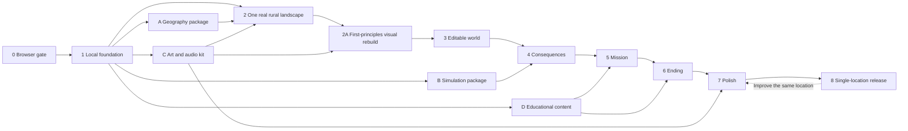

# Terra — implementation plan: one rural location

**Annual-loop follow-up — October 24, 2026:** Peter authorized a minimal end-year summary and placeholder simulation while the teammate rebuilds the main UI. The separate **Terra → Annual Town → Playtest Year Loop** Editor window exercises queue → conclude → accepted summary → next-year planning on the same map. See [test steps and integration seams](docs/annual-town-runtime.md#test-the-annual-loop-without-touching-the-ui-overhaul). Main scene/HUD/rendering remain with the owner. This bounded assignment does not declare Phase 2A or the later production UI/LLM/model gates complete. Delivery is directly to `main`, with no new PR.

**Current bounded assignment — October 24, 2026:** Peter separately authorized an additive annual town-state/public-budget/yearly-outcomes foundation while the main engineer continues the basics and visual rebuild. See [annual runtime and handoff](docs/annual-town-runtime.md). It introduces separate contracts/session code, preserves WorldPack/runoff v1 and does not modify scenes/HUD or certify Phase 2A. Its queue-only refund semantics supersede the proposal refund model for completed annual history; later phase integration needs an explicit revised roadmap.

**Location naming:** The single location is **Meadowbrook Valley** in player-facing copy and all future phase/package work. It is a fictional display name for the already selected Wisconsin AOI, not a location change. Preserve real source names and the stable `coon-valley-brye-v1` data ID in provenance. See [the naming decision](docs/location-selection.md#name-and-provenance).

**Planning baseline / rural-first revision:** October 24, 2026. **Status:** proposed execution plan; no implementation phase is certified complete by this document.

**Visual-rebuild revision — October 24, 2026:** insert **Phase 2A** after Phase 2 and before Phase 3. Existing phase numbers and evidence remain stable. [DESIGN_REFERENCE.md](docs/DESIGN_REFERENCE.md) is the persistent project-wide design reference; [PHASE_2A_GOAL.md](docs/PHASE_2A_GOAL.md) contains the rewritten active goal loop and stricter visual gate. Terra Nil is the primary visual/feel reference, with selected Cities: Skylines information patterns. Establish this standard before adding more gameplay, then preserve it throughout Phases 3–8.

[TERRA_PROJECT_SPEC.md](TERRA_PROJECT_SPEC.md) remains the north star. This plan turns it into ordered, bounded work. The user's latest direction governs execution: win through a beautiful, enjoyable, working hackathon game; use pragmatic shortcuts and avoid unnecessary production infrastructure.

**Build and refine one excellent rural game through phases 0–8.** The rural location is the primary product, not a temporary city prototype. Every phase completes or improves the full experience in that same place. Choose the exact AOI during phase 1, then keep it stable while mechanics, UI, and balance evolve. Additional levels, cities, and live generation are outside the active phases; they require the one-location quality gate and a separate explicit scope decision. Parallel packages can proceed independently after phase 1, with explicit integration points.

Human playtesting can run alongside engineering: if a tester is unavailable, finish the browser/technical gate, mark the human usability check pending, and allow the next requested phase to proceed. Do not claim that usability is verified. This exception prevents a goal loop from waiting indefinitely for a person while useful implementation remains.

Companion documents: [parallel engineer handoffs](docs/PARALLEL_WORK.md) and [phase status / evidence ledger](docs/PHASE_STATUS.md).

For Phase 2A, distinguish **engineering/internal visual gate passed** from **external usability/reference validation passed**. Missing human testers may remain explicitly pending under the exception above; missing browser, input, truthful-state or visual evidence may not. Known user rejection or a substantial visual gap cannot use that exception. The next phase still requires separate authorization.

## 1. Scope and working assumptions

- Phases 0 and 1 happen on Naman's computer only. Establish a working browser build, visual direction, and small shared contracts before handing off implementation.
- Thereafter, the primary engineer owns the live game, composition, camera, interaction, UI, integration, and deployment. A second engineer can own geography, deterministic simulation, and self-contained asset/content packages, using their own agents if desired.
- No hackathon end time or engineering availability has been supplied. Phases are acceptance gates, not promised calendar durations. At kickoff, reserve roughly the final quarter of the remaining time for playtesting, refinement, browser fixes, and rehearsal; shrink feature scope when that reserve is threatened.
- The complete hackathon target includes Cultivate, Restore, Manage Water, meaningful consequences, a balanced rural mission, undo/redo, before/after, learning, Continue Building, and a shareable browser build. The working scenario balances illustrative productive land with vegetation and rainfall runoff; confirm the treatment details during phase 1. This is not a crop-yield or farm-management simulator.
- One small real rural landscape, roughly 8–12 curated management sites initially, up to two cultivation treatments, one appropriate restoration treatment, and one swale/retention treatment are enough. These counts are design starting points, subject to playtesting. More replay comes from alternate proposals and better balance on this map, not more maps.
- Select the rural location during early planning, as requested by the user. Inspect a short candidate list for source coverage, visual composition, and a compatible lesson; do not author multiple candidate levels. Record one selected AOI and its source evidence before the phase-1 handoff.
- Support desktop browsers and laptop/trackpad use. Phone gameplay, accounts, multiplayer, a CMS, production analytics, and a general-purpose city simulator are outside this delivery.
- Hypothetical opportunity sites and soil/drainage assumptions are acceptable when clearly disclosed. Fake geography, fake environmental results, and scripted success presented as simulation are not acceptable shortcuts.

### Observed repository baseline

The Unity project currently lives at the repository root. `ProjectVersion.txt` specifies **6000.6.6f1**; the package manifest includes URP, Input System, and uGUI. A sample scene and `Assets/Editor/TerraBuild.cs` exist. The build script selects enabled scenes and exports a gzip-compressed Web build with decompression fallback.

`SETUP.md` now records successful Editor/Play-mode checks, a Web export, local Chrome rendering, and debugger attachment. This documentation task did not rerun those checks. Phase 0 should reuse that recorded evidence, verify any changed setup, and complete the still-unrecorded public deployment/input gate. At inspection the repository had no commits and its starter files were untracked; the phase-1 handoff needs a committed, shared baseline.

Keep the existing root Unity layout, as reflected in the revised master spec.

## 2. Ordered delivery map

| Phase | Player-visible result / milestone | Ownership | Exit evidence |
|---|---|---|---|
| 0 | The game opens from a real browser URL | Local machine only | Editor smoke check, Web export, deployed load |
| 1 | One selected rural AOI and a coherent visual/interaction foundation | Local machine only | Site-selection evidence, styled fixture, camera, hover/preview/undo, handoff contracts |
| 2 | A beautiful, geographically grounded rural diorama | Primary + geography/art deliveries | Real pack loaded, geographic alignment, hero screenshots |
| **2A** | **Visual rebuild from first principles** | Primary; no parallel packages delegated | Rebuilt scenery and transformations against Terra Nil; each visual dimension ≥4.5/5; actual Chrome comparisons; supporting interaction/performance safeguards |
| 3 | A satisfying editable world | Primary | Cultivate/Restore, credits/productive capacity, reversible edits |
| 4 | Choices have credible, spatial consequences | Primary + simulation delivery | Same-storm runoff, bounded Manage Water, contrasting strategies |
| 5 | A complete, balanced rural mission | Primary + content delivery | Uncoached playthrough, multiple winning solutions |
| 6 | A memorable ending and reason to replay | Primary | Before/after, transfer question, takeaway, Continue Building |
| 7 | Presentation quality throughout the experience | Primary + asset delivery | Visual/interaction audit, browser performance, novice retest |
| 8 | A dependable single-location game, demo, and refinement backlog | Primary | Release URL, rehearsed demo, fallback, accurate claims |

Every side package contributes to the same selected rural location; no parallel engineer should create another level or a generalized generator. The side packages are independent **to implement against phase-1 fixtures**. Their integration still depends on the main game. With one additional engineer, prioritize A first, B second; C and D can use that engineer's additional capacity or agents without editing the main scene.

## 3. Small architecture that supports fast merges

Use plain data and direct calls. Avoid an ECS migration, a dependency-injection framework, generalized event infrastructure, a streaming world engine, or a custom editor suite.

| Area | Proposed location | Responsibility |
|---|---|---|
| Contracts | `Assets/Terra/Scripts/Contracts/` | Plain C# records/classes, IDs, units, simulation inputs/outputs |
| State and rules | `Assets/Terra/Scripts/Core/` | Baseline, interventions, transactions, undo/redo, eligibility |
| Simulation | `Assets/Terra/Scripts/Simulation/` | Deterministic runoff and explanation facts; no scene access; Core owns productive-capacity/budget accounting |
| Geography | `Assets/Terra/Scripts/Geography/` | Pack loading, validation, local coordinates |
| Presentation | `Assets/Terra/Scripts/Rendering/`, `UI/`, `Gameplay/` | Scene, placement input, HUD, mission/ending |
| Unity assets | `Assets/Terra/Scenes/`, `Prefabs/`, `Art/`, `Audio/` | Main scene and independent reusable assets |
| Geography generation | `worldgen/` | Offline Python ingestion, clipping, export, validation |
| Published inputs | `worlds/<pack-id>/`, `content/` | Versioned packs and authored scenario/learning content |
| Build and notes | `scripts/`, `web/`, `docs/` | Packaging, minimal web shell, assumptions, deployment, evidence |

The existing editor build scripts remain in place. Create only directories needed by the current phase. Use a small number of assembly definitions to keep Contracts and Simulation independent of presentation; do not create an assembly for every class.

### State flow

`BaselineWorld + ScenarioDefinition + ordered interventions → derived WorldState → SimulationResult → view model → world/HUD`

`Preview(command)` runs the same eligibility, accounting, and simulation path against temporary state. `Commit(command)` validates and publishes one new revision. Animation responds to that revision; it never owns the result. Full recomputation over a small number of sites is the default until profiling shows a problem.

- Baseline data is immutable. A new placement replaces or adds an intervention overlay.
- One intervention occupies a site in v1. Split authored sites into explicit sub-sites if cultivation and water management need to coexist; defer arbitrary polygon drawing and overlapping edits.
- A transaction includes all consequences of move/replace/remove. Preview the final total, not a partial debit. Invalid actions leave state and history unchanged.
- Removing restores the baseline at that site and refunds the original intervention cost. Replacing charges the difference in final configuration cost. Moving recomputes the destination site's effect/cost and applies atomically. These are reversible design proposals, not a construction economy.
- Undo/redo stores intervention-list snapshots; retry returns to zero interventions. Small in-memory snapshots are fine. A versioned JSON export/import for the demo is optional; cloud saves are unnecessary.
- Baseline metrics, current metrics, and preview deltas remain separate. No result is hardcoded into UI copy.

### Phase-1 contract freeze

Write concise `docs/worldpack-format.md`, `docs/runtime-contracts.md`, and `docs/art-direction.md`, plus valid/invalid fixtures. These files are phase-1 deliverables, not already implemented APIs. Define the following before the other engineer starts:

| Contract | Required decisions |
|---|---|
| Manifest | Schema version, pack ID, bounds, editable/context bounds, source CRS, origin, layer paths, layer availability, provenance |
| Coordinates | GIS projects externally; exported local X = east, Y = up, Z = north, in meters. Record elevation datum/origin, raster row direction, triangle winding and a known reference point. Never pass raw longitude/latitude to Unity placement. |
| Terrain/features | Small JSON height grid; cover polygons/raster; mapped water features and paths when present; optional sparse structures; mapped/decorative vegetation flags |
| Sites | Stable IDs, polygons, canonical analysis area, baseline cover fractions, illustrative existing productive capacity, allowed treatments, protected flag, model-parameter references, contributing-area ID |
| Scenario | Pack ID, tool variants, site-specific costs/capacity, budget, objectives, one storm/soil assumption set, intro/learning IDs |
| Commands | Add, replace, move, remove; stable site and treatment IDs; state revision; explicit validity reason |
| Results | Total illustrative productive capacity and net change from baseline, spent/remaining credits, cover areas, generated/retained/discharged runoff in m³, per-site deltas, objective inputs, structured explanation facts |
| Visual assets | Scale, pivot, forward direction, footprint bounds, orientation/contour anchor, material slots, preview compatibility |
| Content | Stable content IDs, title/body/choices/explanations, supported claim sources, no UI layout or mission logic |

Specify required versus optional fields, JSON number/array conventions, and version rejection. Test serializer behavior with a real tiny fixture; don't assume a serializer accepts arbitrary dictionaries or polymorphism. Use simple arrays/DTOs first.

For packaging, keep `worlds/` as the authored source and copy the selected pack into build-served assets with a script. Do not hand-maintain two copies. Load through URLs/`UnityWebRequest` in Web builds; browser StreamingAssets is not a normal filesystem directory. [Unity StreamingAssets documentation](https://docs.unity3d.com/6000.6/Documentation/Manual/StreamingAssets.html)

Start with same-origin static files and an explicit pack base URL. Prefer JSON until a measured load-size issue justifies binary terrain. No Addressables, remote catalog, database, or GIS server is needed for the active phases. Keep one canonical playable pack; multiple tiny correctness fixtures do not count as extra levels.

## 4. Design and interaction standards

Read [the persistent design reference](docs/DESIGN_REFERENCE.md) for all player-facing work. Cite applicable TN/CS/AX pattern IDs in phase evidence and compare actual browser captures against the latest accepted benchmark. The numeric/timing defaults below are superseded by the accepted art contract where Phase 2A refines them; product truth and scope remain governed by the spec.

**The scene is the product's first impression.** The player should see an inviting, readable miniature rural landscape, understand one useful next action, and see a rewarding transformation within the first minute after loading.

### Visual direction to establish in phase 1

- Warm daylight, a strong terrain silhouette, coherent field/grass/vegetation masses, restrained mapped-water accents, and a carefully framed diorama edge. Keep real relative topography and feature positions intact. A smaller rural scene should feel richly composed rather than empty.
- Invest in terrain materials, ground-cover transitions, cultivation patterns, grasses/shrubs/appropriate trees, and satisfying restoration. Sparse buildings are optional context; avoid spending the asset budget on a city kit. Add detail where the opening camera and editable sites reveal it.
- Existing geography feels settled; proposed interventions get a consistent outline/appearance transition and explicit state label. Decorative trees must not imply surveyed positions.
- Use one readable type family, a small type scale, spacing tokens, rounded tool cards, restrained shadows, and consistent icon treatment. Placeholder/debug controls do not pass the phase-1 visual gate.
- Default to **uGUI with TextMeshPro** for this project's animated game HUD and existing package baseline. Confirm in phase 1 with a working card/tooltip. If UI Toolkit is demonstrably faster for the team, choose it during phase 1 and freeze that choice; avoid maintaining two competing HUD systems. Both are supported approaches, with different authoring strengths. [Unity UI comparison](https://docs.unity3d.com/6000.6/Documentation/Manual/UI-system-compare.html)

### Main play screen

| Region | Contents / behavior |
|---|---|
| Top left | Terra / location; unobtrusive Data & Assumptions entry |
| Top center | Three clear measures: productive capacity (illustrative units), runoff relative to the same baseline storm, remaining credits; target and progress visible |
| Center | Landscape remains the dominant visual; avoid permanent panels over key terrain/vegetation features and candidate sites |
| Bottom center | Cultivate / Restore / Manage Water cards; selected state, short intent, variant selector only when relevant |
| Cursor / selected site | Stable preview with price, productive-capacity change, environmental delta, and one reason if blocked; clamp to viewport |
| Contextual side panel | Optional detail, contributing-area highlight, model assumptions; dismissible |
| Bottom corner | Undo/redo, reset view, sound/settings/help; readable but secondary |
| Completion | Compact success invitation; ending flow is dismissible and Continue Building is obvious |

Do not show unavailable measurements as zero. Before simulation integration, use an explicit development-only pending state. Public demonstration builds must contain real calculations for visible claims.

### Interaction rules

- One consistent loop: select tool → hover site → inspect preview → click to commit. Site snapping is the initial implementation for every tool.
- Hover, selected, valid, blocked, and protected states use text/icon/outline distinctions as well as color.
- Orbit/pan/zoom work with mouse and Mac trackpad; add on-screen reset and a short help hint. Tune bounds so the player cannot lose the world.
- Dragging the camera never places an intervention. UI clicks never fall through to the world. Escape cancels placement or closes the topmost panel. Destructive reset gets a simple confirmation; individual edits are reversible with undo.
- Keyboard shortcuts for tools and undo/redo supplement visible controls. Provide a keyboard way to cycle/select eligible sites and commit; do not make every important interaction pointer-only.
- Preview values match committed values. One action produces one concise trade-off explanation, with no repeated toast spam.
- Suggested motion: quick hover response, 150–250 ms UI transitions, roughly 350–700 ms placement reveal. These are tuning defaults. Reduced motion removes camera flights and strong growth/bounce effects; state updates immediately.
- Sound begins after player interaction, with mute available; a soft placement cue and ambient bed are sufficient. No dependency on autoplay audio.

### Review gate used throughout

Capture the **browser**, not just Unity Scene view, at 1280×720 and 1440×900. Review default view, hover, blocked action, placement, and any new modal. Aim for readable body text around 16 px at default browser scale, sufficiently large targets, clear contrast, no clipped copy, and a world that still dominates the screen.

Use a 1–5 internal score for scene appeal, legibility, feedback, ease of interaction, and coherence. A working but ugly/unreadable feature is not done. Target at least 4 in every relevant category; record the weakest item and fix it. Scores guide review rather than pretending to be objective user research.

**From Phase 2A onward**, use its reference-calibrated six-dimension rubric: every visual dimension at least 4.5/5 individually, with no averaging or compensation from UX/performance scores. Review normal, close, overview and transformed states, then pass supporting browser safeguards. This supersedes the generic foundation score above. Scores require reference comparisons and specific remaining-gap notes; a working feature or a single attractive hero shot does not establish reference quality. Later phases must meet this bar for new surfaces and preserve accepted existing ones.

From phase 2 onward, measure a 30-second camera/placement path in the deployed browser on the actual demo laptop. Target 60 fps, accept a stable 30 fps if necessary, and aim for preview response within 100 ms and no placement stalls above 200 ms. Record frame time and load duration; these are budgets to test, not claims. Start with a compressed initial-download goal below roughly 50 MB and first interaction within 15 seconds on the measured demo connection; reduce scenery/texture cost if reality misses it badly.

## 5. Phases and acceptance gates

### Phase 0 — Verify the local toolchain and browser path

**Goal:** a tiny project builds reproducibly and opens from a shareable URL. **Owner:** Naman's machine only.

Use [docs/PHASE_0_GOAL.md](docs/PHASE_0_GOAL.md) for the prepared kickoff prompt, audited setup evidence, remaining checks, and phase-specific stop conditions. The goal starts only when requested; preparing the brief does not run it.

1. Verify the pinned Editor, Web Build Support, license, disk headroom, VS Code integration, URP configuration, scene list, and Git ignores. Preserve useful setup work.
2. Open the existing scene, enter Play mode, inspect Console, and verify input and rendering. Add only the minimal camera/input needed for a smoke test.
3. Use the existing Web build script. Serve the result over HTTP locally; then deploy through the intended static host. Verify loading paths, compression behavior, resizing, and focus/input in the deployed build.
4. Test Chrome on the demo machine; Chrome is sufficient for phase acceptance. Test other browsers only when explicitly requested by the user; do not launch Safari or request Private Browsing unlocks by default. Record exact tested versions and any actual limitations rather than claiming universal browser support.
5. Update `SETUP.md` to observed reality, document the deployment commands/URL, and establish the initial Git checkpoint.

**Done when:** a clean page load displays a controllable 3D scene at a real URL, with no blocking browser console/network errors, and the build can be repeated. Editor-only success does not satisfy the gate.

**Shortcut:** simple static hosting, current compression fallback, one scene. **Defer:** CI, containers, backend, custom launcher. If hosting genuinely needs unavailable credentials, record the external blocker; local smoke evidence does not count as deployed success.

### Phase 1 — Local visual foundation and handoff kit

**Goal:** select the single rural AOI, prove the feel, and freeze just enough seams for independent work. **Owner:** Naman's machine only. **Depends on:** phase 0.

1. Compare a small shortlist of rural AOIs using data availability/licensing, source previews, terrain/cover readability, and compatibility with the productive-land/runoff lesson. Choose **one** and record its bounds, CRS, sources, rationale, and obvious gaps in `docs/location-selection.md`. Do not build playable candidate maps. Then create `TerraMain` and a code-owned bootstrap that can load a tiny pack, spawn scenery, and bind a HUD. Keep the starter scene available as a smoke fixture if useful.
2. Make a small, explicitly labeled development fixture with a slope, contrasting ground cover, a path, a water-management connection, and 3–4 editable sites. This is for contract/input testing; never present it as real geography. Align its categories with the selected rural site; reuse it as technical test data only.
3. Implement the camera, site hit testing, selected/hover outlines, one ghost placement, cancel, and one undo operation. The fixture can use a simple illustrative productive-capacity/credit calculation.
4. Build the styled HUD/tool-card/tooltip slice, loading/error state, typography/colors/spacing, and one satisfying placement animation. Review a screenshot and short browser interaction capture.
5. Confirm the rural scenario and Cultivate treatment recipes: productive area/capacity versus cover, costs, and bounded runoff effects, with no harvest/season system. Write the contracts in section 3, a valid tiny pack, invalid-pack fixtures, expected simulation input/output examples, and an asset preview scene. Establish source IDs and one stable fixture checksum/version.
6. Commit the shared baseline. Record its SHA and frozen versions in the handoff document. Give the other engineer a runnable checkout and narrow ownership boundaries.

**Done when:** one rural AOI is selected with a credible data path, the fixture is pleasant to navigate, hover/preview/commit/undo works in-browser, the styled screen is coherent, and the geography/simulation/art packages can each be tested without editing the main scene. No placeholder map is counted as completed real geography.

**Shortcut:** hardwired bootstrap references, JSON, tiny fixture, in-memory history. **Defer:** generic editors and extensibility beyond the first three tools. Do not spend days designing contracts; prove them with the fixture and freeze v1.

### Phase 2 — The one real rural landscape and hero view

**Goal:** make the selected location geographically grounded and visually compelling. **Depends on:** phase 1 + package A; use package C assets when ready.

1. Ingest package A's single rural pack for the AOI chosen in phase 1. The primary engineer owns `WorldPackLoader`, terrain/cover/context renderers, loading progress, and error presentation.
2. Render the actual terrain and cover patterns, then mapped water/path context where present. Sparse structures are optional. Source geography defines placement; hypothetical management-site outlines and decorative vegetation are explicitly distinguished.
3. Author the opening camera, diorama edge, lighting, vegetation masses, ground texture variation, and subtle ambient motion. Invest in the close-up transformation areas as well as the wide hero shot.
4. Integrate roughly 8–12 curated hypothetical management sites. Preserve relevant mapped sensitive features and authored no-edit zones, labeling the latter as scenario assumptions. Keep site markings subtle at rest and clear during tool use.
5. Expose a Data & Assumptions panel with actual place name/bounds, layer sources/dates, missing data, inferred decoration, and fictional scenario settings.
6. Eliminate floating vegetation/structures, terrain seams, clipping, and z-fighting. Profile the actual browser and simplify scenery before adding infrastructure.

**Done when:** the landscape matches its source anchors/cover/terrain within documented limits, the opening and close-up browser views meet the visual gate, and the pack has provenance. The first location becomes the canonical scene for every subsequent gameplay and visual iteration.

**Shortcut:** one bounded AOI, simplified offline data, shared terrain/vegetation materials, authored site polygons, a few hero details. **Fallback:** reduce the same AOI or use a documented adequate-resolution layer; never silently fabricate geography. Reopen site selection only if a fundamental data blocker makes the chosen place unusable, and replace it rather than keeping multiple playable locations.

### Phase 2A — First-principles visual rebuild

**Goal:** rebuild the actual playable visuals to the Terra Nil-led art bar. The user explicitly rejected the incremental prototype polish and authorized replacing entire existing aspects. Direct visual quality is primary; preserving existing code/assets/UI is not a success criterion. **Depends on:** Phase 2's real-location evidence, already complete. **Owner:** primary integration engineer; no delegation started. Existing phase numbers stay stable.

Use the rewritten [goal brief](docs/PHASE_2A_GOAL.md), [visual rebuild direction/resource register](docs/VISUAL_REBUILD.md), and persistent [design library](docs/DESIGN_REFERENCE.md). The earlier 2A captures are a rejected baseline.

1. Inspect matched Terra Nil frames and artist material; identify composition, form, material, lighting, and transformation failures. Research and download suitable licensed resources.
2. Build materially different visual studies of the same AOI. Reconsider camera scale, scene framing, terrain/cover presentation, vegetation assets, lighting, and water from first principles.
3. Prove a compelling forest–field–water scene in Unity and Chrome, then extend its coherent visual grammar across the location. Replace obsolete rendering/asset paths.
4. Make land interventions visually rich and satisfying. Rebuild or simplify existing presentation/features when they obstruct the result.
5. Fit the minimum useful interface to the world, then validate retained mechanics, accessibility, scientific honesty, browser delivery and performance.
6. Record two matched visual reviews, actual gameplay captures/video, resource provenance, and an accepted new art contract. Surface these benchmarks throughout the project.

**Done when:** each of the six visual dimensions in the revised goal reaches at least 4.5/5 with actual evidence and no substantial reference gap, and the supporting browser safeguards pass. No UX score or average can compensate for weak scenery. Missing novice participants do not waive the user's known visual rejection. **Stop before Phase 3.**

**Protect:** educational purpose, one real location, honest source/model claims, recoverable history. **Replace freely:** existing implementation, art assets, rendering, camera, composition, UI, and obstructive early features. **Defer:** unrelated simulation, additional maps, city content, generators, and later-phase expansion.

### Phase 3 — The editable-world foundation

**Execution exception — October 24, 2026:** the user explicitly authorized Phase 3 editing in an isolated worktree alongside the other worker’s Phase 2A rebuild. Complete and verify the editing slice there; integrate it with the accepted visual result afterward. This exception does not certify Phase 2A or start Phase 4.

**Goal:** building and revising proposals feels good even without mission framing. **Depends on:** phase 2A engineering/internal visual gate; any pending human review stays explicit. Preserve the accepted Phase 2A components and design benchmark when adding editing operations.

1. Finish `WorldStateStore`, intervention rules, command validation, snapshot history, and full recomputation over the small set of sites.
2. Implement Cultivate with a standard plot and a vegetated-margin variant, plus Restore with one locally fitting treatment. Each has site eligibility, productive/vegetated area fractions, illustrative capacity per productive area, cost, and a visual recipe from data. The recipes remain configurable and must not be presented as measured yield forecasts.
3. Implement shared preview/commit/move/replace/remove and undo/redo. Support right-click or Escape cancel, stable selection after camera movement, and UI input capture.
4. Bind budget, total current illustrative productive capacity, its net change, and cover accounting. Include existing productive use and lost capacity when land is restored/replaced; prevent area/capacity double counting. Preserve protected sites; reject overspend; restore originals after remove/undo. If simulation is not yet integrated, keep environmental outputs explicitly pending in development builds.
5. Animate cultivation/vegetation/water-management features from state, clear prior visual overlays correctly, and keep animation interruption/undo safe.
6. Exercise repeated edit/reset cycles and return-to-baseline behavior. Add focused tests for transactions, budgets, occupied sites, productive capacity and displaced baseline use, and history equivalence.

**Done when:** all editing operations are reliable in the same real rural browser scene, previews match commits, money/area cannot be duplicated, and at least two sites in this location make a visibly different productive-land/cover trade-off. A human can experiment for several minutes without losing control or breaking state.

**Shortcut:** site snapping, fixed recipes, full refunds, no physics-based placement. **Defer:** freeform drawing, street editing, zoning, real estate economics, campaign menus.

### Phase 4 — Environmental consequences and Manage Water

**Execution exception — October 24, 2026:** the user requested the next phase while Phase 2A continues in parallel. Completed Phase 3 (`c49a3c2`) is the foundation; Phase 4 runs in `codex/phase4-consequences` without taking ownership of the visual worker’s checkout. This advances consequences only. Phase 2A visual acceptance, combined presentation/performance acceptance, and Phase 5 remain separate gates. [Implementation and evidence](docs/PHASE_4_CONSEQUENCES.md).

**Goal:** the same actions drive explainable social, economic, and environmental trade-offs. **Depends on:** phase 3 + package B.

1. Integrate the pure simulation evaluator and sourced/documented parameter assumptions. Freeze the chosen storm for a run; baseline and proposal share it.
2. Partition the analysis area so editable sites and unchanged context are disjoint. Compute each unit's runoff depth/volume and sum volumes; do not derive total runoff by averaging nonlinear parameters. Track the unchanged area's contribution so context cannot silently dilute objectives.
3. Add Manage Water using authored contributing-area groups and finite capacity. Retention is bounded by connected available runoff and capacity; prevent multiple water-management features from retaining the same volume twice. Treat the connection map as an educational assumption where real field drainage is unknown.
4. Show baseline/current runoff, a clear delta, and a short causal explanation. On preview, show affected cover and contributing area when useful. If baseline runoff is zero, use an explicit absolute-delta objective or clear zero-baseline handling rather than dividing by zero.
5. Use exact evaluator results for preview and commit at this scale. Render measured quantities with appropriate rounding; precise internal arithmetic does not justify precise scientific claims.
6. Tune representative sites so cultivation, restoration, and water management have meaningful opportunity costs. Add one case where a swale helps a connected managed plot and one where a disconnected treatment cannot affect it.

**Done when:** model tests pass; volume accounting is nonnegative and conserved within stated tolerance; a changed placement changes measured results for a clear reason; the player can explain the trade-off from the UI. No magic global water-treatment bonus or flood-depth claim.

**Shortcut:** authored connections, hypothetical disclosed soil group, a fixed educational storm, synchronous site calculations. **Defer:** sewer networks, hydraulic inundation, particle-water physics, live weather, erosion systems.

### Phase 5 — A balanced mission a new player can finish

**Goal:** turn the foundation into an enjoyable 8–12-minute rural challenge in the same location. **Depends on:** phase 4; package D supplies copy.

1. Implement scenario loading and a small mission state machine: intro → playing → goals met → review/ending → continue/retry. Objectives are evaluated from real state, not narrative triggers.
2. Author the rural productive-land/vegetation/runoff scenario established in phase 1 and 3–5 contextual onboarding hints. Teach one gesture at a time through the world; allow skip/reopen help.
3. Tune productive-capacity target, budget, site choices, cover constraints, and allowable runoff change together. Example production units/credits in the spec are placeholders, not observed yields or fixed balance. Revise this same mission after model or interaction changes rather than creating a different map to escape balancing work.
4. Use two or more materially different saved action sequences to prove reachability. Include a plausible failure strategy and recovery through undo or replacement. A tiny enumeration script over the curated sites is acceptable for checking feasibility.
5. Give near-success feedback that identifies the unmet constraint without prescribing one exact winning plan. Keep failures reversible; no timers or punishment mechanics are needed.
6. Observe at least one uncoached novice playing, ideally three. Record first-action time, repeated confusion, completion time, and their explanation of a trade-off; fix the largest issue and retest.

**Done when:** at least two distinct configurations satisfy the same objectives, the opening guidance is understandable, and a novice can complete the actual browser mission without verbal coaching. If no external tester is available, record the completed engineering checks and leave human usability unverified; follow the human-feedback exception above rather than blocking further implementation.

**Shortcut:** one authored mission, short deterministic tips, manual playtest notes. **Defer:** campaign map, account progression, analytics pipeline, procedural quest design.

### Phase 6 — Before/after, learning, and a satisfying ending

**Goal:** make the result memorable and connect the lesson to a real question. **Depends on:** phase 5; package D.

1. Create a same-camera baseline/proposal toggle with a compact comparison card. Start with a toggle instead of a costly split-screen slider. Switching views never mutates the proposal.
2. Explain two or three actual changes: illustrative productive-capacity change, credits spent, and same-storm runoff difference. Highlight relevant changed sites.
3. Add one unseen-situation transfer question with reasoned feedback, then a Take It Home question card. Use a short entry prediction if measuring before/after understanding; record locally or in pilot notes, without accounts or personal identifiers.
4. Support copying the question text; add image export if inexpensive. Provide verified external links only when actually checked; a useful question works without external integration.
5. Continue Building restores editing of the existing proposal. Goals remain live; the completion celebration does not replay on every edit. Retry resets safely. A successful design is not lost when the ending opens.
6. Add an optional short rain reveal only if it explains the computed result: rain particles plus clearly illustrative contribution/connection highlights. It must be skippable and respect reduced motion.

**Done when:** the full play → success → compare → learn → takeaway → continue/retry loop works in-browser, comparison values match simulation, and players can articulate what changed and why.

**Shortcut:** one question, text card, deterministic copy, simple comparison toggle. **Defer:** social integrations and elaborate weather cinematics. Do not cut the useful ending merely to add more visual effects.

### Phase 7 — Design, sound, performance, and usability pass

**Goal:** every important screen and interaction retains the quality established in Phase 2A across the now-complete game. **Depends on:** phase 6. This is a consistency and refinement pass, not the first visual/UX redesign.

1. Audit the actual browser flow: loading, opening view, all tools/variants, preview, blocked state, edit history, success, comparison, learning, retry, and loading failure.
2. Improve weak composition, clutter, text hierarchy, colors, site readability, camera feel, and animation timing. Review both default and close-up cameras; remove generic prototype styling.
3. Integrate final art/audio from package C. Normalize material scale, lighting response, sound levels, and transition style. Preserve accessible labels, focus, and reduced motion.
4. Profile first load, camera motion, previews, repeated placements, world reset, and end screens. Simplify meshes, share materials, instance repeated vegetation, cap expensive shadows, and reduce render scale before adding architecture.
5. Test resizing, browser zoom, trackpad, keyboard path, mute, reduced motion, lost focus, refresh, and network-loading failure. Add one practical low-quality option if measured hardware variance calls for it.
6. Run a second novice test on the polished build. Repair the top comprehension issue before accepting more features.

**Done when:** the design review meets its target, browser budgets are measured with any remaining misses disclosed, there are no blocking flow errors, and a complete playthrough retains the visual quality of the opening screenshot.

**Shortcut:** baked-looking lighting, restrained effects, small textures, static geometry where possible. **Defer:** generalized asset streaming, automatic benchmarking, deep optimization that does not improve the demo machine.

### Phase 8 — Hackathon release and rehearsal

**Goal:** ship the full rural game with a dependable live demo and keep refinement focused on this same location. **Depends on:** phase 7.

1. Freeze feature scope. Build from the recorded commit, deploy, and test the exact public URL in a fresh browser session.
2. Run a short release checklist: load, all three tools, undo/redo, protected/budget rejection, winning solution, comparison, learning, Continue Building, retry, sources/assumptions, mute/settings.
3. Capture a good starting camera and a reproducible demo action sequence. Demo snapshots may speed rehearsal, but must use the actual command/evaluator path and be clearly distinguished from live play.
4. Rehearse the spec's 3–4-minute story: recognizable place → human need → choice → trade-off → revision → result → learning → another valid design in the same place.
5. Keep the last verified local Web build and a short recorded playthrough as clearly labeled fallbacks. The release should not fetch essential rural-world data from a third-party GIS API at runtime.
6. Document build reproduction, credits/attribution, educational assumptions, known gaps, and the full one-location scope. Do not imply a second level or live generator exists.
7. Triage remaining feedback into improvements to this same map: comprehension, balance, input, visuals, sound, learning, and performance. Reopen the relevant phase for meaningful fixes and rerun affected acceptance checks.

**Done when:** the public build supports an uninterrupted full playthrough, two rehearsals succeed, the release commit/URL and fallback are recorded, and presentation claims match observable behavior.

**This is the full initial game in one rural location.** Finishing phase 8 does not trigger a second map. Continue targeted refinement of this location until its full scope and quality bar are met.

### Expansion is a separate future decision, not phase 9

The former phases 9–11 for a second world, live generation, and other chapters are removed from the active sequence. Before any such work:

1. All three tools and the full editing/mission/comparison/learning/replay flow work in the first location.
2. The scene, UI, input, sound, and browser performance meet the agreed bar; high-impact observed issues are resolved.
3. Core rules, data assumptions, and balance have stabilized enough that another map will not multiply ongoing rework. Alternate winning proposals already demonstrate depth in this map.
4. The user explicitly chooses expansion and its maintenance cost; write a separate scoped plan then.

Until that decision, no second WorldPack, city kit, level picker, geocoder, generation worker, or AI context pipeline is a required proof, stretch goal, or parallel assignment. Tiny test fixtures are allowed; additional authored playable levels are not part of this goal.

## 6. Goal-loop operating procedure

This plan prepares future goal loops; it does not start one or authorize the entire roadmap now. Start one phase at a time with the objective below. Each loop should inspect the current evidence ledger, implement the smallest missing slice, verify it, review design, fix the weakest item, and update evidence. Stop phase work when its gate is actually satisfied; do not repeatedly refactor a finished phase to fill time.

**Reusable kickoff prompt:**

Every player-facing phase also reads `docs/DESIGN_REFERENCE.md` and the accepted `docs/art-direction.md`, cites relevant pattern IDs, and preserves Phase 2A's benchmark. For Phase 2A itself, use its dedicated kickoff instead of relying on this generic prompt.

> Start a goal to complete Phase [N] in IMPLEMENTATION_PLAN.md. Read TERRA_PROJECT_SPEC.md, the phase entry, docs/PHASE_STATUS.md, docs/DESIGN_REFERENCE.md, docs/art-direction.md, and applicable repository instructions. Honor the current hackathon scope and package ownership. Implement the phase end to end, including its browser and design acceptance gates. Keep the last working build available. Use focused tests for state/model/data correctness and visually inspect the actual browser UI. For player-facing changes, cite relevant reference pattern IDs and preserve the accepted Phase 2A quality benchmark. Update docs/PHASE_STATUS.md with what works, validation evidence, remaining gaps, and the next phase handoff. Do not count mocks, an Editor-only run, or unverified user testing as completed acceptance evidence. Keep all work on the same selected rural location. Do not create another level, city, or live generator. Do not start the next phase automatically; after phase 8, propose or carry out only explicitly requested refinement of this same game.

| Phase | Concrete goal objective |
|---|---|
| 0 | Verify and deploy a reproducible minimal Unity Web build on the current machine. |
| 1 | Deliver one selected rural AOI, a polished local interaction fixture, and a committed runnable v1 handoff kit. |
| 2 | Load and render a geographically aligned, attractive rural landscape in the browser. |
| **2A** | **Rebuild the visuals from first principles against Terra Nil. Existing assets, rendering, camera, UI and features are replaceable. Every visual dimension must reach ≥4.5/5 independently; validate actual Chrome output and supporting delivery safeguards before Phase 3.** |
| 3 | Make Cultivate/Restore and all reversible editing operations reliable and satisfying on this rural location’s sites. |
| 4 | Integrate deterministic runoff and bounded Manage Water with matching previews and explanations. |
| 5 | Deliver a balanced rural mission with multiple solutions and uncoached usability evidence. |
| 6 | Complete the comparison, learning, takeaway, and Continue Building/retry loop. |
| 7 | Meet the visual/interaction bar and measured browser budgets across the complete experience. |
| 8 | Publish and rehearse a reliable, accurately presented single-location release and a refinement backlog for that same game. |

When a dependency is unavailable, work on the fixture/adapter/validation that does not depend on it and keep the unmet gate visible. Credentials, external tester evidence, or another engineer's missing package cannot be invented by a goal loop. Record exactly what is needed. Goal-loop persistence should improve the current phase, not inflate scope.

## 7. What to protect and what to cut

| Protect through release | Cheap approach | Cut/defer first |
|---|---|---|
| Recognizable real geography | Small AOI, offline preprocessing, simple terrain/cover rendering | Extra locations, huge map, and dense building inventory |
| Beautiful, legible world/UI | Strong composition, palette, lighting, few excellent assets | Many visual themes, expensive effects |
| Meaningful spatial choices | Curated sites, simple data-driven rules | Arbitrary freeform editing and legal zoning |
| Honest linked consequences | Small deterministic evaluator, disclosed assumptions | Complex hydrology and future ecological modules |
| Safe experimentation | In-memory snapshots, atomic edits | Cloud persistence and progression accounts |
| Learning and a good ending | One transfer question, comparison toggle, text takeaway | Social integrations and elaborate ending cinematics |
| Reliable browser demo | Static bundled rural data, tested URL and fallback | Live services on the gameplay critical path |

If the event is imminent, keep the same one-location scope and reduce optional effects, treatment variants, asset counts, or site counts. Additional maps and live generation are already excluded, not features to cut only at the last minute. Protect all three core tools, productive-land/budget/runoff trade-offs, a playable win condition, comparison/learning/Continue Building, geographic honesty, and clear presentation. Record any unavoidable cut to required scope as incomplete.

The acceptable hack is an offline-generated rural map, a short list of authored sites, simple direct code, and a single hosted build. The unacceptable hack is a beautiful animation whose numbers do not come from the player's choices. Rural simplicity should let us spend more time making one complete landscape feel excellent.
