# Terra — implementation plan: ten years in one rural place

**Revised October 24, 2026 by explicit user direction.** The [canonical spec](TERRA_PROJECT_SPEC.md) now makes annual public-budget decisions and economic/social/environmental outcomes the core game. [ACTIONS_AND_EFFECTS.md](docs/ACTIONS_AND_EFFECTS.md) preserves all twelve chart rows and specifies required behavior. [Peter's PRD](docs/PRD_ANNUAL_GAMEPLAY.md) is the source proposal, with an adoption note. [PHASE_STATUS.md](docs/PHASE_STATUS.md) records what is actually implemented.

**Scope:** one real Meadowbrook Valley AOI across all years and phases; no additional map, city level or live generator. Housing, industry, community and utility projects from the chart are now intentional hypothetical options on this rural map. This supersedes the old “three tools are the whole game” restriction, not the rural setting. Geographic source names and `coon-valley-brye-v1` remain stable.

**Delivery principle:** prove the annual loop in the playable scene, then deepen it. Do not finish an instant-placement mission and bolt years onto its ending. The full release includes all twelve families; a staged starter subset is a milestone, not a scope cut. Planning changes here do not execute all phases, start a goal, publish, or message another worker.

## 1. Reconcile the work already done

| Work inspected | Current evidence / integration consequence |
|---|---|
| Local Phases 0–2 | Completed browser/geography foundations in the status ledger; retain same pack and source IDs |
| Local Phase 2A | Active visual work and dirty renderer/material/HUD files; user rejection remains unresolved; preserve its owner and edits |
| Existing Phase 3 worker | The assignment register records separately authorized reversible editing work. Review its actual branch before reuse; revise current-year proposal semantics rather than duplicate its Core/HUD implementation |
| B / D / C3 | Local simulation, learning and audio packages already integrated independently; package tests do not mean live annual consequences, mission or sound wiring are complete |
| Peter `a4ba01e` on `origin/main` | Annual state, USD ledger, lifecycle, three starter outcomes, persistence and fast-forward foundation; local primary branch does not yet contain these files |
| Peter `080f692` on `origin/main` | Accepted summaries and isolated Editor annual-loop playtest; handoff reports 94 plain-source and 106 Unity annual checks, plus 139 legacy checks; these are reported remote receipts, not rerun here |
| Peter `1bcc254` on `origin/main` | 17 metric action assets and matching icons; isolated catalog/gallery checks, not main-game eligibility, quantities, browser appearance or gameplay integration |

Remote inspected after fetch: `1bcc254`. Read the pinned [annual runtime handoff](https://github.com/namanpro47/Terra/blob/1bcc254/docs/annual-town-runtime.md) and [action art handoff](https://github.com/namanpro47/Terra/blob/1bcc254/docs/build-action-art.md) during integration. Those are remote references until merged; do not claim their local paths exist. Only the source PRD is brought into this checkout by this planning change. The local UI still follows the legacy immediate-placement flow.

**First implementation task after reconciling ownership:** preserve current dirty visual work, review the annual/editing/art commits, and integrate in a clean recoverable checkout or coordinated narrow merge. Do not pull/reset over the running visual work, cherry-pick entire unrelated asset changes blindly, or create a second ledger. No message to the other worker is sent by this plan.

## 2. Ordered delivery map

| Phase | Player-visible result | Required evidence |
|---|---|---|
| 0–2 | Existing browser foundation and real rural map | Preserve historical acceptance |
| **2A** | Beautiful playable landscape rebuilt against Terra Nil | Existing six-dimension visual gate; actual Chrome comparisons |
| **3A** | One authoritative annual state and financial model | Remote integration, contract/queue/save tests, explicit migration and ownership |
| **3B** | **Three-year browser loop** with projects, budget, meters and adaptation | Queue → End Year → report → next year; Wait/reload; matched world/results |
| **4A** | All twelve chart action families are buildable and consequential | Recipe/footprint/art coverage, resource/service accounting, full v2 meters |
| **4B** | Consequences depend on location, maintenance, age and conditions | Spatial runoff adapter, saved events, causal facts, conditional previews |
| **5** | Balanced ten-year challenge and fast-forward | Two viable strategies; adverse/no-action cases; novice observations |
| **6** | Understandable Year 10 future, comparison and replay | Same-driver counterfactual, camera/timeline, optional learning/takeaway |
| **7** | Consistent whole-game quality | Chrome, accessibility, performance, audio and full-run review |
| **8** | Reproducible public game and rehearsed demo | Release identity, public checks, fallback, truthful claims |

```mermaid
flowchart LR
  P2[2 Real rural map] --> V[2A Visual gate]
  V --> A[3A Annual state integration]
  A --> B[3B Three-year playable loop]
  B --> C[4A Full action catalog and meters]
  C --> D[4B Spatial and annual consequences]
  D --> E[5 Ten-year balance]
  E --> F[6 Future comparison and replay]
  F --> G[7 Whole-game refinement]
  G --> H[8 Release]
```



3A/3B are subdivisions of Phase 3, and 4A/4B of Phase 4; historical phase evidence is not renumbered. Existing authorized independent work may proceed in parallel, but live Phase 3 acceptance still depends on Phase 2A. There is no new delegation from this document.

## 3. Runtime and contract decisions

Keep plain C# data/rules, small authored site lists and full recomputation. Avoid general frameworks, city simulation, new databases and competing UI systems.

```text
Immutable WorldPack + pinned annual scenario + accepted history
     → current-year action queue and reservation preview
     → frozen End Year request
     → ledger + lifecycle + saved conditions + bounded effects
     → accepted annual state, raw components, meters and report
     → world/HUD → next planning year
```

- `AnnualTown` / `AnnualTownSession` becomes the single owner of money, time and history. Inspect actual API versions after integration. Reuse `AnnualTownSummary` for accepted-report presentation.
- Adapt existing placement/editing to the current-year queue. Legacy `WorldStateStore` can serve geometry/preview temporarily; it cannot spend money or refund accepted assets. Preview reservations use the same rule path as submission.
- Preserve `Planning / Resolving / Reviewing / Completed`. Freeze request IDs, revision, input hash and saved drivers. Atomic reject/accept; retry returns the same accepted result. Queue edits are disabled during resolution/review.
- USD integer cents, explicit 2026 scenario price frame, full commitment reservation and the existing defined payment order. Chart prices replace the demonstration $1,000-per-credit conversion. Do not accidentally retain the demonstration 5% upkeep rule or $20K appropriation as researched policy.
- Phase 3 authors a complete starter definition including costs, bundles, timelines, upkeep and service needs. Phase 4 adds required jobs/households/energy/water/pressure fields and v2 scoring with units/limits/weights. Every required field must be explicit; a missing effect/expense is not zero.
- Version annual definition/schema/rubric independently from WorldPack and fixed-storm DTO v1. Extend validation, detached copies, save replay, hashes and fixtures together. Reject mismatched saves clearly; no silent credit-to-cash migration or changed past scores.
- Fixed-storm runoff remains package B's pure evaluator. Primary-owned adapters feed disjoint active land/connection inputs; no flood, health or water-quality claims from that calculation.
- Rules and authored explanations are offline-capable. An optional LLM narrator is outside the required path. No server/provider/image-generation task is required to close these gates.

### Single-owner boundaries

Primary integration owns Core/Contracts, Gameplay/HUD, main scene, scenario balance, adapters and shared docs, in coordination with the already assigned editing worker and Peter's existing module. B owns pure runoff; A geography; C assets/audio; D educational prose. Read [PARALLEL_WORK.md](docs/PARALLEL_WORK.md) and [assignment register](docs/PARALLEL_KICKOFF.md). Transfer ownership explicitly before overlapping edits; do not infer permission to message another chat from reading this file.

## 4. Design and review standards

Read [DESIGN_REFERENCE.md](docs/DESIGN_REFERENCE.md) and [art-direction.md](docs/art-direction.md) for player-facing work. Use **TN-01/03/04/05/08, CS-01/02/04, AX-01**: landscape first, small budget/meters, coherent action illustrations, spatial previews, brief reports and an appreciable ending. Keep actual final operational buildings/land and their preview images consistent.

The HUD needs Year, cash/commitments, three meters and End Year; three stable categories contain the actions. Plan details, full ledger, scoring components and sources are expandable, not permanently stacked over the landscape. Queueing changes previews, not accepted meters. The source table's /5 profiles are optional design-intent details, never unexplained annual rewards.

Verify actual Chrome at 1280×720 and 1440×900; also 1920×1080 and 125% zoom layout. Include planning, blocked, queued, resolving, retry, report, late-year operation, suspended service, final comparison and replay. Keyboard/site selection, modal focus, UI isolation, trackpad/camera, reduced motion and mute stay usable. No Safari test or unlock is required.

**Quality gate:** preserve Phase 2A's six visual dimensions at ≥4.5/5 individually with matched reference/game evidence and no substantial known gap. Two reference reviews, actual moving/close/transformed imagery and specific remaining criticisms are necessary. No amount of correct accounting or good UI excuses poor scenery. Current rejected captures are not an accepted benchmark.

**Engineering budgets:** target 60 fps (document a stable-30 fallback), preview response ≤100 ms and no placement stalls >200 ms. Use Phase 2A's three 30-second foreground paths and fresh-cache load checks; target first interaction ≤15 s and initial compressed transfer <50 MB on the measured demo setup. Measure End Year and fast-forward responsiveness separately, keep progress visible and yield between years if necessary. Report methods and actual misses. A future provider's latency cannot be assumed from offline results.

**Human review:** observe uncoached novice play when available. If no participant is available, record engineering/internal gates separately and leave human validation pending. This exception never waives missing browser evidence, incorrect state, known user rejection or a material visual gap.

## 5. Historical foundation and retained visual gate

Phases 0–2 below preserve their original bounded deliverables and acceptance history; their credits/three-tool examples describe the foundation, not the full revised product. Phase 2A remains the active visual gate. Do not restart completed setup/location selection because an old task is listed here.

### Phase 0 — Verify the local toolchain and browser path

**Goal:** a tiny project builds reproducibly and opens from a shareable URL. **Owner:** Naman's machine only.

Use [docs/PHASE_0_GOAL.md](docs/PHASE_0_GOAL.md) for the prepared kickoff prompt, audited setup evidence, remaining checks, and phase-specific stop conditions. The goal starts only when requested; preparing the brief does not run it.

1. Verify the pinned Editor, Web Build Support, license, disk headroom, VS Code integration, URP configuration, scene list, and Git ignores. Preserve useful setup work.
2. Open the existing scene, enter Play mode, inspect Console, and verify input and rendering. Add only the minimal camera/input needed for a smoke test.
3. Use the existing Web build script. Serve the result over HTTP locally; then deploy through the intended static host. Verify loading paths, compression behavior, resizing, and focus/input in the deployed build.
4. Test Chrome on the demo machine; Chrome is sufficient for phase acceptance. Test other browsers only when explicitly requested by the user; do not launch Safari or request Private Browsing unlocks by default. Record exact tested versions and any actual limitations rather than claiming universal browser support.
5. Update `SETUP.md` to observed reality, document the deployment commands/URL, and establish the initial Git checkpoint.

**Done when:** a clean page load displays a controllable 3D scene at a real URL, with no blocking browser console/network errors, and the build can be repeated. Editor-only success does not satisfy the gate.

**Shortcut:** simple static hosting, current compression fallback, one scene. **Defer:** CI, containers, backend, custom launcher. If hosting genuinely needs unavailable credentials, record the external blocker; local smoke evidence does not count as deployed success.

### Phase 1 — Local visual foundation and handoff kit

**Goal:** select the single rural AOI, prove the feel, and freeze just enough seams for independent work. **Owner:** Naman's machine only. **Depends on:** phase 0.

1. Compare a small shortlist of rural AOIs using data availability/licensing, source previews, terrain/cover readability, and compatibility with the productive-land/runoff lesson. Choose **one** and record its bounds, CRS, sources, rationale, and obvious gaps in `docs/location-selection.md`. Do not build playable candidate maps. Then create `TerraMain` and a code-owned bootstrap that can load a tiny pack, spawn scenery, and bind a HUD. Keep the starter scene available as a smoke fixture if useful.
2. Make a small, explicitly labeled development fixture with a slope, contrasting ground cover, a path, a water-management connection, and 3–4 editable sites. This is for contract/input testing; never present it as real geography. Align its categories with the selected rural site; reuse it as technical test data only.
3. Implement the camera, site hit testing, selected/hover outlines, one ghost placement, cancel, and one undo operation. The fixture can use a simple illustrative productive-capacity/credit calculation.
4. Build the styled HUD/tool-card/tooltip slice, loading/error state, typography/colors/spacing, and one satisfying placement animation. Review a screenshot and short browser interaction capture.
5. Confirm the rural scenario and Cultivate treatment recipes: productive area/capacity versus cover, costs, and bounded runoff effects, with no harvest/season system. Write the contracts in section 3, a valid tiny pack, invalid-pack fixtures, expected simulation input/output examples, and an asset preview scene. Establish source IDs and one stable fixture checksum/version.
6. Commit the shared baseline. Record its SHA and frozen versions in the handoff document. Give the other engineer a runnable checkout and narrow ownership boundaries.

**Done when:** one rural AOI is selected with a credible data path, the fixture is pleasant to navigate, hover/preview/commit/undo works in-browser, the styled screen is coherent, and the geography/simulation/art packages can each be tested without editing the main scene. No placeholder map is counted as completed real geography.

**Shortcut:** hardwired bootstrap references, JSON, tiny fixture, in-memory history. **Defer:** generic editors and extensibility beyond the first three tools. Do not spend days designing contracts; prove them with the fixture and freeze v1.

### Phase 2 — The one real rural landscape and hero view

**Goal:** make the selected location geographically grounded and visually compelling. **Depends on:** phase 1 + package A; use package C assets when ready.

1. Ingest package A's single rural pack for the AOI chosen in phase 1. The primary engineer owns `WorldPackLoader`, terrain/cover/context renderers, loading progress, and error presentation.
2. Render the actual terrain and cover patterns, then mapped water/path context where present. Sparse structures are optional. Source geography defines placement; hypothetical management-site outlines and decorative vegetation are explicitly distinguished.
3. Author the opening camera, diorama edge, lighting, vegetation masses, ground texture variation, and subtle ambient motion. Invest in the close-up transformation areas as well as the wide hero shot.
4. Integrate roughly 8–12 curated hypothetical management sites. Preserve relevant mapped sensitive features and authored no-edit zones, labeling the latter as scenario assumptions. Keep site markings subtle at rest and clear during tool use.
5. Expose a Data & Assumptions panel with actual place name/bounds, layer sources/dates, missing data, inferred decoration, and fictional scenario settings.
6. Eliminate floating vegetation/structures, terrain seams, clipping, and z-fighting. Profile the actual browser and simplify scenery before adding infrastructure.

**Done when:** the landscape matches its source anchors/cover/terrain within documented limits, the opening and close-up browser views meet the visual gate, and the pack has provenance. The first location becomes the canonical scene for every subsequent gameplay and visual iteration.

**Shortcut:** one bounded AOI, simplified offline data, shared terrain/vegetation materials, authored site polygons, a few hero details. **Fallback:** reduce the same AOI or use a documented adequate-resolution layer; never silently fabricate geography. Reopen site selection only if a fundamental data blocker makes the chosen place unusable, and replace it rather than keeping multiple playable locations.

### Phase 2A — First-principles visual rebuild

**Goal:** rebuild the actual playable visuals to the Terra Nil-led art bar. The user explicitly rejected the incremental prototype polish and authorized replacing entire existing aspects. Direct visual quality is primary; preserving existing code/assets/UI is not a success criterion. **Depends on:** Phase 2's real-location evidence, already complete. **Owner:** primary integration engineer; no delegation started. Existing phase numbers stay stable.

Use the rewritten [goal brief](docs/PHASE_2A_GOAL.md), [visual rebuild direction/resource register](docs/VISUAL_REBUILD.md), and persistent [design library](docs/DESIGN_REFERENCE.md). The earlier 2A captures are a rejected baseline.

1. Inspect matched Terra Nil frames and artist material; identify composition, form, material, lighting, and transformation failures. Research and download suitable licensed resources.
2. Build materially different visual studies of the same AOI. Reconsider camera scale, scene framing, terrain/cover presentation, vegetation assets, lighting, and water from first principles.
3. Prove a compelling forest–field–water scene in Unity and Chrome, then extend its coherent visual grammar across the location. Replace obsolete rendering/asset paths.
4. Make land interventions visually rich and satisfying. Rebuild or simplify existing presentation/features when they obstruct the result.
5. Fit the minimum useful interface to the world, then validate retained mechanics, accessibility, scientific honesty, browser delivery and performance.
6. Record two matched visual reviews, actual gameplay captures/video, resource provenance, and an accepted new art contract. Surface these benchmarks throughout the project.

**Done when:** each of the six visual dimensions in the revised goal reaches at least 4.5/5 with actual evidence and no substantial reference gap, and the supporting browser safeguards pass. No UX score or average can compensate for weak scenery. Missing novice participants do not waive the user's known visual rejection. **Stop before Phase 3.**

**Protect:** educational purpose, one real location, honest source/model claims, recoverable history. **Replace freely:** existing implementation, art assets, rendering, camera, composition, UI, and obstructive early features. **Defer within 2A:** annual runtime/catalog expansion, additional maps and generators. The same-map chart buildings are required in later gameplay phases.

## 6. Revised gameplay phases

### Phase 3A — Integrate the annual authority and current-year planning

**Goal:** a single coherent annual model, building on Peter's code and the existing editing work. **Depends on:** inspect current owners/branches and retain the Phase 2A acceptance boundary.

1. Review `a4ba01e`, `080f692`, action art `1bcc254`, local package integrations and the separately assigned editing branch. Record reused, extended and superseded modules. Merge without overwriting dirty visual work or replaying completed packages.
2. Run the actual annual source/Unity checks and existing legacy/geography checks in the integrated tree; report new results rather than copying Peter's Windows counts as local evidence.
3. Bind provisional edit semantics to the annual queue. Add or adapt missing current-year move/replace/remove/redo atomically, with stale-revision checks and reservation recomputation. Committed sites cannot receive old full-refund behavior.
4. Author the starter annual definition for the real site's available areas, quantities, ownership/consent assumptions, unmet needs, costs, upkeep, terms, timing and visual IDs. Use the chart's amounts for chart actions. Proposed tuning starting point is $10M cash / $1M annual closing appropriation; freeze and test it as authored balance, not local fiscal evidence.
5. Save the run definition/version, queued plan, accepted history and frozen request. Handle reload/invalid-version failure without rerolling or silently resetting a run. No cloud accounts required.
6. Add focused cases for reservation, ledger reconciliation, tax timing, delayed operation, insufficient funds/arrears, queue history, stale requests, duplicate submission and save replay. Existing foundation coverage can be reused if it still exercises the integrated path.

**Done when:** the integrated annual module is authoritative, the real-map starter definition validates, and current-year editing cannot mutate accepted history or duplicate money. This is an engineering subgate; Editor-only success does not complete Phase 3.

### Phase 3B — Make three years playable in the browser

**Goal:** prove the requested loop before building a large catalog UI. **Depends on:** 3A and accepted Phase 2A presentation.

1. Replace legacy primary controls with Year, public budget/commitments, Economic/Social/Environmental starter meters, three action categories, queued-plan review and End Year. Keep source/assumption detail available.
2. Deliver traditional and regenerative/rotation farming, supporting restoration/swale, public park and low-density housing on eligible sites. Housing/park must supply explicit scenario home/recreation services, not pretend crop production is housing. Label the starter rubric's limits and defer full-catalog comparison until v2.
3. Preview ghost footprint, costs, future obligations, expected timing and conditional effects. Keep proposals visually distinct from construction/establishment/operating assets. Bind animations to accepted state, with interrupt/reduced-motion safety.
4. Submit once; show lifecycle changes, reconciled ledger and up to three fact-backed outcome cards; continue to Year 2 and Year 3. No manual resetting of cash/map between years. Empty queue uses Wait, not a frozen year.
5. Exercise committed-state reload, frozen-request retry, invalid actions, keyboard input, camera/UI isolation and context restoration after reports. The browser controls must use the actual annual session, not a demonstration-only parallel store.
6. Record a normal three-year path and a path with changed priorities, a waiting year or a disclosed setback. Capture the actual Chrome build, map and reports; explain where scenery and state align.

**Done when:** an uncoached player can queue two actions, undo one, End Year, understand a meter/ledger change, make a different Year 2 decision and reach Year 3. Browser acceptance must prove annual controls and persistence; an isolated Editor window is insufficient. Mark novice availability honestly.

**Keep small:** fixed authored sites and a starter catalog; no live AI, new map, complicated tax model or redesigned ownership platform. **Do not cut:** real map integration, three meters, actual costs, recurring effects or the submission boundary.

### Phase 4A — Complete the action catalog, buildings and meter model

**Goal:** all twelve chart families become meaningful choices in the same game. **Depends on:** the proven 3B loop.

1. Implement the remaining housing density, warehouse, data center, village center, non-renewable power, wind/solar variants, stewardship agreement and wastewater-service action. Keep all original amounts and profile intent traceable in the action contract; document any intentional later balance change and why.
2. Freeze funded bundle sizes, owner/operator, capacity, footprint, construction/establishment, upkeep, receipts, connection/consent prerequisites and bounded effects for every enabled offer. Undefined values block activation; label unsourced numerical inputs as scenario assumptions.
3. Add household, job, energy/water/service and pressure measures to the annual contract and v2 rubric. Test primitive arithmetic, demand caps, baseline displacement, explicit zero cases, save/version rejection and meter derivation. No universal /5 bonus conversion or yearly stacking of unchanged stock benefits.
4. Review Peter's matching icons/metric prefabs in the playable scene; adapt suitable work to the accepted art direction. Test full rotated footprints, slope/ground contact, clearance and occupied area against actual sites. Project quantity must match rendered count/scale.
5. Ensure every family has at least one eligible opportunity in the same AOI. Where existing sites are too coarse, author explicit hypothetical sub-sites with stable mappings, provenance and non-overlapping analysis area. Do not solve fit by shrinking geometry or inventing legal rights.
6. Show unmet service/resource needs and what each enabled asset actually provides. Preserve distinctions: household occupancy vs homes built, temporary vs ongoing jobs, generation vs delivered energy, wastewater vs drinking water, stewardship agreement vs physical restoration.
7. Add catalog coverage evidence: each table row → recipe/variant → site → visual → cost schedule → state inputs → meter/explanation. Check an invalid placement and an operating result per family.

**Done when:** all twelve rows are playable under explicit rules, the complete rubric explains their benefits and costs, and their normal/close/late-year browser appearances preserve the visual gate. If a family remains unavailable, Phase 4A/full-catalog scope remains incomplete.

### Phase 4B — Spatial and annual consequences

**Goal:** choices have consequences beyond a static table. **Depends on:** 4A and package B.

1. Integrate the pure runoff evaluator through a primary-owned adapter using disjoint site/context areas and active cover. Preserve the documented nonlinear mixture rule or explicitly supply per-cover units; do not silently change DTO semantics.
2. Derive connected effective treatment capacity from lifecycle, condition and funded operation. Bound retained volume by connected generated volume and capacity; prevent double treatment. Show generated/retained/discharged m³ and zero-baseline handling.
3. Add saved authored normal/adverse condition schedules sufficient to make timing, resource demand, maintenance and adaptation matter. Clearly label them scenarios, not historical probabilities or precise flood/yield forecasts.
4. Pin drivers per run; compare player and no-new-action paths under the same sequence. Source-grounded historical-weather sampling is optional later and cannot be invented from a single historical event.
5. Separate certain price/footprint preview from conditional outcome ranges. Derive reports from changed fields, lifecycle and driver IDs. Test disconnected treatment, delayed benefit, demand saturation, unfunded operation and correlated effects.
6. Check that measures and explanations do not claim soil carbon, biodiversity, public health, water quality or flood protection from a runoff-only calculation. Other pressure indicators must declare authored units and limitations.

**Done when:** a choice's location, age, maintenance or event exposure changes its accepted effects for a documented reason; the three meters and map explain the change, and matching conditions give reproducible results. No magic global benefit or AI-authored ledger.

### Phase 5 — Balance ten years and adaptation

**Goal:** a compelling 8–12-minute target experience through Year 10. **Depends on:** Phase 4 complete; existing D content is an input to revise.

1. Build the full mission lifecycle around annual planning/review, not an instant goals-met ending. Use concise community needs and progressive hints: inspect, queue, reserve, submit, understand, adapt. No per-turn questionnaire.
2. Tune public appropriation, bundle cost/size, upkeep, lifecycle, demand, resource constraints, events and meter thresholds together. Preserve the chart as provenance; explain any later recipe price change rather than silently replacing it.
3. Prove at least two materially different ten-year paths with actual commands on the real map. Include baseline/no-new-action, overbuilding, all-one-family, poor-maintenance and adverse-event cases; reject dominant cheap-action score farming. No single project should win every objective at every site.
4. Preserve agency when conditions worsen: show the next affordable useful choice or Wait and consequences. Don't require retroactive undo to recover. Define transparent final assessment thresholds in scenario data; a mixed outcome still gets an ending.
5. Implement confirmed See My Ten-Year Future through the same annual transitions with the reviewed current queue and no further new actions. Verify equality against manual continuation for the same seed/policy, failure/resume and no Year 11. Show outstanding obligations beyond the horizon.
6. Observe an uncoached novice (ideally three), including first action, commitment comprehension, report confusion, run duration, one explained trade-off and replay intent. Fix the largest issue and retest; record absent human evidence explicitly.

**Done when:** the complete ten-year game is reachable and understandable, multiple strategies remain viable, fast-forward is equivalent, and balance evidence covers stress cases. Prototype starter-rubric results cannot substitute for full-catalog balancing.

### Phase 6 — The future you shaped, comparison and replay

**Goal:** a memorable, truthful ending. **Depends on:** Phase 5.

1. Build the no-new-action trajectory from the same initial world, baseline services/obligations, appropriations, drivers and rules. Freeze per-seed comparison results only after validating them through the same engine. Existing operations continue; “do nothing” is not a frozen screenshot.
2. Offer same-camera opening / your Year 10 / no-new-action Year 10 views without mutating the run. Show raw outcome changes, three meter histories, spending/receipts/commitments and biggest benefit/trade-off; make scope and assumptions visible.
3. Use accepted history for short authored narrative and site highlights. The final Unity world is the visual payoff; no required generated image or AI service. No unsupported thriving forest, cleared water or prevented-flood claim.
4. Add optional unseen transfer question and takeaway card. Reuse/edit package D's text for annual decisions and economic/social/environmental reasoning; don't keep old credit-budget or Continue Building instructions.
5. Replay creates a new run from baseline after appropriate confirmation, preserving the prior result until the player chooses. Inspect final map remains read-only; no accidental Year 11 or historic refunds.
6. Verify manual and fast-forward endings agree, comparison controls leave saved state intact, and source/rubric versions match. Test mixed outcomes and shortfall endings, not just success.

**Done when:** the player sees what their choices changed under shared conditions, can name a benefit/cost/uncertainty, and can try another strategy without losing or corrupting accepted history.

### Phase 7 — Whole-game quality

Review loading, every action family, preview/rejection, plan review, resolution/retry, annual reports, later-year scene, suspended assets, ledger/meters, final comparison and replay in Chrome. Preserve accepted scenery quality while adding buildings and UI; the isolated asset gallery is not the benchmark.

Wire and mix the existing free audio package; test mute, input-triggered audio and reduced motion. Review text size/zoom, focus, keyboard, trackpad, resize, lost focus and reload. Measure load, frame times, preview/placement, End Year, ten-year fast-forward and memory across repeated runs. Fix meaningful failures; do not add speculative optimization infrastructure.

**Done when:** the full sequence meets the visual/input/performance gates, no blocking flow errors remain, observed novice confusion has been addressed, and any untested human/hardware coverage is explicit.

### Phase 8 — Release and rehearsal

Build from a recorded source checkpoint, publish the exact output and verify public Chrome loading and a complete run. Record source/pack/scenario/asset/export hashes and URL. Rehearse the revised 3–4-minute demo: real place → public decision → annual consequence → adaptation → ten-year future → learning/replay.

Keep a verified local build and a clearly labelled recorded fallback. Check every catalog family, money/commitments, meter reasons, waiting, persistence, fast-forward, ending/replay, sources, mute and settings. Document reproduction, sources/licenses and honest limits; triage remaining improvements to this same location.

**Done when:** two rehearsals and a complete public-browser run succeed, product claims match observed behavior, and required catalog/annual/visual gates are actually closed. This is not permission to start a second map.

## 7. Goal-loop and handoff procedure

The plan prepares future bounded work; it starts no goal automatically. Preserve active ownership and requested phase scope. A phase ends when its actual gate passes, not when a model has exhausted its time or produced a long checklist.

> Complete Phase [N] in IMPLEMENTATION_PLAN.md. Read TERRA_PROJECT_SPEC.md, docs/ACTIONS_AND_EFFECTS.md, docs/PHASE_STATUS.md, docs/DESIGN_REFERENCE.md, docs/art-direction.md and the assignment register. Inspect current local and remote work before changes; reuse Peter's annual model and preserve active visual/editing work. Implement the bounded slice end to end, record tests and actual Chrome evidence, and preserve the Phase 2A quality bar. Keep one Meadowbrook Valley location. Distinguish package/Editor verification from live browser acceptance, and intended behavior from implemented results. Update status and next handoff; do not start the next phase automatically or contact another worker without authorization.

| Next goal | Concrete outcome |
|---|---|
| 2A | Complete the currently authorized visual rebuild against its dedicated goal; retain known user rejection until resolved |
| 3 | Integrate the annual authority and deliver the three-year playable browser loop (3A + 3B) |
| 4 | Complete all chart actions, full meters and spatial/annual consequences (4A + 4B) |
| 5 | Balance and verify ten years, adaptation and fast-forward |
| 6 | Complete same-conditions future comparison, ending and replay |
| 7–8 | Verify the whole product, then publish and rehearse it |

## 8. Protect, simplify and defer

Protect the annual commitment boundary, honest public ledger, three explainable meters, spatial choices, full chart coverage, ten-year result, comparison/replay and visual quality. Simplify implementation through curated sites, explicit recipe bundles, authored events, small JSON definitions, deterministic templates and coherent free assets.

Defer live AI, generated ending images, calibrated economic/ecological models, road/traffic/supply-chain simulation, cloud accounts and additional maps. If delivery time forces a smaller demo, declare the missing catalog or years as incomplete scope and preserve the full target in this plan. Do not turn a visually attractive but static placement demo into a claimed complete annual game.
