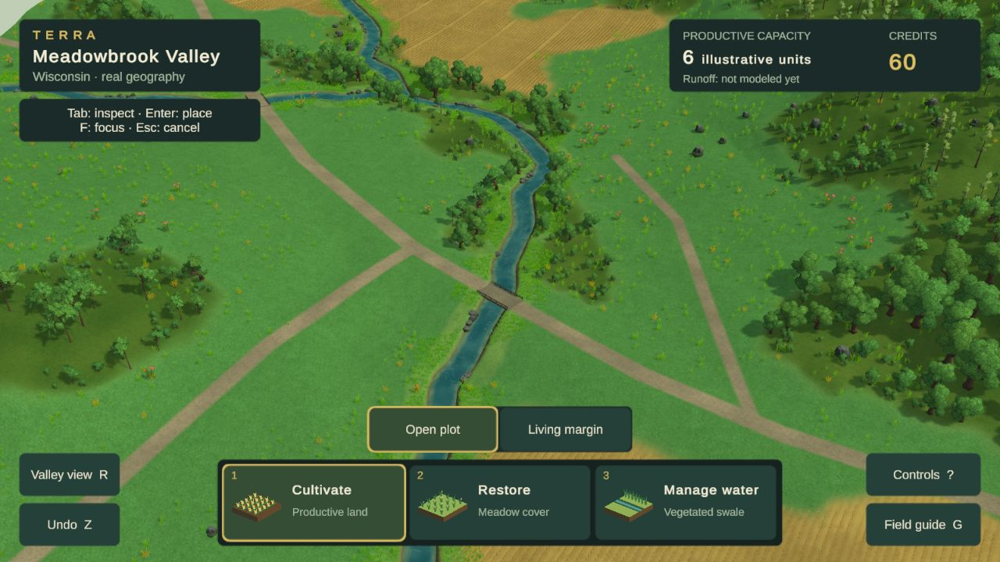
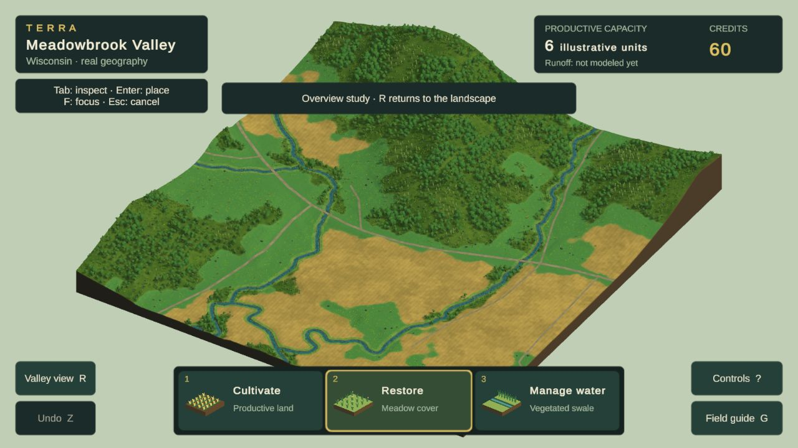

# Current visual review — Phase 2A remains open

**Source checkpoint26:** smaller plant communities, revised crop scale and a forest-edge opening are saved as work in progress. Editor captures and a clean C# compile are recorded in the [study ledger](evidence/phase2a/visual-rebuild/README.md). Chrome evaluation is pending; the browser captures below remain study25.

**Latest illustrated candidate: study25, October 24, 2026. Fine meadow material and palette sampling updated; visual and performance acceptance remain open. Not an accepted art direction.** The [persistent design reference](DESIGN_REFERENCE.md), [visual goal](PHASE_2A_GOAL.md), and [study ledger](evidence/phase2a/visual-rebuild/README.md) govern this comparison. Refresh this page with actual Chrome output as the candidate changes; retain historical captures in the ledger.

## Current game: normal play

Chrome,1280×720 CSS /1600×900 render buffer, same Meadowbrook Valley AOI. A free hand-painted grass texture and its matching normal map replace the broad procedural meadow wash. Coarse road-context pixels now share that surface around explicit mapped routes. The palette used by grass no longer bleeds unused white atlas space at distance. Source land-cover queries and accounting are unchanged; displayed meadow around coarse sealed context is an illustration, not a reclassification. Four erces tree forms from study22 remain.

**The broader low-sward/crop trial23 and broad-brush material24 were rejected.** Their captures, reasons and sources remain in the ledger. This candidate still reads too uniformly across large open areas; field repetition, plant scale and rectangular interventions remain conspicuous. The annual-gameplay roadmap is not implemented by this visual work.

## Primary comparison: Terra Nil

[Free Lives official image](https://freelives.net/uploads/2024/04/Terra-Nil-Screen-3.webp), 1920×1080. Compare displayed-size material richness, planted-bank masses, ground contrast, contact and light. This is a different scene, camera and landform construction, not a pixel-matched scientific comparison or a requirement to invent stepped Wisconsin terrain. Its authorship and assets remain with the reference game.

[Free Lives official canopy image](https://freelives.net/uploads/2024/04/Terra-Nil-Screen-2.webp). Compare foliage mass, rich leaf silhouettes, edge layering and separation of materials. Tropical plants and the reference’s stylized terrain are not a Wisconsin species or geometry specification.

## Whole-location consistency

Distinct canopy cohorts and low edge growth now extend across the location. The distant field surface represents crops as individual stalks become subpixel. Evaluate the zoom transition as well as this still; better frame time does not excuse a visible loss of quality.

## Gaps that keep the gate open

| Dimension | Current assessment / next concrete test |
|---|---|
| Composition, scale and depth | Closer creek opening is more useful; empty ground, overly large repeated forms and overview slab still weaken the scene. |
| Vegetation and environmental forms | Four branching forms and a low edge layer improve the canopy. Thin-tree stands remain sparse; broadleaf cohorts can still read as repeated clusters. |
| Ground, fields, water and transitions | Meadow uses finer artist surface/relief and has continuous road verges. Broad areas remain visually uniform; cultivation still reads as mechanical rows and treatments are schematic. |
| Lighting, color and atmosphere | Shorter, lighter shadows improve readability. Similar greens and broad smooth ground still weaken separation and richness. |
| Intervention appearance and transformation | The current treatments work, but conspicuous rectangular edges and inconsistent surface detail remain. Future annual lifecycle visuals need the same standard. |
| Whole-scene consistency | Close/wide representation is under evaluation. Required layouts, matched reviews, motion video and full delivery checks remain incomplete. |

**No dimension is certified at the required 4.5/5.** No formal acceptance review, current public release or reference-parity claim follows from these studies. Use TN-02/09/10/11/12 when taking the next visual pass; use Cities: Skylines patterns for information design as the annual gameplay is built.

Study25 is isolated on `codex/visual-study20`; [worktree/integration handoff](VISUAL_WORK_HANDOFF.md). Restore/undo passed. First diagnostic p95=75ms with a duplicate game tab; repeat after closing it p95=41ms, both failed. No error-level messages returned. No performance acceptance. Displayed size/render buffer differ from22, so do not infer a controlled before/after speed comparison. Next test scene composition and plant-scale hierarchy materially; another texture/tint pass alone will not solve the open-ground and transformation failures. No public deployment or annual-gameplay implementation is claimed.
