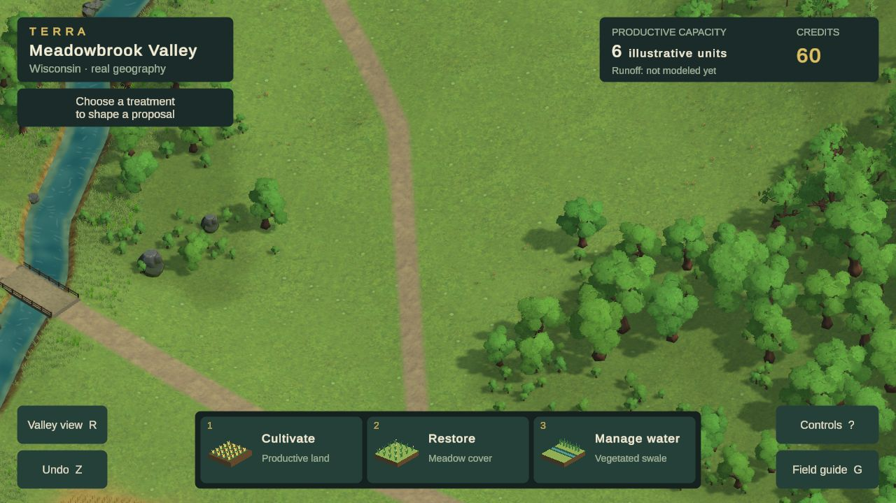
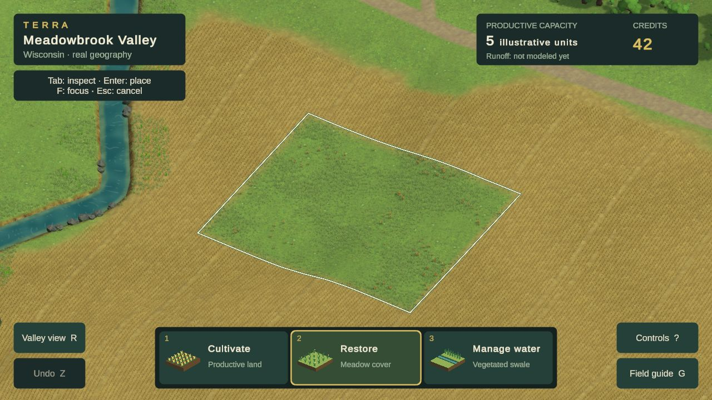
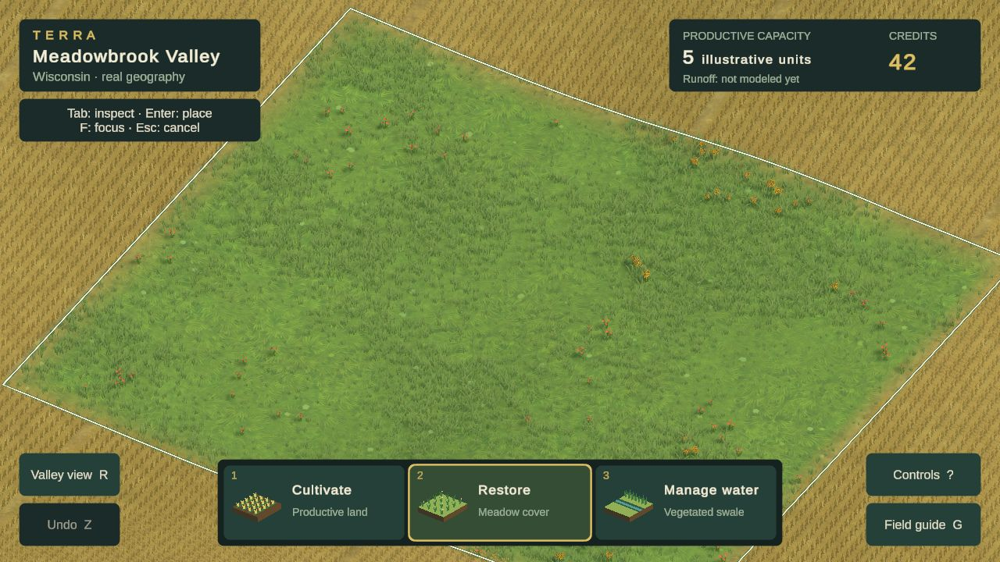
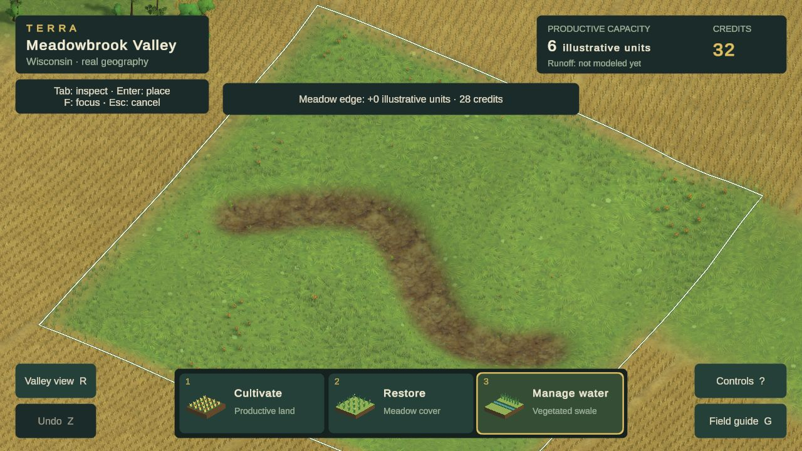
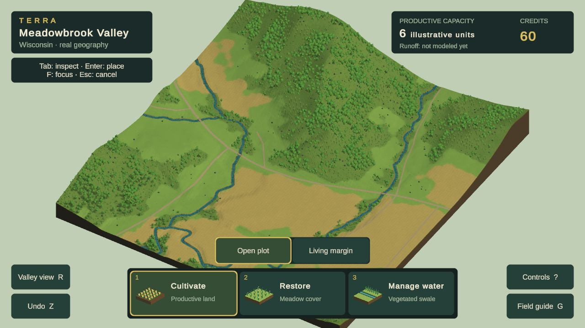

# Current visual review — Phase 2A remains open

**Current checkpoint: study32e camera candidate, followed by annual-source merge `1aec1e8`.** The latest Chrome export is [study32e](evidence/phase2a/visual-rebuild/study32e-build.json): perspective west-crossing opening, Restore/undo verified, no error-level browser logs. Its single moving route has p95 34 ms; visual and performance gates remain unaccepted. Local port 49658 serves this legacy-HUD export. Annual source from `48a3e41` is merged and recompiles with zero errors/warnings, but has not been exported or browser-verified here. The annual focus-framing diagnostic failed with a target-invocation exception; investigate before claiming camera integration acceptance. Remote `e25c5d3` is now merged for the next study. The missing local WorldPack files have been staged; fresh runtime verification remains pending.

The user approved accepting Unity's terms for the **free TriForge Fantasy Worlds: Forest FREE** pack. Acquisition and download are complete; the URP dependency subset is prepared locally but has not been imported or evaluated in the game. The inventory report is complete. Unity import is waiting at its trust dialog; the user has been asked to clear it in the visual worktree. No purchase or image generation. Rejected AO experiments are reverted. Read the [design reference](DESIGN_REFERENCE.md) and [art contract](art-direction.md) before continuing. Earlier entries below retain their historical verification scope.

**Latest Chrome candidate: study31b, October 24, 2026.** Connected meadow growth and ground-related grass shading improve continuity. Visual and full performance gates remain unaccepted. Read the [persistent reference](DESIGN_REFERENCE.md), [visual goal](PHASE_2A_GOAL.md) and [study ledger](evidence/phase2a/visual-rebuild/README.md#study31--continuous-meadow-and-shared-grass-lighting-chrome-verified-gate-open).

## Current game: normal play

1280×720 CSS and render buffer. The painted source detail is more legible and bank grass no longer glows against the ground. The unchanged opening still has too much empty central ground and a clipped bridge. This is a specific material improvement, not a successful whole-scene composition. No new assets, image generation or purchases.

## Restoration and swale

Connected growth with height drifts replaces separate oval colonies. Grass roots and terrain share a value range; shaded tips give the existing source meshes some depth. Normal-scale relief remains weak, and surrounding crop rows still dominate.

The existing Julio paint and Quaternius plants now read as one surface more readily. The flowers are sparse and the result lacks the reference's strong environmental forms. Do not improve the score simply because this is better than the prior attempt.

The29 terrain depression remains reversible and grounded. Its broad exposed earth bed still looks coarse. Shape, depth and planting are illustrative; source terrain/accounting are unchanged and permanent water is not implied.

## Primary comparison: Terra Nil

[Free Lives official image](https://freelives.net/uploads/2024/04/Terra-Nil-Screen-3.webp),1920×1080. Compare material richness, bank masses, surface contrast, contact and light at comparable displayed size. Different geography and camera; this is not a pixel-matched scientific comparison or a reason to invent stepped Wisconsin terrain. Reference authorship/assets remain with their creators.

[Free Lives official canopy image](https://freelives.net/uploads/2024/04/Terra-Nil-Screen-2.webp). Compare layered foliage mass, internal structure and grounded edges. Tropical species are not a Wisconsin prescription. TN-02/09/10/11/12 guide this review.

## Whole-location consistency

Broad crop-color bands from30/31a were rejected after producing repetitive valley-wide stripes. They are removed here; curved planting rows remain. Sparse woodland structure and the slab presentation still look schematic.

| Dimension | Unresolved reference gap |
|---|---|
| Composition, scale and depth | Empty opening, clipped landmark and schematic overview; no compelling foreground/middle/background composition. |
| Vegetation and forms | Trees still repeat, thin stands lack mass and forest edges contain conspicuous small stubs. |
| Ground, fields, water and transitions | Improved ground/grass continuity; mechanical crop rows, weak meadow relief and coarse exposed swale soil remain. |
| Lighting, color and atmosphere | Better grass/ground value agreement, but insufficient separation and depth across the scene. |
| Intervention and transformation | Connected meadow is clearer than colonies; still lacks rich, satisfying environmental forms. Annual lifecycles require separate integrated review. |
| Whole-scene consistency | Close, normal and overview all remain below the visual bar; final layouts and motion evidence are incomplete. |

**No dimension is certified at4.5/5.** No accepted art direction, current public release or reference-parity claim follows from these studies.

Study31b is isolated on `codex/visual-study20`; [handoff](VISUAL_WORK_HANDOFF.md), [source/export/browser evidence](evidence/phase2a/visual-rebuild/study31b-build.json). Restore/swale/undo and cultivation-replacement cancellation pass; no error-level logs returned. One30s moving route: p95=19ms,p99=27ms,max30ms,zero frames>33ms and zero unfocused frames. Three presentation-opportunity samples were18.7–23.6ms, not physical display latency or a robust p95. Full performance/load/layout/public-delivery gates remain incomplete. Ground shader's existing GLES3x potentially-uninitialized warning remains; no shader errors reported.

**Next materially change composition and environmental scale hierarchy.** Another small tint/density adjustment in this same framing will not resolve the dominant gap. Keep the same source geography and validate the complete playable image, including the newer annual renderer when integrated by its owner.
