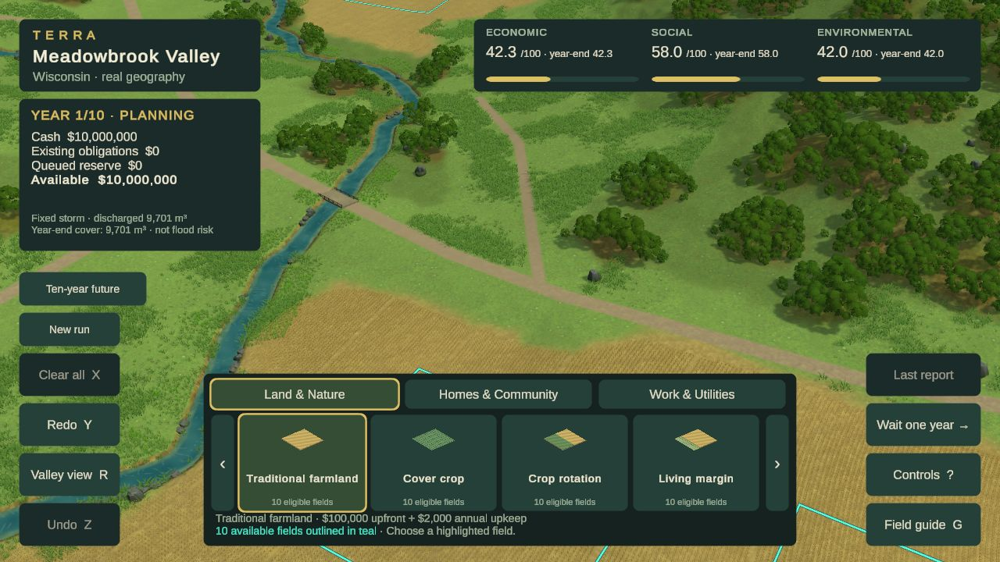
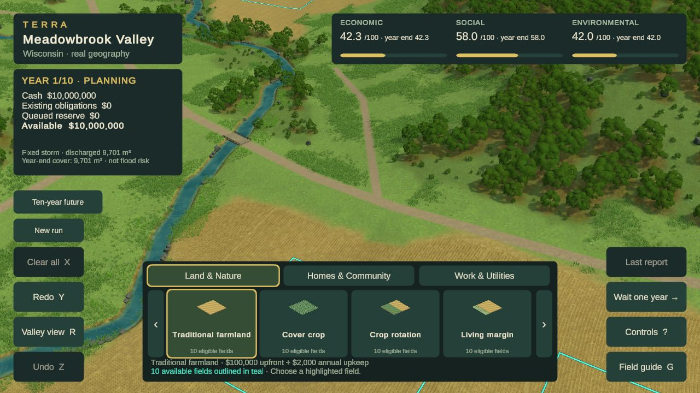
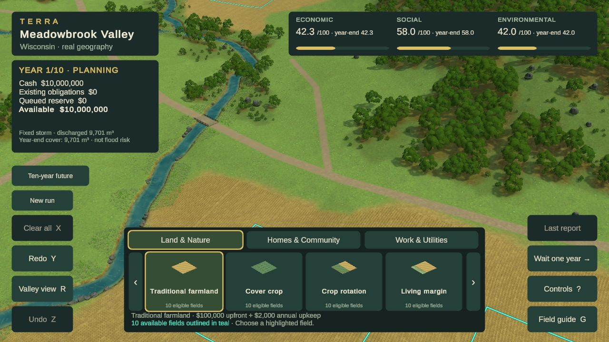
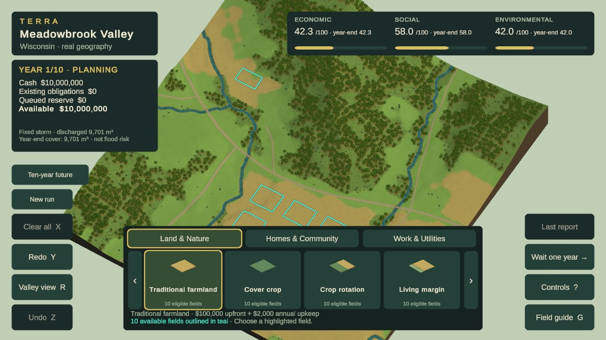

# Current visual review — Phase 2A remains open

**Study43 unfinished checkpoint:** Current atlas/HUD main is merged; connected-meadow scripts and Editor captures are saved for review. No production adoption, new Chrome verification or visual acceptance. [Checkpoint and replay](evidence/phase2a/visual-rebuild/study43-checkpoint.md).

**Studies41–42 rejected:** A layered sward reduces scatter but looks like a fuzzy carpet; an older CC0 Quaternius grass family remains noisy after correcting its FBX wrapper and adapting lighting. [Sward evidence](evidence/phase2a/visual-rebuild/study41-findings.md) · [asset trial and next construction decision](evidence/phase2a/visual-rebuild/study42-findings.md). These are Editor-only experiments, with no production adoption or Phase2A acceptance.

**Study40 rejected asset trial:** The free AssetQuest forest family was tested with native cutout materials and an adapted volume-lighting control. Foliage and ground contact remain too noisy at play distance. [Captures, replay scripts and findings](evidence/phase2a/visual-rebuild/study40-findings.md) preserve this Editor-only experiment; no production adoption or visual acceptance. Study39 remains the last exported candidate with unresolved performance.

**Study39 Chrome checkpoint, not accepted:** [Source-grass LOD evidence](evidence/phase2a/visual-rebuild/study39-findings.md) and [export/browser receipt](evidence/phase2a/visual-rebuild/study39-build.json) cover source `cc04fb2`, including main through `8cfb3ad`. Nine served files match the successful export. Near/far grass and queue/undo were inspected; cash stayed $10,923,000. One route failed at **9.64 FPS / 144 ms p95**. An unchanged study37 control also slowed to **18.04 FPS / 75 ms p95** under competing local activity, so causation and the LOD benefit remain unresolved. No error-level logs returned; 54 asset checks and 209 lifecycle assertions passed before export. **Do not integrate as a validated candidate yet.** Visual quality remains below the reference. [Study38](evidence/phase2a/visual-rebuild/study38-findings.md) was rejected; [study40 free-resource preflight](evidence/phase2a/visual-rebuild/study40-resource-preflight.md) is research only. No purchase, image generation, deployment or parity claim.

**Previous checkpoint: study37, not accepted.** [Layered woodland groups and grass culling](evidence/phase2a/visual-rebuild/study37-findings.md) have a successful Web export and [actual Chrome evidence](evidence/phase2a/visual-rebuild/study37-build.json) from source `53bfacb` (main through `3ce7df9`). Taller centers, younger edges and glades improve hierarchy, but repetitive crowns, weak surfaces and transitions remain. One foreground 1280×720 route averaged **42.22 FPS**, p95 **37ms**, p99 **44ms**; this is slower than study36 and is not ready for main. Queue/undo preserved cash; proposed and establishing restoration were viewed, with no error-level logs returned. Compilation and209 pre-merge lifecycle checks pass. The route ran in Year2 with one established project, so it is not a controlled single-variable comparison. Full performance, mature appearance and visual acceptance remain open. Free resources only; no image generation.

**Previous checkpoint: study36, not accepted.** [Broad grassland findings](evidence/phase2a/visual-rebuild/study36-findings.md) and [exact export/Chrome evidence](evidence/phase2a/visual-rebuild/study36-build.json) now cover source `a54d2fe`, including main through `a686a5b`. Opening, close and overview captures show larger grass patches, but coarse repetition, weak transitions and forest-floor gaps remain. One foreground 1280×720 route averaged **46.34 FPS**, p95 **32ms**, p99 **40ms**, with no error-level logs; queue/undo preserved cash. This is slower than study34b and is retained on the working branch for revision, not ready for main. Compilation and209 lifecycle assertions pass; established/mature grass shader colors and full performance acceptance remain pending. Phase 2A stays open. Free resources only; no image generation.

**Previous checkpoint: study34b, still unaccepted.** Corrected forest export `f88b6f6` passed exact local byte verification at **47.8 MB**. One foreground Chrome route measured **19ms p95/p99**; queue/undo preserved cash, with no error-level browser logs. Distant foliage is recovered, but overview repetition, bare lower layers and the broad flat grass surface remain substantial gaps. [Actual Chrome evidence](evidence/phase2a/visual-rebuild/study34b-build.json) · [rejected understory/material/composition trials and next direction](evidence/phase2a/visual-rebuild/study35-findings.md). Phase 2A remains open. No dimension is certified at 4.5/5; no purchase or image generation.

**Current main update:** Peter’s synchronization through `de7f83b` includes the study32 perspective opening and calibrated full-project Focus. Its [actual Chrome opening](evidence/peter-sync/opening.png), [village focus](evidence/peter-sync/village-focus.png) and [verification](evidence/peter-sync/README.md) supersede study31b for the current opening camera. The study31b comparisons below remain historical material/vegetation evidence. Neither integration closes the six-dimension visual gate, and the old-camera performance receipts are not measurements of the new perspective view.

**Historical material candidate: study31b, October 24, 2026.** Connected meadow growth and ground-related grass shading improve continuity. Visual and full performance gates remain unaccepted. Read the [persistent reference](DESIGN_REFERENCE.md), [visual goal](PHASE_2A_GOAL.md) and [study ledger](evidence/phase2a/visual-rebuild/README.md#study31--continuous-meadow-and-shared-grass-lighting-chrome-verified-gate-open).

## Latest candidate: study37

Woodland now forms layered groups. Whole-scene quality and frame cost still fail the gate.

## Previous candidate: study36

Grass stands now form larger patches. The extra density adds cost and does not solve the whole-scene visual gap. This remains an unfinished checkpoint.

## Previous candidate: study34b

The artist-authored branching and clustered foliage provide fuller masses, but repeated crowns, thin edge trees, bare understory and weak grass–bank transitions remain substantial gaps. This corrected export includes mip-coverage/LOD corrections and main’s graded project edges through f4f148d. Compare with the official references below; this is not an accepted baseline.

Distant foliage is recovered, but the overview still consists of small repeated crowns and conspicuous floor footprints. Coverage repair is not visual acceptance. [Study34 findings and exact evidence](evidence/phase2a/visual-rebuild/study34-findings.md).

## Historical study31b: normal play

1280×720 CSS and render buffer. The painted source detail is more legible and bank grass no longer glows against the ground. The unchanged opening still has too much empty central ground and a clipped bridge. This is a specific material improvement, not a successful whole-scene composition. No new assets, image generation or purchases.

## Restoration and swale

Connected growth with height drifts replaces separate oval colonies. Grass roots and terrain share a value range; shaded tips give the existing source meshes some depth. Normal-scale relief remains weak, and surrounding crop rows still dominate.

The existing Julio paint and Quaternius plants now read as one surface more readily. The flowers are sparse and the result lacks the reference's strong environmental forms. Do not improve the score simply because this is better than the prior attempt.

The29 terrain depression remains reversible and grounded. Its broad exposed earth bed still looks coarse. Shape, depth and planting are illustrative; source terrain/accounting are unchanged and permanent water is not implied.

## Primary comparison: Terra Nil

[Free Lives official image](https://freelives.net/uploads/2024/04/Terra-Nil-Screen-3.webp),1920×1080. Compare material richness, bank masses, surface contrast, contact and light at comparable displayed size. Different geography and camera; this is not a pixel-matched scientific comparison or a reason to invent stepped Wisconsin terrain. Reference authorship/assets remain with their creators.

[Free Lives official canopy image](https://freelives.net/uploads/2024/04/Terra-Nil-Screen-2.webp). Compare layered foliage mass, internal structure and grounded edges. Tropical species are not a Wisconsin prescription. TN-02/09/10/11/12 guide this review.

## Whole-location consistency

Broad crop-color bands from30/31a were rejected after producing repetitive valley-wide stripes. They are removed here; curved planting rows remain. Sparse woodland structure and the slab presentation still look schematic.

| Dimension | Unresolved reference gap |
|---|---|
| Composition, scale and depth | Empty opening, clipped landmark and schematic overview; no compelling foreground/middle/background composition. |
| Vegetation and forms | Trees still repeat, thin stands lack mass and forest edges contain conspicuous small stubs. |
| Ground, fields, water and transitions | Improved ground/grass continuity; mechanical crop rows, weak meadow relief and coarse exposed swale soil remain. |
| Lighting, color and atmosphere | Better grass/ground value agreement, but insufficient separation and depth across the scene. |
| Intervention and transformation | Connected meadow is clearer than colonies; still lacks rich, satisfying environmental forms. Annual lifecycles require separate integrated review. |
| Whole-scene consistency | Close, normal and overview all remain below the visual bar; final layouts and motion evidence are incomplete. |

**No dimension is certified at4.5/5.** No accepted art direction, current public release or reference-parity claim follows from these studies.

Study31b is isolated on `codex/visual-study20`; [handoff](VISUAL_WORK_HANDOFF.md), [source/export/browser evidence](evidence/phase2a/visual-rebuild/study31b-build.json). Restore/swale/undo and cultivation-replacement cancellation pass; no error-level logs returned. One30s moving route: p95=19ms,p99=27ms,max30ms,zero frames>33ms and zero unfocused frames. Three presentation-opportunity samples were18.7–23.6ms, not physical display latency or a robust p95. Full performance/load/layout/public-delivery gates remain incomplete. Ground shader's existing GLES3x potentially-uninitialized warning remains; no shader errors reported.

**Next materially change composition and environmental scale hierarchy.** Another small tint/density adjustment in this same framing will not resolve the dominant gap. Keep the same source geography and validate the complete playable image, including the newer annual renderer when integrated by its owner.
