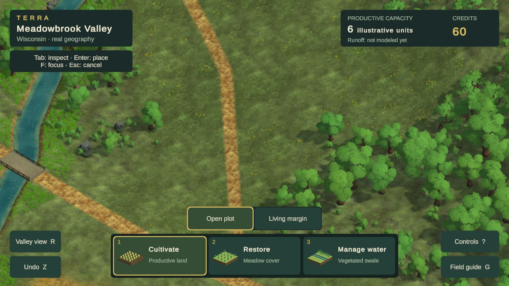
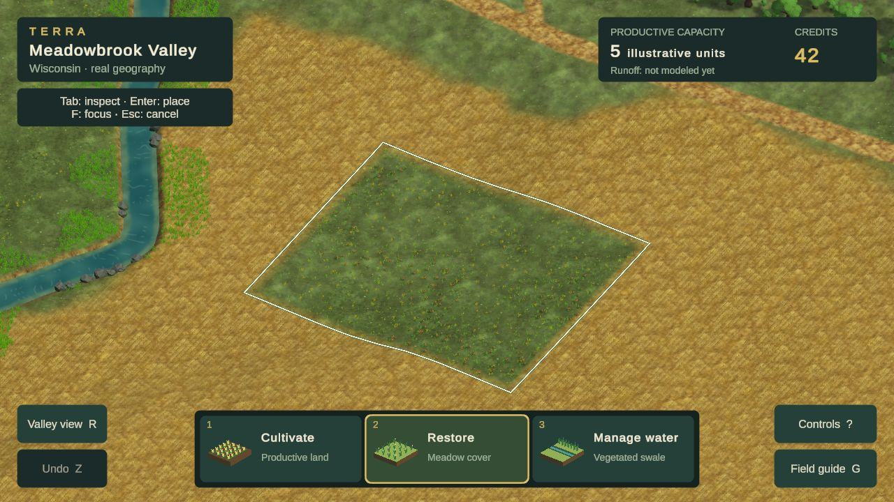
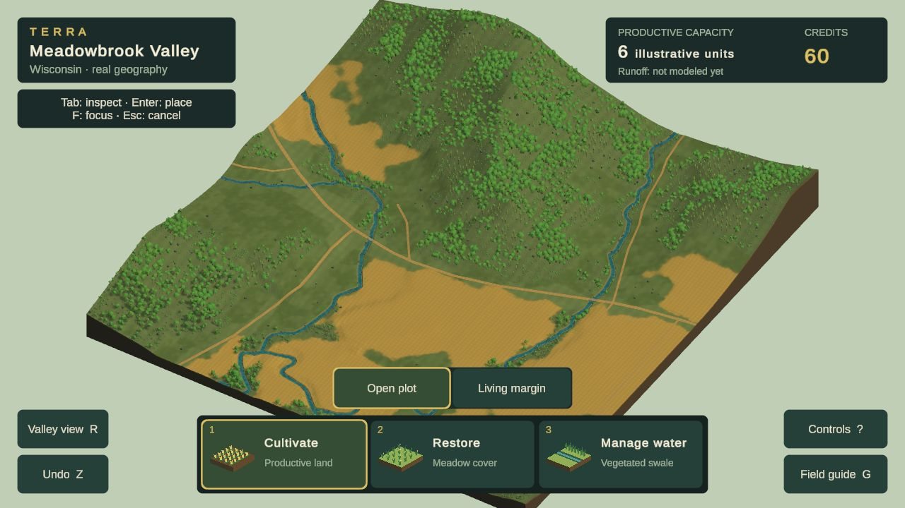

# Current visual review — Phase 2A remains open

**Latest Chrome candidate: study28e, October24,2026. Painterly ground family and corrected foliage rendering; Phase2A remains unaccepted.** The [persistent design reference](DESIGN_REFERENCE.md), [visual goal](PHASE_2A_GOAL.md), and [study ledger](evidence/phase2a/visual-rebuild/README.md) govern this comparison.

## Current game: normal play

1280×720 CSS/render buffer. Free JulioVII grass/earth/stone color and matching relief replace the mixed ground family. Shared offset sampling removes repeated square stamps; distant paint converges to its average. Leaves now have alpha-safe import and matching cutout shadow/depth passes. The closer orthographic view enlarges landmarks but cuts the bridge at the left edge and still devotes too much of the image to sparse, uniform planting. No image generation or purchases.

## Restoration in the new material family

28d and28e have identical rendering code;28e moves inactive resources into an archive. Terrain-integrated restoration, source geometry and accounting remain unchanged. The meadow treatment still lacks the density, form and visual payoff of the reference. Fields remain mechanical and their earth texture is too dominant.

## Primary comparison: Terra Nil

[Free Lives official image](https://freelives.net/uploads/2024/04/Terra-Nil-Screen-3.webp), 1920×1080. Compare displayed-size material richness, planted-bank masses, ground contrast, contact and light. This is a different scene, camera and landform construction, not a pixel-matched scientific comparison or a requirement to invent stepped Wisconsin terrain. Its authorship and assets remain with the reference game.

[Free Lives official canopy image](https://freelives.net/uploads/2024/04/Terra-Nil-Screen-2.webp). Compare foliage mass, rich leaf silhouettes, edge layering and separation of materials. Tropical plants and the reference’s stylized terrain are not a Wisconsin species or geometry specification.

## Whole-location consistency

The distant paint no longer repeats as a checker. Canopy spacing, broad woodland gaps and the slab presentation still look schematic. This is a defect correction, not a whole-scene quality pass.

## Gaps that keep the gate open

| Dimension | Current assessment / next concrete test |
|---|---|
| Composition, scale and depth | Closer creek opening is more useful; empty ground, overly large repeated forms and overview slab still weaken the scene. |
| Vegetation and environmental forms | Four branching forms and a low edge layer improve the canopy. Thin-tree stands remain sparse; broadleaf cohorts can still read as repeated clusters. |
| Ground, fields, water and transitions | One artist ground family improves consistency and the checker defect is removed. Dirt paths are too prominent; fields and restored planting remain mechanical. Swale forms are still schematic. |
| Lighting, color and atmosphere | Alpha-safe foliage removes black outlines and mismatched leaf-card shadows. Similar greens and coarse plant communities still weaken separation and richness. |
| Intervention appearance and transformation | Treatments now share the terrain material and have softened contact. Plant communities and swale construction remain too schematic. Future annual lifecycle visuals need the same standard. |
| Whole-scene consistency | Close/wide representation is under evaluation. Required layouts, matched reviews, motion video and full delivery checks remain incomplete. |

**No dimension is certified at the required 4.5/5.** No formal acceptance review, current public release or reference-parity claim follows from these studies. Use TN-02/09/10/11/12 when taking the next visual pass; use Cities: Skylines patterns for information design as the annual gameplay is built.

Study28e remains isolated on `codex/visual-study20`; [integration handoff](VISUAL_WORK_HANDOFF.md).28d moving diagnostic first failed atp95=123ms,max224ms; after closing superseded visual tabs, the repeat measuredp95=33ms,p99=36ms,max40ms. Both are retained; this is not the three-route acceptance suite or a controlled causal comparison.28e archives unused resources, reducing checked transfer from55.09MB to36.79MB; exact-file serving checks pass. Final public deployment, fresh-cache suite, layouts, motion video and two passing visual reviews remain incomplete. **Do not spend the next pass on tint or texture density: change the plant-community and treatment construction materially.**
