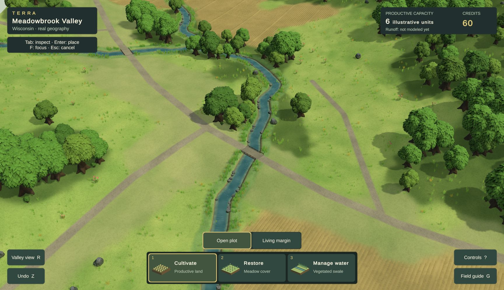
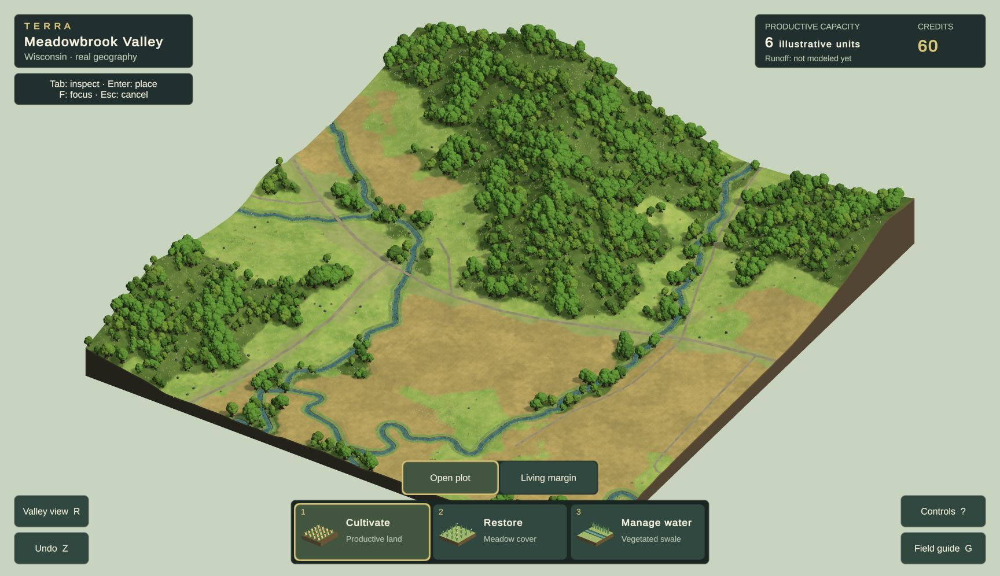

# Current visual review — Phase 2A remains open

**Latest illustrated candidate: study20, October 24, 2026. Road junctions and lighting improved; visual and performance acceptance remain open. Not an accepted art direction.** The [persistent design reference](DESIGN_REFERENCE.md), [visual goal](PHASE_2A_GOAL.md), and [study ledger](evidence/phase2a/visual-rebuild/README.md) govern this comparison. Refresh this page with actual Chrome output as the candidate changes; retain historical captures in the ledger.

## Current game: normal play

Chrome, 1728×996, same Meadowbrook Valley AOI. The creek now has exposed banks, shallow-water variation, restrained surface marks and grouped edge plants. Existing artist ground textures read at playable scale. The current HUD/accounting remains the earlier placement slice; the annual-gameplay roadmap is not implemented by this visual work.

## Primary comparison: Terra Nil

[Free Lives official image](https://freelives.net/uploads/2024/04/Terra-Nil-Screen-3.webp), 1920×1080. Compare displayed-size material richness, planted-bank masses, ground contrast, contact and light. This is a different scene, camera and landform construction, not a pixel-matched scientific comparison or a requirement to invent stepped Wisconsin terrain. Its authorship and assets remain with the reference game.

## Whole-location consistency

The distant renderer uses supplied oak LODs and a field surface representation as individual crop stalks become subpixel. Evaluate the zoom transition as well as this still; better frame time does not excuse a visible loss of quality.

## Gaps that keep the gate open

| Dimension | Current assessment / next concrete test |
|---|---|
| Composition, scale and depth | Closer creek opening is more useful; empty ground, overly large repeated forms and overview slab still weaken the scene. |
| Vegetation and environmental forms | Sculpted leaf forms help, but one crown shape dominates. Evaluate a coherent shrub/edge family and more deliberate forest openings. |
| Ground, fields, water and transitions | Surface art and water improved; road union fixes intersection seams. Cultivation still reads as mechanical rows and treatment boundaries remain schematic. |
| Lighting, color and atmosphere | Shorter, lighter shadows improve readability. Similar greens and broad smooth ground still weaken separation and richness. |
| Intervention appearance and transformation | The current treatments work, but conspicuous rectangular edges and inconsistent surface detail remain. Future annual lifecycle visuals need the same standard. |
| Whole-scene consistency | Close/wide representation is under evaluation. Required layouts, matched reviews, motion video and full delivery checks remain incomplete. |

**No dimension is certified at the required 4.5/5.** No formal acceptance review, current public release or reference-parity claim follows from these studies. Use TN-02/09/10/11/12 when taking the next visual pass; use Cities: Skylines patterns for information design as the annual gameplay is built.

Study20 is isolated on `codex/visual-study20`; [worktree/integration handoff](VISUAL_WORK_HANDOFF.md). Its30s diagnostic p95=92ms fails; concurrent builds prevent attributing that result to these edits alone. See the full ledger before comparing with19b.
