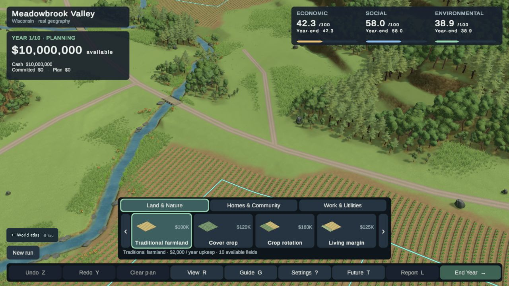
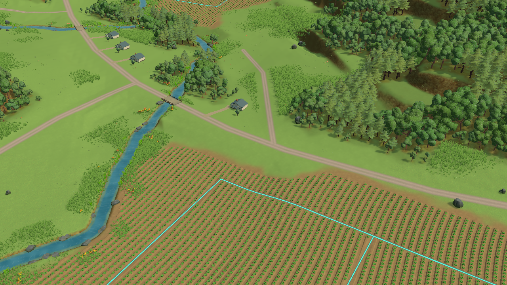
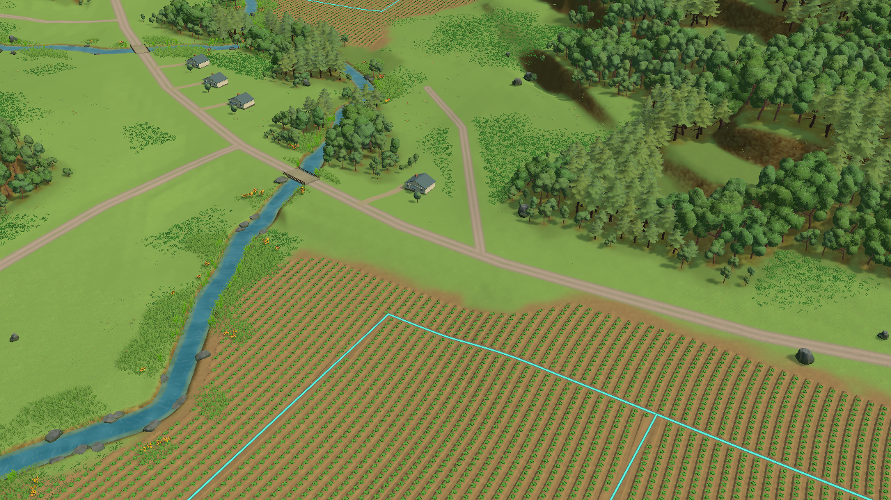
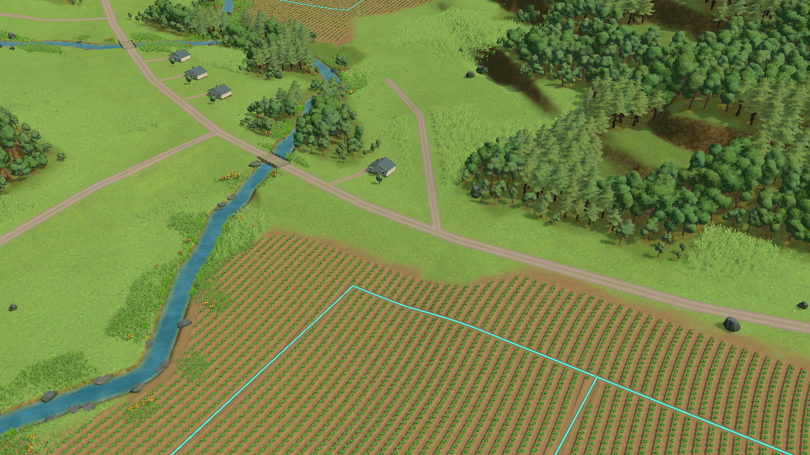
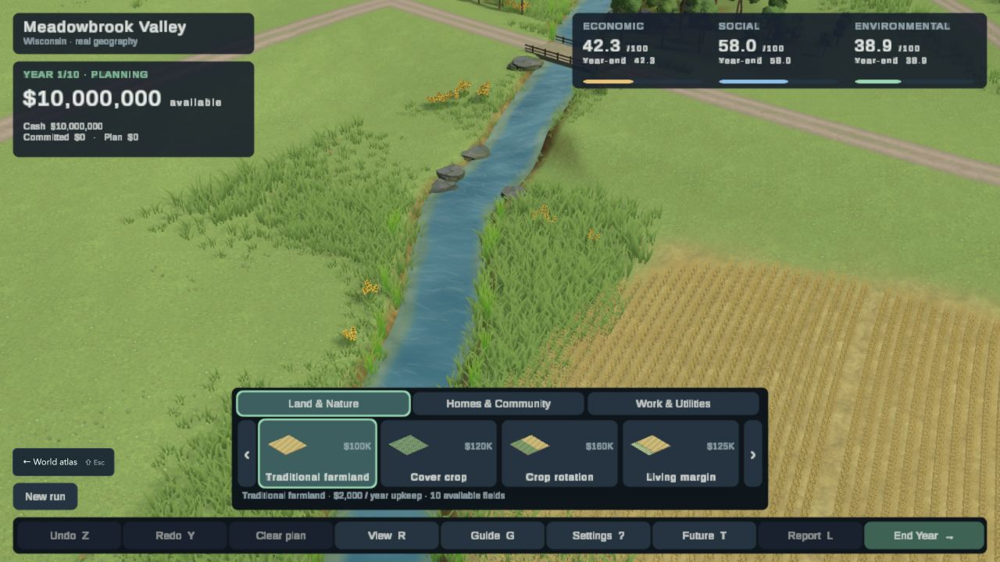
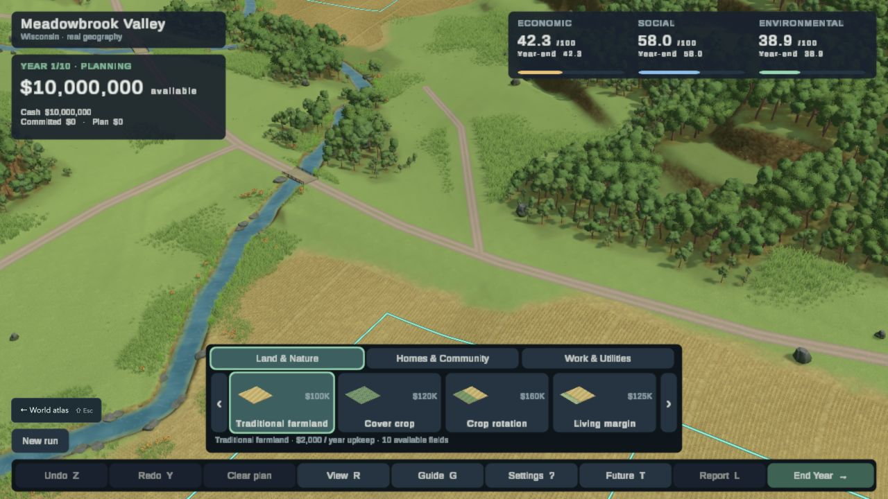
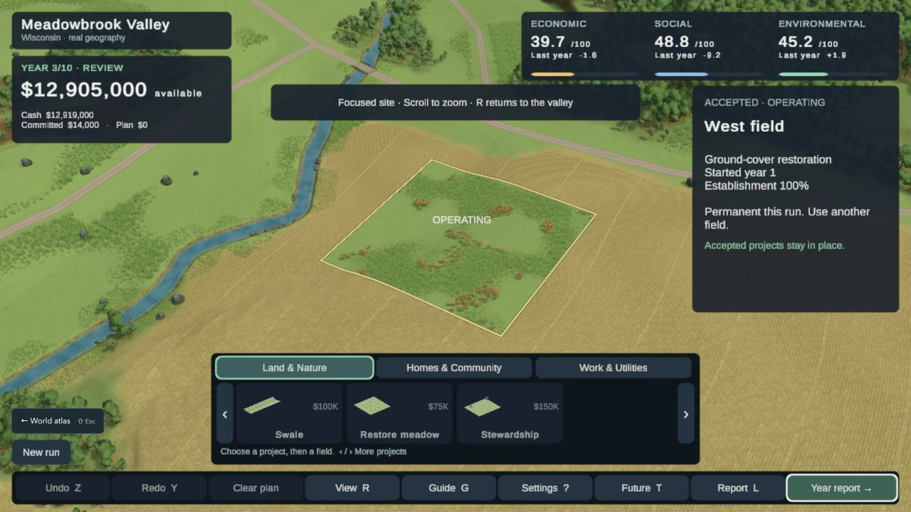
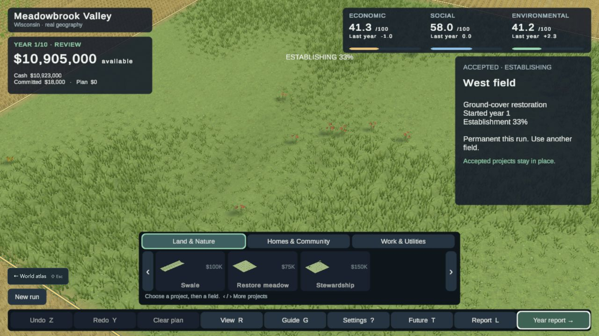
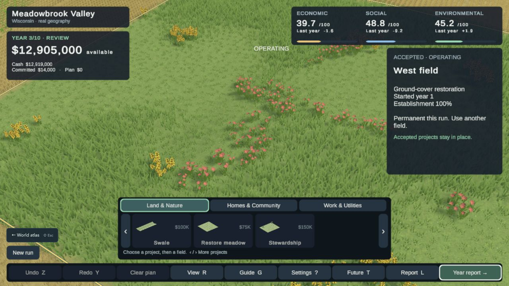
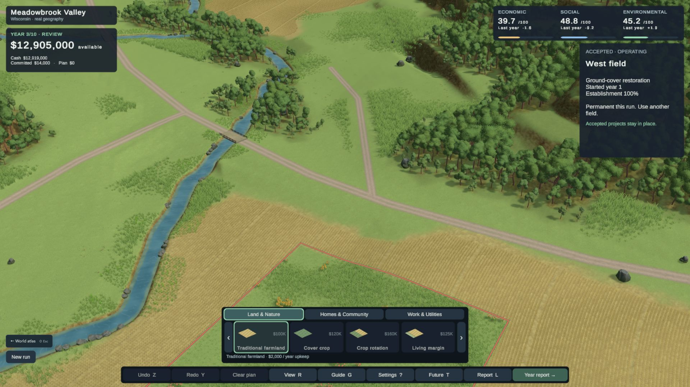

# Current visual review — Phase 2A remains open

**Latest playable browser evidence: study64**, sourcee3f4905. Shared quiet soil shading and brighter crop leaves improve the raised beds. Actual Chrome verifies living-margin preview/queue/undo with unchanged stored cash; one entry took9.46s. [Captures, raw logs and limits](evidence/phase2a/visual-rebuild/study64-findings.md). The subsequent focused Chrome opening/editing/Year10 paths fail the stable-30 limit at37/41/34ms p95. [Timing and annual checks](evidence/phase2a/combined-crops-browser-01/README.md).

**Latest Editor candidate: study65, source `3b28015`.** Four metric homes depict the already-counted fictional starting community, with foundations and terrain-following road access. Compilation and35 source/state/lifecycle checks pass. This capture excludes the HUD and has not been verified in Chrome; repeated houses, sparse yards and whole-scene weaknesses remain. [Study65 evidence](evidence/phase2a/visual-rebuild/study65-findings.md).

[Study66 rendered asset comparison](evidence/phase2a/visual-rebuild/study66-findings.md): the approved free BigRookGames family was inspected in its supplied URP demo and in Wisconsin. Native and adapted leaf materials yield fuller crowns, but dense repeated rounded layers and weak edge structure remain. The swap is not adopted; production scenery is unchanged.

**Latest structural and asset comparisons: studies67–68, both rejected.** [Study67](evidence/phase2a/visual-rebuild/study67-rendered/README.md) tests fewer mature trees, actual low shrubs and larger glades using the coherent BigRook family. Repeated layered crowns and disconnected shrubs remain. [Study68](evidence/phase2a/visual-rebuild/study68-environment/README.md) evaluates the free RG Poly environment in its native scene and substitutes its supplied grass geometry/material in Terra. At play distance it becomes separated green marks; the replacement is not adopted. These are actual Editor camera renders, not Chrome acceptance.

**Latest material investigation: [study69](evidence/phase2a/visual-rebuild/study69-surface/README.md).** Shared world-space artist paint reduces detached grass contrast and improves close ground detail with the original planting layout. The initial cloudy texture treatment and an additional 15,874 low plants are rejected. The corrected material remains a limited candidate, with its inherited Metal shader warning now resolved in the isolated experiment. Actual normal/close/wide Editor captures are recorded; no Chrome or visual-gate acceptance. Production scenery remains the study65 candidate above.

The persistent failure is the whole field–meadow surface, not the lack of another plant model. Crop rows, weak forest/field structure and the broad overview remain substantial gaps. Carry forward the useful shared-surface relationship; do not pursue more density or texture-only polish as a substitute for better field construction.

The direct visual gaps remain: repetitive field rhythm, insufficient forest-floor layering, weak material transitions and a distant board-like wide view. No dimension is certified at4.5/5. The evidence below records earlier candidates and source-specific checks.

**Historical candidate: study60, source `d04f7d4`, October 25, 2026.** The sections below preserve earlier rendered evidence; [the earlier review](ARCHIVED_VISUAL_REVIEW_46.md) preserves historical studies and their original claims. [Persistent design library](DESIGN_REFERENCE.md) · [unchanged visual gate](PHASE_2A_GOAL.md) · [current evidence](evidence/phase2a/visual-rebuild/study60-findings.md).

[Latest unfinished investigation: study59 cultivated soil beds](evidence/phase2a/visual-rebuild/study59-findings.md). Saved for continuity; it does not replace the retained candidate below.

## The actual playable result

Study60 adds layered streamside grass, flowering pockets and flatter stones, grounded to the actual channel surface. This improves the water/land relationship. The six visual gates remain open: crop marks, broad weak ground, repeated crowns and bank silhouettes still need substantial work. One focused30s route measured23ms p95; placement/undo preserved cash. [Full source-scoped evidence](evidence/phase2a/visual-rebuild/study60-findings.md).

## Retained restoration appearance, study55

Actual Chrome, 1280×720, full HUD. Restoration now forms connected low/tall plant swaths with flowering pockets. This corrects the prior fine scatter, but mechanical crop marks, broad empty ground and weak material/forest transitions remain substantial gaps.

The same planting grows through the saved annual outcome: 33% in Year 1, 67% in Year 2, 100% in Year 3. These are actual accepted browser states using labelled offline chapters, not mockups or manually changed saved outcomes. The live three-year cash values and reload are checked; decorative plant size/species remain illustrative. TN-02/05/08.

The normal view exposes the whole-scene weaknesses. Woodland has more volume, yet repeated crowns and bare edges remain. Cultivation reads as thousands of tiny repeated marks. The catalogue overlaps the restored parcel at the default camera, especially at 720px height. A successful close meadow cannot certify the whole image.

## Primary comparison: Terra Nil

[Free Lives official reference](https://freelives.net/uploads/2024/04/Terra-Nil-Screen-3.webp), 1920×1080; inspected again during study55. The reference concentrates flowers and plant silhouettes along boundaries while broad surfaces remain readable. Its painted ground, crisp bank transitions and contact shadows read as a deliberately composed world. Our repeating fine marks and uneven scale hierarchy still fall short. Different geography/camera prevents pixel matching; this is no reason to invent stepped Wisconsin terrain. Reference artwork belongs to its creators.

[Free Lives layered-landscape reference](https://freelives.net/uploads/2024/04/Terra-Nil-Screen-2.webp). Compare low plants, taller forms, crown masses and the structure between them. Tropical species are not a Wisconsin prescription. TN-01/02/09–12 guide appearance; Cities: Skylines remains secondary information-design guidance in the persistent library.

## What prevents acceptance

| Dimension | Current unresolved issue |
|---|---|
| Composition, scale and depth | Broad sparse ground, weak middle-scale structure, and HUD overlap of the treated foreground. |
| Vegetation and forms | Fuller grass/flowers; repeated blades/crowns and incomplete woodland understory still visible. |
| Ground, fields, water and transitions | Crop construction is mechanical; bare steep faces and simplified banks remain. |
| Lighting, color and atmosphere | Color is coherent enough to read, but depth, contact and surface separation remain weaker than the reference. |
| Intervention and transformation | Actual annual growth is more legible; only one browser parcel/three years and two Editor action lifecycles have been reviewed in this revision. |
| Whole-scene consistency | Larger layouts inspected; alternate sites, other interventions, motion, all three regions and full release acceptance remain incomplete. |

**No dimension is certified at 4.5/5.** Current progress does not waive the user's visual rejection or establish commercial-game parity. The next substantial art change targets cultivated field mass. [Study56](evidence/phase2a/visual-rebuild/study56-findings.md) rejects grass-as-grain and empty interiors with narrow wheat bands; [study57](evidence/phase2a/visual-rebuild/study57-findings.md) rejects the mature corn swap, and [study58](evidence/phase2a/visual-rebuild/study58-findings.md) rejects a flat surface baked from grain geometry. The retained scenery is still study55, now using the verified submission collector. Do not repeat density/tint/tiling adjustments or the raised canopy sheet. The next construction needs cultivated soil and plant volumes that read together at parcel scale.

## Verification boundary

42 annual/render checks and 28 material ownership checks pass on the combined source. Chrome verifies proposal → Year 1 → Year 2 → Year 3 → reload, with unchanged accepted cash on reload and no browser error-level entries. The diagnostic export serves 31 exact files totaling 46.41 MB; its dirty/ignored-input provenance limits are explicit in [the evidence](evidence/phase2a/visual-rebuild/study55-findings.md). One first entry of 9.238 s and warm reload of 12.582 s do not establish the three-fresh-load gate. Subsequent [Chrome evidence on source `2f8543d`](evidence/full-game/consolidation-browser/README.md) meets the documented stable-30 fallback at 33/31/29 ms p95 and verifies three fresh entries at 12.306/12.342/12.013 seconds with a 46.43 MB export. The collector is integrated into this visual branch in `5b8ad52`; compilation and 15 collector checks pass here. These source-specific one-machine measurements supersede the preceding 35/46/34 ms failure for that candidate only. They do not certify the rejected art experiments, future scenery changes, strict 60 FPS, accessibility or a final clean public release.
