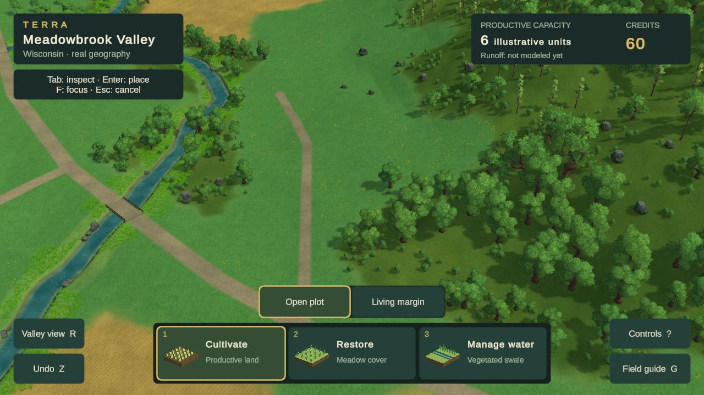
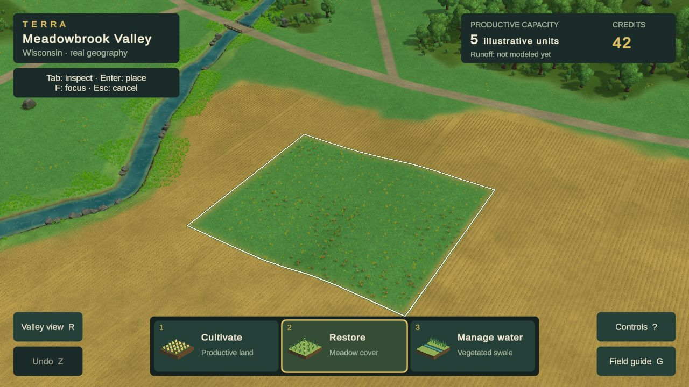
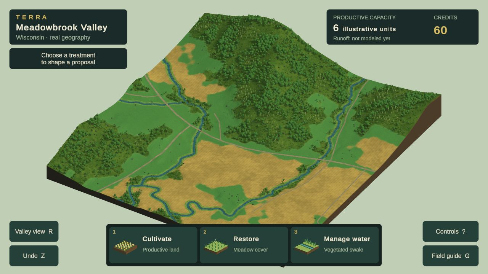

# Current visual review — Phase 2A remains open

**Latest Chrome candidate: study27, October 24, 2026. Terrain-integrated interventions; visual and performance gates remain failed.** The [persistent design reference](DESIGN_REFERENCE.md), [visual goal](PHASE_2A_GOAL.md), and [study ledger](evidence/phase2a/visual-rebuild/README.md) govern this comparison. These are recoverable studies, not accepted art direction.

## Current game: normal play

Verified 1280×720 CSS/render buffer. Study 26 corrects oversized meadow/crop plants and frames a forest edge;27 integrates interventions into the terrain's own materials. Free artist models and textures remain the source assets. No image generation. The broad open terrain, mechanical fields and weak plant communities still leave a substantial reference gap.

## Restoration now belongs to the terrain

The raised solid-color overlay is gone. Restored land shares terrain normals, artist paint/relief and lighting, with a narrow visual transition inside the management boundary. Exact site geometry, land-cover queries and accounting remain unchanged. Preview/cancel and undo restore the prior surface. This is a contact/material consistency improvement; the treatment still lacks the richness needed to pass.

## Primary comparison: Terra Nil

[Free Lives official image](https://freelives.net/uploads/2024/04/Terra-Nil-Screen-3.webp), 1920×1080. Compare displayed-size material richness, planted-bank masses, ground contrast, contact and light. This is a different scene, camera and landform construction, not a pixel-matched scientific comparison or a requirement to invent stepped Wisconsin terrain. Its authorship and assets remain with the reference game.

[Free Lives official canopy image](https://freelives.net/uploads/2024/04/Terra-Nil-Screen-2.webp). Compare foliage mass, rich leaf silhouettes, edge layering and separation of materials. Tropical plants and the reference’s stylized terrain are not a Wisconsin species or geometry specification.

## Whole-location consistency

Distinct canopy cohorts and low edge growth now extend across the location. The distant field surface represents crops as individual stalks become subpixel. Evaluate the zoom transition as well as this still; better frame time does not excuse a visible loss of quality.

## Gaps that keep the gate open

| Dimension | Current assessment / next concrete test |
|---|---|
| Composition, scale and depth | Closer creek opening is more useful; empty ground, overly large repeated forms and overview slab still weaken the scene. |
| Vegetation and environmental forms | Four branching forms and a low edge layer improve the canopy. Thin-tree stands remain sparse; broadleaf cohorts can still read as repeated clusters. |
| Ground, fields, water and transitions | Meadow uses finer artist surface/relief and has continuous road verges. Broad areas remain visually uniform; cultivation still reads as mechanical rows remain weak. Treatments now share the terrain material, but planting and swale forms are still schematic. |
| Lighting, color and atmosphere | Shorter, lighter shadows improve readability. Similar greens and broad smooth ground still weaken separation and richness. |
| Intervention appearance and transformation | Treatments now share the terrain material and have softened contact. Plant communities and swale construction remain too schematic. Future annual lifecycle visuals need the same standard. |
| Whole-scene consistency | Close/wide representation is under evaluation. Required layouts, matched reviews, motion video and full delivery checks remain incomplete. |

**No dimension is certified at the required 4.5/5.** No formal acceptance review, current public release or reference-parity claim follows from these studies. Use TN-02/09/10/11/12 when taking the next visual pass; use Cities: Skylines patterns for information design as the annual gameplay is built.

Study 27 is isolated on `codex/visual-study20`; [integration handoff](VISUAL_WORK_HANDOFF.md). Preview/cancel, replacement-cancel, Restore and undo passed in Chrome. The moving/placement diagnostic failed at p95=67 ms, p99=75 ms, max=102 ms. No error-level logs; no performance acceptance, public deployment or annual-gameplay claim. The existing orthographic diagnostic did not solve scene richness. Next test a substantially stronger material/foliage direction and representative scene framing, not another tint/density cycle.
