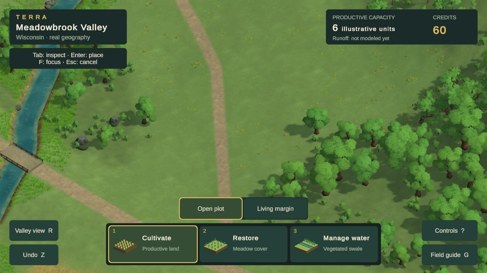
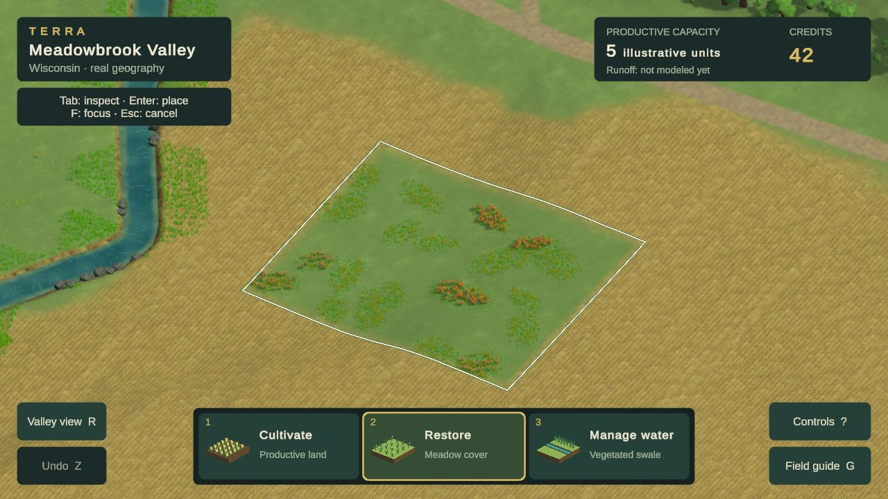
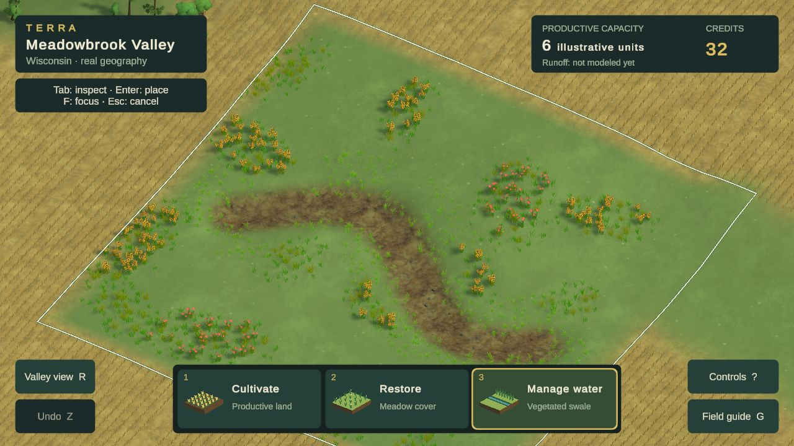
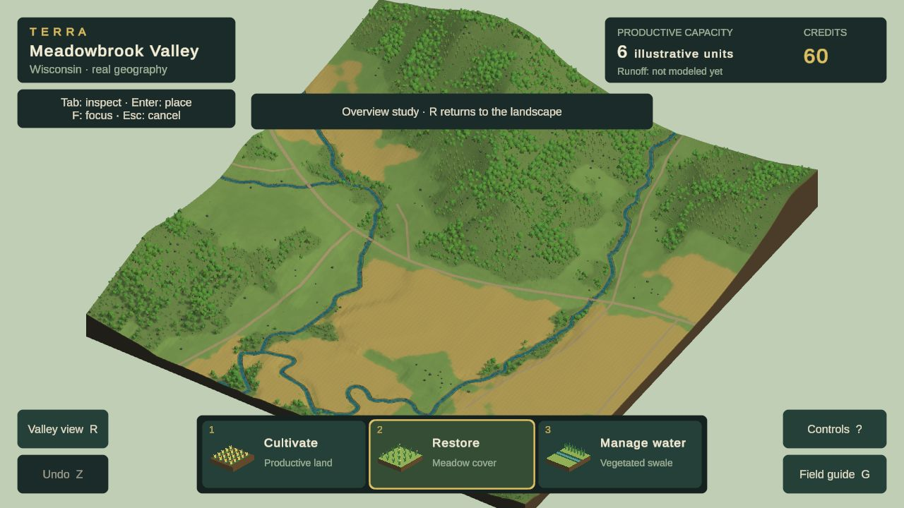

# Current visual review — Phase 2A remains open

**Latest Chrome candidate: study29c, October 24, 2026. Terrain swale, grouped meadow planting and quieter ground. Visual and performance gates remain unaccepted.** The [persistent design reference](DESIGN_REFERENCE.md), [visual goal](PHASE_2A_GOAL.md), and [study ledger](evidence/phase2a/visual-rebuild/README.md#study29--terrain-swale-and-planted-meadow-colonies-chrome-verified-gate-failed) govern this comparison.

## Current game: normal play

1280×720 CSS/render buffer. The quieter JulioVII ground treatment reduces mottling and the paths' yellow prominence. It also exposes how empty the central ground still is. The bridge remains clipped at the left edge. No new assets, image generation or purchases.

## Restoration and swale

Elongated colonies replace isolated random plant dots, with low growth, taller interiors and flower groups from the existing Quaternius family. The pattern is more legible, but groups remain too separate and the intervening ground too smooth. The surrounding crop rows remain mechanical.

The swale is now a shallow depression in the rendered ground with low shoulders and partly buried stones. It replaces the raised planter-like ribbons. Its shape/depth are illustrative; source terrain and accounting are unchanged. No permanent standing water is implied. The brown bed is still visually coarse, and vegetation does not yet form a convincing continuous bank community.

## Primary comparison: Terra Nil

[Free Lives official image](https://freelives.net/uploads/2024/04/Terra-Nil-Screen-3.webp), 1920×1080. Compare displayed-size material richness, planted-bank masses, ground contrast, contact and light. This is a different scene, camera and landform construction, not a pixel-matched scientific comparison or a requirement to invent stepped Wisconsin terrain. Its authorship and assets remain with the reference game.

[Free Lives official canopy image](https://freelives.net/uploads/2024/04/Terra-Nil-Screen-2.webp). Compare foliage mass, rich leaf silhouettes, edge layering and separation of materials. Tropical plants and the reference’s stylized terrain are not a Wisconsin species or geometry specification.

## Whole-location consistency

The distant paint no longer repeats as a checker. Canopy spacing, broad woodland gaps and the slab presentation still look schematic. This is a defect correction, not a whole-scene quality pass.

## Gaps that keep the gate open

| Dimension | Current assessment / next concrete test |
|---|---|
| Composition, scale and depth | Closer creek opening is more useful; empty ground, overly large repeated forms and overview slab still weaken the scene. |
| Vegetation and environmental forms | Four branching forms and a low edge layer improve the canopy. Thin-tree stands remain sparse; broadleaf cohorts can still read as repeated clusters. |
| Ground, fields, water and transitions | One artist ground family improves consistency and the checker defect is removed. Paths are quieter; crop rows remain mechanical, meadow colonies too separate, and the swale bed coarse. |
| Lighting, color and atmosphere | Alpha-safe foliage removes black outlines and mismatched leaf-card shadows. Similar greens and coarse plant communities still weaken separation and richness. |
| Intervention appearance and transformation | Treatments now share the terrain material and have softened contact. Swale relief is grounded and reversible; the plant communities still lack continuity and richness. The separate annual lifecycle renderer must adopt the improvements and be checked in its actual user flow. |
| Whole-scene consistency | Close/wide representation is under evaluation. Required layouts, matched reviews, motion video and full delivery checks remain incomplete. |

**No dimension is certified at the required 4.5/5.** No formal acceptance review, current public release or reference-parity claim follows from these studies. Use TN-02/09/10/11/12 when taking the next visual pass; use Cities: Skylines patterns for information design as the annual gameplay is built.

Study29c is isolated on `codex/visual-study20`; [integration handoff](VISUAL_WORK_HANDOFF.md). Exact serving checks pass at36.80MB of checked files. Restore/swale/undo pass; no error-level messages returned. The moving diagnostic's p95=31ms is outweighed by two frames>200ms (max529ms), so performance is not accepted. Full-game annual rendering, final layouts, video, fresh-cache suite, public delivery and two passing visual reviews remain incomplete. **Next change field and groundcover construction; another palette or density tweak will not close the dominant gap.**
