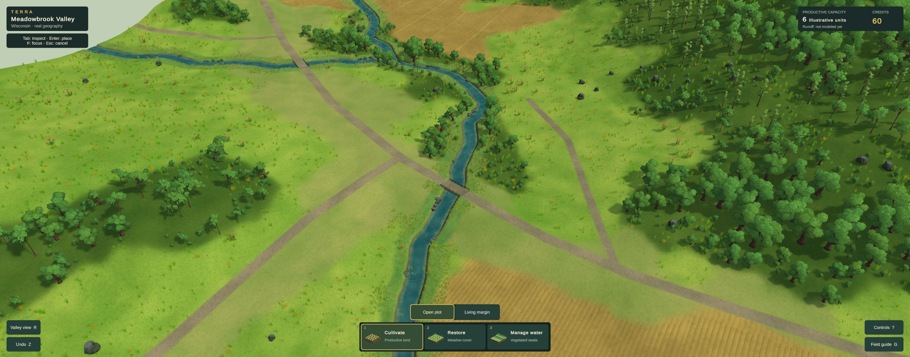
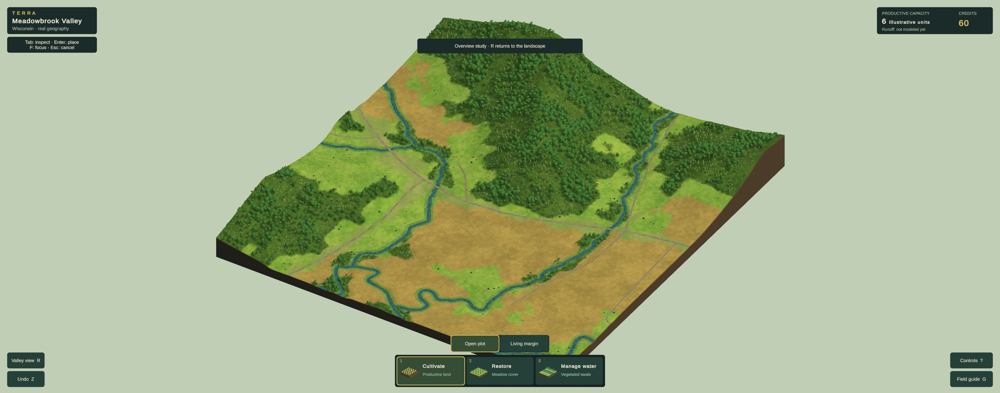

# Current visual review — Phase 2A remains open

**Latest illustrated candidate: study22, October 24, 2026. Canopy forms and woodland hierarchy improved; visual acceptance remains open. One performance route meets the stable-30 fallback; the full suite is pending. Not an accepted art direction.** The [persistent design reference](DESIGN_REFERENCE.md), [visual goal](PHASE_2A_GOAL.md), and [study ledger](evidence/phase2a/visual-rebuild/README.md) govern this comparison. Refresh this page with actual Chrome output as the candidate changes; retain historical captures in the ledger.

## Current game: normal play

Chrome, 3440×1352 CSS/render buffer, same Meadowbrook Valley AOI. Four artist-authored tree models replace the repeated crown family. Source leaf textures remain unchanged; volume-based leaf normals avoid the dark flat-card appearance. Smaller woodland edges, mature interior trees and broad clearings create a clearer hierarchy. Existing planted banks remain. Broad meadow surfaces and thin upper-right tree cohorts still weaken the image. The current HUD/accounting remains the earlier placement slice; the annual-gameplay roadmap is not implemented by this visual work.

## Primary comparison: Terra Nil

[Free Lives official image](https://freelives.net/uploads/2024/04/Terra-Nil-Screen-3.webp), 1920×1080. Compare displayed-size material richness, planted-bank masses, ground contrast, contact and light. This is a different scene, camera and landform construction, not a pixel-matched scientific comparison or a requirement to invent stepped Wisconsin terrain. Its authorship and assets remain with the reference game.

[Free Lives official canopy image](https://freelives.net/uploads/2024/04/Terra-Nil-Screen-2.webp). Compare foliage mass, rich leaf silhouettes, edge layering and separation of materials. Tropical plants and the reference’s stylized terrain are not a Wisconsin species or geometry specification.

## Whole-location consistency

Distinct canopy cohorts and low edge growth now extend across the location. The distant field surface represents crops as individual stalks become subpixel. Evaluate the zoom transition as well as this still; better frame time does not excuse a visible loss of quality.

## Gaps that keep the gate open

| Dimension | Current assessment / next concrete test |
|---|---|
| Composition, scale and depth | Closer creek opening is more useful; empty ground, overly large repeated forms and overview slab still weaken the scene. |
| Vegetation and environmental forms | Four branching forms and a low edge layer improve the canopy. Thin-tree stands remain sparse; broadleaf cohorts can still read as repeated clusters. |
| Ground, fields, water and transitions | Surface art and water improved; road union fixes intersection seams. Cultivation still reads as mechanical rows and treatment boundaries remain schematic. |
| Lighting, color and atmosphere | Shorter, lighter shadows improve readability. Similar greens and broad smooth ground still weaken separation and richness. |
| Intervention appearance and transformation | The current treatments work, but conspicuous rectangular edges and inconsistent surface detail remain. Future annual lifecycle visuals need the same standard. |
| Whole-scene consistency | Close/wide representation is under evaluation. Required layouts, matched reviews, motion video and full delivery checks remain incomplete. |

**No dimension is certified at the required 4.5/5.** No formal acceptance review, current public release or reference-parity claim follows from these studies. Use TN-02/09/10/11/12 when taking the next visual pass; use Cities: Skylines patterns for information design as the annual gameplay is built.

Study22 is isolated on `codex/visual-study20`; [worktree/integration handoff](VISUAL_WORK_HANDOFF.md). Restore/undo passed; no error-level messages returned. The30s moving/placement diagnostic p95=18ms,p99=18ms,max26ms,zero frames>33ms meets the stable-30 fallback for this route only. It does not certify the full three-route suite or imply a controlled speedup over21d. Next: substantially different ground/field surfaces and planting masses. No public deployment or annual-gameplay implementation is claimed.
