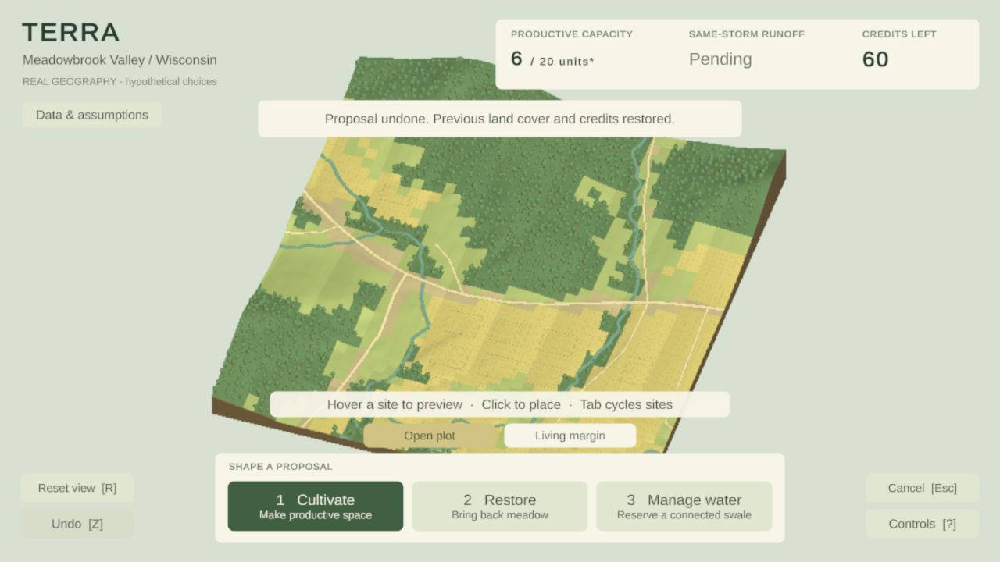
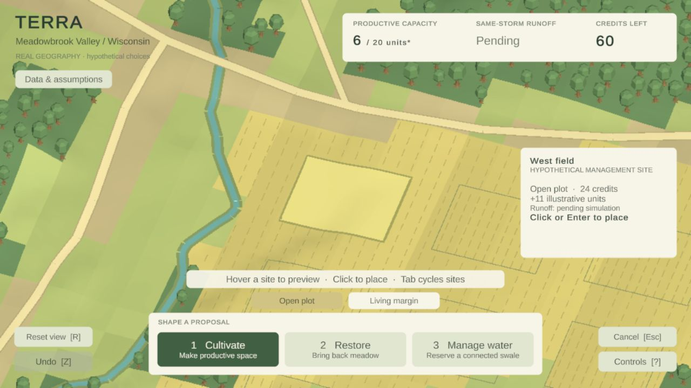

# Terra design reference — Terra Nil and Cities: Skylines

> **Active visual reset — October 24, 2026:** The user rejected the prototype's visual quality and the UX-heavy incremental approach. Read [the rewritten Phase 2A goal](PHASE_2A_GOAL.md) and [VISUAL_REBUILD.md](VISUAL_REBUILD.md) first. This library remains the source reference; earlier Terra screenshots are rejected/historical comparisons. Prioritize the rendered landscape, materials, foliage, lighting and transformations. No current implementation is protected merely because it exists.


**Project-wide reference · researched October 24, 2026 · revision 2 — visual rebuild**

**Latest asset direction:** the user rejected overreliance on generated images. No further generation in the current pass. Compare established, coherent asset families with their intended shaders and demo setups, then judge our actual complete scene. The generated canopy studies and their camera compromises remain unaccepted and replaceable. See [resource evaluation](VISUAL_REBUILD.md#resource-register).

**Use Terra Nil as the primary reference for how Terra looks and feels. Use Cities: Skylines selectively for how a spatial decision is explained.** The target is a beautifully composed, responsive rural landscape game whose interface makes choices understandable without dominating the landscape.

This is the reusable reference for all player-facing work, not a record of implemented quality. [The project spec](../TERRA_PROJECT_SPEC.md) remains the product authority. [The art contract](art-direction.md) records the implemented system. [Phase 2A](PHASE_2A_GOAL.md) establishes the new standard before Phase 3; later phases must retain it. [The evidence ledger](PHASE_STATUS.md) records actual verification.

## Find the relevant reference quickly

| Working on… | Read / compare | Terra rule |
|---|---|---|
| Landscape, lighting, camera, vegetation | [Visual references](#visual-reference-board), [new visual studies](VISUAL_REBUILD.md), TN-01, TN-02, TN-09–12 | The world is the reward; compose wide and close views together |
| HUD, metrics, tool dock, icons | TN-03, TN-04, CS-01 | A few clear choices; stable locations; readable labels and values |
| Hover, placement, rejection, undo | TN-05, CS-02, CS-03 | Show where, what, cost, and consequence before commitment |
| Help, source information, onboarding | TN-06, CS-04 | Brief guidance in context, deeper explanation on request |
| Motion, audio, completion | TN-07, TN-08 | Quiet feedback, visible transformation, space to appreciate |
| Scaling, contrast, keyboard controls | AX-01, CS-05 | Verify actual browser output, including increased text size |
| Any new screen or mechanic | [Carry-forward review](#carry-forward-review-for-every-phase) | Attach the relevant pattern IDs and actual browser evidence |

## Research scope and confidence

This is comparative desk research, visual inspection, and an audit of Terra's saved browser captures and current source. Neither reference game was installed or playtested for this task. No exact animation timings, measured usability scores, or current-version feature completeness are inferred from screenshots.

- **Terra Nil:** official product material and March 2023 publisher tutorial; inspected desktop HUD and title-screen captures from WSGF's **GOG 1.0.1**, dated May 2023. The official tutorial was sampled visually at **0:15, 0:31, and 0:47**, not watched in full. These are versioned design references, not a claim that every pixel remains unchanged today. The current store page also lists later updates; those additions are not a reason to expand Terra's scope.
- **Cities: Skylines (original):** the publisher's original PC manual, especially printed pages **8–10** (PDF pages 9–11), for interface organization, advisor, and information views. The interface diagram was rendered and visually inspected. Do not apply its historical key bindings to Terra.
- **Cities: Skylines II:** January 29 and February 12, 2026 official development articles, including an inspected proposed toolbar/progression screenshot. These are dated announcements; this research does not establish which proposed features shipped later.
- **Evidence labels below:** **Observed** means visible in inspected imagery; **Documented** means stated by the cited source; **Terra application** is our design recommendation. Recommendations are not claims about the references or completed Terra behavior.

## Visual reference board

### V1 — Terra Nil: desktop play, GOG 1.0.1


[Open full reference](https://www.wsgf.org/f/u/contrib/dr/30168/ingame_16x9.png) · [Capture context and version, Rose / WSGF](https://www.wsgf.org/dr/terra-nil/en).

**Observed:** dark blue status/tool surfaces sit against vivid greens; a circular percentage and adjacent currency occupy a corner. Illustrated tools carry small cost badges. Terrain edges, grass texture, water, shadows, and a bright local selection separate different visual scales. The middle remains largely scenery. This is the principal HUD/world comparison frame.

### V2 — Terra Nil: illustrated explanation and spatial context

[Official Beginner's Guide video](https://www.youtube.com/watch?v=nui_kUMr_dU) · [0:31 illustrated explanation](https://www.youtube.com/watch?v=nui_kUMr_dU&t=31s) · [0:47 spatial connection view](https://www.youtube.com/watch?v=nui_kUMr_dU&t=47s).

**Observed:** at 0:31 a light illustrated reference page sits beside the relevant world example; at 0:47 thin bright links appear over the landscape. The publisher describes the handbook as an illustrated in-game guide. These sampled frames support the contrast between quiet play UI and richer explanatory material; they do not establish all tooltip rules or transition timing.

### V3 — Cities: Skylines: original desktop organization

[Official manual — interface diagram, printed p.8 / PDF p.9](https://cdn.akamai.steamstatic.com/steam/apps/255710/manuals/CitiesSkylines-UserManual_EN.pdf#page=9).

**Observed:** the city fills the screen above a narrow bottom service/status strip; information tools occupy predictable edge positions. **Documented:** the advisor explains the active tool, and information views change how relevant city information appears. Use the manual's following two pages for those descriptions. This is an information-architecture reference, not Terra's visual style target.

### V4 — Cities: Skylines II: proposed 2026 toolbar and progression panel


[Official January 29 article and image context](https://www.paradoxinteractive.com/games/cities-skylines-ii/news/upcoming-visual-updates).

**Observed:** colorful pictorial categories, a selected category, tabs, a detail pane, and a conspicuous close control establish hierarchy within a dense interface. **Documented:** the team sought clearer icons and onboarding and emphasized demand bars. Our takeaway is to identify important information deliberately, not to import this amount of UI into Terra.

### V5 — Terra: known comparison baseline, not current final acceptance





These are the **initial local Phase 2 export at 1280×720**, not the finished Phase 2 build. [Capture and performance context](evidence/phase2/iteration/README.md) records known fixes already planned after these images. Phase 2A must capture the final Phase 2 build before declaring which gaps remain. Do not overwrite these historical files.

External images remain linked references with attribution, outside the game's asset/build directories. If a remote image stops rendering, use its source page; replace a reference only after inspecting the replacement and recording its version/date. Create Terra's own icons, illustrations, materials, and audio. Reference artwork is not an implementation asset.

## Terra Nil pattern library

### TN-01 — Make the landscape carry the emotional experience

**Documented:** the official product description emphasizes hand-painted environments, ambient sound, tranquil music, and a mode for appreciating the result. [Official store description](https://store.steampowered.com/app/1593030/Terra_Nil/).

**Terra application:** the first frame should invite exploration before the player reads instructions. Frame the valley so terrain relief, cultivated space, woodland, and mapped water make a deliberate composition. Give the scene a foreground, middle distance, and background through camera, lighting, scale, and occlusion. Keep the same authored location recognizable after every treatment.

**Avoid:** an attractive menu in front of an unfinished world, or a scenic screenshot that only works with the game controls hidden. Preserve actual terrain and mapped feature positions; achieve depth through rendering rather than invented cliffs or exaggerated topography.

**Review:** compare V1 with wide and close Terra browser frames. Is the main visual subject the land? Does the scene retain depth and cover identity when reduced to thumbnail size?

### TN-02 — Organize detail into readable masses

**Observed:** V1's bright ground, dark terrain sides, blue water, vegetation, and machine silhouettes remain distinct despite small surface details.

**Terra application:** compose broad cover groups first, clusters second, individual plants last. Woodland should read as canopy groups with intentional gaps, not a uniform scattering of tiny cones. Cultivation needs coherent row rhythm and a visibly different living margin. Grass restoration needs a distinct ground/plant treatment at ordinary play zoom. Manage Water needs a readable footprint without becoming a decorative bright-blue river.

Use subtle material variation within each cover class. Presentation may soften the appearance of coarse source pixels, but analytical boundaries, mapped lines, source resolution, and authored site geometry remain unchanged. Decorative detail must not masquerade as finer observed data.

**Review:** inspect normal zoom, focused site, camera motion, and undo. Reject noisy repetition, floating plants, visible seams, dark unreadable shadow masses, and effects that hide the treatment boundary.

### TN-03 — Small, visually strong HUD groups

**Observed:** V1 uses localized dark surfaces and bold status values; scenery remains continuous between them.

**Terra application:** use a compact location identity, one measures group, one bottom tool group, and one contextual preview. Prototype a deep forest/ink HUD against the valley, retaining warm paper for explanations. This is a proposed Terra direction, not an assertion that Terra Nil uses our palette. Do not merely recolor today's large panels.

Keep budget and current illustrative production visible. Until Phase 4, show runoff as unavailable in neutral language without an invented zero or an ecological success color. Phase 5 may add goal targets; a circular global restoration percentage would falsely collapse Terra's competing objectives into one ecological score.

**Review:** the eye should find the selected tool, available credits, and the affected site without reading several competing banners. At rest, a large uninterrupted region of land must remain visible.

### TN-04 — Tool illustrations connect the menu to the world

**Observed:** V1 pairs recognizable miniature tool images with prices.

**Terra application:** give Cultivate, Restore, and Manage Water original, consistent miniature illustrations based on their actual in-world treatments. Retain visible text labels and shortcut hints. The two cultivation variants share a family and appear only with Cultivate. Show exact contextual cost in preview; a dock price must be clearly a base price or range if replacement/refund/site state affects it.

**Avoid:** emoji, stock icons with mixed perspective, icon-only novice controls, or a large multi-row catalogue. Three choices are enough. A locked-looking control must say why it is unavailable; an unimplemented later feature should not look actionable.

### TN-05 — Help the player anticipate the transformation

**Terra application, informed by V1/V2:** make the proposal boundary and expected appearance visible before click. Keep the site's identity, treatment, credit change, production change, and availability reason beside that preview in a stable card. A ghost must read as proposed; the committed landscape must read as settled.

Use separate states for hover, keyboard focus, selected tool, valid preview, blocked preview, and committed proposal. Do not let a red rejection and a successful but mixed trade-off share a visual treatment. Put the cause of rejection first: protected learning zone, incompatible treatment, or insufficient credits. Offer an immediate recovery action using existing controls.

The current transaction path remains authoritative. Preview, commit, displayed deltas, interrupted animation, and undo must agree. A flourish is never allowed to spend credits twice or delay control recovery. This reliability requirement belongs to Terra; it is not an untested claim about Terra Nil's history system.

### TN-06 — A field guide, not a wall of disclosure text

**Documented:** Terra Nil's publisher presents a handbook that teaches reclamation with illustrations. [Official guide](https://www.youtube.com/watch?v=nui_kUMr_dU).

**Terra application:** make help and Data & Assumptions a small, consistent field-guide surface: a short heading, a simple diagram or labelled example when helpful, short explanatory sections, and a clear return to the landscape. Keep “real geography / hypothetical choices / modeled estimates” distinct. Exact source dates, bounds, and limitations remain available in detail.

Do not build a full encyclopedia, search engine, collectible journal, or elaborate page-turn system. Two well-designed information pages can serve the present slice. Phase 5 expands contextual onboarding; Phase 6 adds learning, without changing the visual grammar.

### TN-07 — Quiet responsiveness and sensory feedback

**Documented:** tranquility, music, and atmosphere are explicit product goals in the official description. The developer interview also describes early player feedback as central to development. [Store](https://store.steampowered.com/app/1593030/Terra_Nil/), [Free Lives producer interview, September 2022](https://gameworldobserver.com/2022/09/30/terra-nil-free-lives-interview-reverse-city-builder-studio-ghibli).

**Terra application:** one subtle hover/focus response, a short placement cue, a restrained establishment reveal, and a quiet ambient bed should make actions feel intentional. Silence and reduced motion must preserve every piece of meaning. No sound on every hovered site, celebratory reward for every numeric increase, forced camera travel, or blocking grow animation.

Tune timing in the real browser. Initial Terra targets are 150–220 ms UI transitions and 350–650 ms placement reveals; these are design starting points, not measured Terra Nil timings. Inputs and state commit immediately, with visual feedback inside the latency budget.

### TN-08 — Let the player value the result

**Documented:** Terra Nil's described progression moves toward a finished environment rather than unlimited expansion; its Appreciate mode allows viewing the result. Lead designer Sam Alfred's GDC session abstract also emphasizes balance. [Official store](https://store.steampowered.com/app/1593030/Terra_Nil/), [GDC 2023 session abstract](https://www.gdcvault.com/play/1029027/Developing-Terra-Nil-A-Strategy).

**Terra application:** later comparison/ending screens should preserve the same recognizable valley and make its changes legible before presenting educational copy. Continue Building returns smoothly to the player's design. Do not import recycling/departure mechanics: Terra includes livelihoods and productive land, so removing all human activity is not the win condition. Do not depict the real valley as a lifeless wasteland to imitate the reference's dramatic opening.

## Cities: Skylines pattern library

### CS-01 — Stable categories and progressive detail

**Documented/observed:** the original manual places city services in a fixed toolbar, with detail available through panels. [Original manual, pp.8–10](https://cdn.akamai.steamstatic.com/steam/apps/255710/manuals/CitiesSkylines-UserManual_EN.pdf#page=9).

**Terra application:** keep the three intervention families in stable positions. Reveal variant choices within the selected family; reveal site details only for the selected/hovered site. A new gameplay feature must fit the established hierarchy rather than creating another permanent floating window.

**Avoid:** copying the original game's service count, bottom economic ticker, time controls, demand bars, zoning categories, or broad city-management scope.

### CS-02 — Put relevant information onto the land

**Documented:** information views alter the map presentation to expose relevant city conditions. [Original manual, p.10 / PDF p.11](https://cdn.akamai.steamstatic.com/steam/apps/255710/manuals/CitiesSkylines-UserManual_EN.pdf#page=11).

**Terra application:** when a treatment is selected, emphasize eligible sites and explain one blocked site on inspection. Any diagnostic view needs a title, legend, explicit exit, and a return to the normal landscape. Phase 2A only exposes facts already available, such as eligible/protected sites. Connection/runoff overlays wait for Phase 4's actual results and documented assumptions. Never derive a flood map from an aggregate volume.

**Review:** a player should be able to answer “where can this go?” using the map, and “why here?” using the same local explanation. Persistent rainbow shading fails the calm default-view goal.

### CS-03 — Separate a world object from the tool acting on it

**Terra application:** keep “selected site” distinct from “active treatment.” A selected proposal can stay identifiable when a player closes its details, cancels placement, or moves the camera. Phase 3 adds move/remove/replace/history through this same selection language. Phase 2A styles the existing selection and undo, without implementing the entire editor early.

The original manual's tool and panel organization is a structural precedent, not proof that its editing semantics match Terra's. Define Terra's interactions explicitly and verify them.

### CS-04 — Explain a tool where it is used

**Documented:** the original game's advisor provides active-tool information and tips. [Original manual, p.9 / PDF p.10](https://cdn.akamai.steamstatic.com/steam/apps/255710/manuals/CitiesSkylines-UserManual_EN.pdf#page=10).

**Terra application:** one short contextual instruction replaces the current always-visible combination of hint strip, variant strip, toast, and help buttons competing for attention. The player can reopen full controls. Later mission hints should teach the next gesture, not dictate a complete solution. Avoid Chirper-like streams and repeated notifications.

### CS-05 — Established games also need clarity corrections

**Documented:** January 2026's sequel article proposes clearer onboarding/icons and a toolbar makeover; February's follow-up describes player requests to retain the old UI and a planned legacy option. [January article](https://www.paradoxinteractive.com/games/cities-skylines-ii/news/upcoming-visual-updates), [February follow-up](https://www.paradoxinteractive.com/games/cities-skylines-ii/news/upcoming-gameplay-updates).

**Terra application:** visual novelty is not evidence of improvement. Compare task completion, information density, and readability before and after a redesign. Preserve stable meanings and familiar positions where possible. Adopt useful hierarchy from V4, not its huge modal, category density, or blue metropolitan aesthetic. Do not build a legacy-theme system for this prototype.

## Accessibility and browser adaptation

### AX-01 — Measure what the browser actually displays

**Documented:** WSGF's version-specific test reports UI scaling and problems with information spreading toward distant screen edges. [Terra Nil 1.0.1 report](https://www.wsgf.org/dr/terra-nil/en). **Terra application:** bound the content area on wide screens and verify layout at 1280×720, 1440×900, and 1920×1080. Include 125% browser zoom and a larger-text option; shrinking text to rescue a crowded layout is not an acceptable fix.

Terra's proposed minimums: body text around 16 effective CSS px, primary controls at least 44×44 effective CSS px, essential small labels at least 14 px, and no critical instruction encoded only by hue, sound, hover, or motion. Use 4.5:1 text contrast and 3:1 meaningful control/state contrast as engineering checks, with backing surfaces where moving scenery would undermine contrast. W3C defines the underlying contrast thresholds; its AA target-size minimum is 24×24 CSS px with exceptions, so **44×44 is our more generous product target**, not a quotation of that minimum. [Text contrast](https://www.w3.org/WAI/WCAG22/Understanding/contrast-minimum.html), [non-text contrast](https://www.w3.org/WAI/WCAG22/Understanding/non-text-contrast.html), [target size](https://www.w3.org/WAI/WCAG22/Understanding/target-size-minimum.html).

Keyboard focus must be visible, modal focus must stay within the modal, and closing it must restore a useful focus. Preserve site cycling and keyboard commitment without colliding with menu traversal. Camera gestures must never place accidentally. These checks do not constitute full WCAG or screen-reader conformance for a Unity canvas; record actual support and limitations honestly.

## Direct visual patterns added for the rebuild

### TN-09 — Surface art must survive a close view

**Observed:** the [official restored-bank frame](https://freelives.net/uploads/2024/04/Terra-Nil-Screen-3.webp) separates cracked barren ground, softened treated soil, green growth and rock with distinct surface marks. Detail follows the material rather than applying the same noise everywhere.

**Terra application:** compose field rhythms, meadow growth and woodland floor as different surfaces. Judge both small-scale massing and close material richness. A flat fill plus a tint/noise pass is insufficient. Painted textures, geometry, shaders and blended layers are available means, not mandated techniques.

### TN-10 — Foliage needs layered silhouettes and internal structure

**Observed:** the [official tropical frame](https://freelives.net/uploads/2024/04/Terra-Nil-Screen-2.webp) has overlapping crowns, distinct edge plants, internal light/dark clusters, occasional trunks and restrained color accents. Astrid Bruce documents [painted textures and Unity-ready willow assets](https://astridbruce.artstation.com/projects/zPEND2).

**Terra application:** rebuild a coherent rural foliage family; vary crown shape, height, clearings and edge density. Do not copy tropical species or claim surveyed tree positions. Reject a stock-mesh carpet even if its polygon count is high.

### TN-11 — Water is a layered landscape feature

**Observed:** the tropical frame distinguishes water color/depth, submerged detail, shore contact and bright edge motion. The restored-bank frame uses irregular banks and planted edges around narrower channels.

**Terra application:** develop a Wisconsin-scale stream with bed, bank, surface, vegetation contact and restrained movement. Keep the mapped route and disclose illustrative widths/depths. Do not paste a blue ribbon over the ground and call it finished, or imply a hydrological simulation from attractive water.

### TN-12 — Compose light and scale before adding detail

**Observed:** the [desktop temperate frame](https://www.wsgf.org/f/u/contrib/dr/30168/ingame_16x9.png) separates bright ground, darker canopy masses, side faces and local highlights. Important environmental forms remain large enough to read.

**Terra application:** test a closer valley composition and an authored overview. Tune camera, silhouette, warm/cool relationships, contact shadow and ambient depth together. A muted palette, distant whole-map view or empty surround is not sacred. Review during movement and with the HUD present; grading alone cannot repair weak forms.

## Historical initial Terra gap assessment

**Superseded as the active priority list by the user's visual reset.** Use [the visual rebuild goal](PHASE_2A_GOAL.md) and [its dominant visual failures](PHASE_2A_GOAL.md#why-the-previous-approach-failed). The table below records the earlier UX-heavy audit, not the current work order.


This audit uses V5 plus `TerraHud.cs`, `TerraMain.cs`, and `LandscapeRenderer.cs` as read on October 24. It is a prioritized starting hypothesis; Phase 2 work is still in progress.

| Gap | Evidence / consequence | Phase 2A response | Priority |
|---|---|---|---|
| Interface competes with land | Wide capture has a 620×91 measures panel, 730×116 dock, separate variant/hint strips and dispersed utility buttons | Recompose into fewer aligned groups; reclaim the middle and bottom edge | High |
| Soft, low-separation scene | Initial wide frame appears washed out; small repeated plants read as texture rather than authored canopy; capture notes identify 0.8 render scale and shadow issues | Recheck Phase 2 fixes first, then improve value hierarchy, plant grouping and crispness | High |
| Tool identity relies on text blocks | Current three cards lack pictorial treatment cues | Original coherent tool art, visible labels, strong selected/focus states | High |
| Preview is a text box | Fixed 290×205 panel mixes site disclosure, cost, effect, and command | Structured preview rows paired with an unmistakable ghost and local identity | High |
| Meaning and status compete | Production target displayed while mission work is future; runoff is Pending; recurring toast spans the upper scene | Truthful phase-aware metrics, one restrained feedback region, no false progress | High |
| Details lack editorial hierarchy | Source/help copy is composed as large TMP text blocks | Short guide sections, illustrated explanation where useful, preserved full provenance | Medium |
| Keyboard/scale edge cases need fresh evidence | Existing shortcuts and reduced-motion toggle are implemented; larger-text and full visible focus path are not established by captures | Explicit focus model, layout checks and browser input regression | High |
| Feel is not proven by still images | Static images cannot verify camera easing, cue mix or interruption behavior | Actual browser interaction video and measured responsiveness | High |

## Carry-forward review for every phase

Before changing player-facing code or assets, read the relevant patterns and inspect the latest accepted Terra capture. During the current reset there is no accepted Phase 2A visual target: compare against Terra Nil and treat prior Terra captures as rejected or historical. In the phase evidence entry record **pattern IDs, intended improvement, actual browser captures, weakest remaining gap, and any deliberate deviation**. A code test alone cannot close a visual issue.

| Phase | Additional design responsibilities |
|---|---|
| 2A | Rebuild direct visual quality from first principles: composition, foliage, ground, water, light and transformations; replace existing implementation as needed; fit UI afterward |
| 3 | Extend those components to move, replace, remove, redo and reset without clutter or input ambiguity |
| 4 | Add truthful runoff/connection information, comparable deltas, legends and causal explanations |
| 5 | Add mission/goal status and progressive onboarding; test comprehension without coaching |
| 6 | Add comparison, learning and Continue Building using the same visual language and preserved camera |
| 7 | Audit the whole experience against the Phase 2A benchmark; it is no longer the first design pass |
| 8 | Verify that the shipped build matches the accepted presentation and truthful product claims |

Keep reference observations here, current design tokens/component decisions in `art-direction.md`, and implementation outcomes in `PHASE_STATUS.md`. Update this reference when new evidence changes an interpretation; include date, source and reason. The spec wins if a borrowed pattern conflicts with rural livelihoods, truthful geography, educational estimates, or the one-location scope.

## Source register

All links were consulted October 24, 2026. Dates below refer to the source or tested version, not an assertion of current UI behavior.

| ID | Source / provenance | Use and limit |
|---|---|---|
| R1 | [Terra Nil official site](https://www.terranil.com/) | Product framing, handbook and visual gallery; marketing, not usability evidence |
| R2 | [Official Steam product description](https://store.steampowered.com/app/1593030/Terra_Nil/) | Atmosphere, restoration loop, appreciation; later update scope deliberately excluded |
| R3 | [Devolver beginner's guide, March 10, 2023](https://www.youtube.com/watch?v=nui_kUMr_dU) | Publisher tutorial; sampled visual frames listed above |
| R4 | [Devolver What the Facts, March 25, 2023](https://www.youtube.com/watch?v=5q-7JW8sKvs) | Publisher description cross-check; video not watched in this task |
| R5 | [Sam Alfred / Free Lives, GDC 2023](https://www.gdcvault.com/play/1029027/Developing-Terra-Nil-A-Strategy) | Session abstract only; no claim to have watched the talk |
| R6 | [Interview with producer Ruan Rothmann, September 30, 2022](https://gameworldobserver.com/2022/09/30/terra-nil-free-lives-interview-reverse-city-builder-studio-ghibli) | First-person development perspective within a reported interview; not a technical spec |
| R7 | [Rose / WSGF, May 10–12, 2023](https://www.wsgf.org/dr/terra-nil/en) | Original captured desktop evidence, GOG 1.0.1; not an official promise for later versions |
| R8 | [Cities: Skylines original publisher manual](https://cdn.akamai.steamstatic.com/steam/apps/255710/manuals/CitiesSkylines-UserManual_EN.pdf) | Historical original-PC interface; pp.8–10, not the sequel |
| R9 | [Cities: Skylines II visual-update diary, January 29, 2026](https://www.paradoxinteractive.com/games/cities-skylines-ii/news/upcoming-visual-updates) | Official proposed redesign and inspected image; shipping status not established |
| R10 | [Cities: Skylines II follow-up, February 12, 2026](https://www.paradoxinteractive.com/games/cities-skylines-ii/news/upcoming-gameplay-updates) | Official account of feedback and intended settings; no causal usability study |
| R12 | [Developer painterly-direction announcement](https://vfqd.itch.io/terra-nil/devlog/188191/the-future-of-terra-nil) | Primary art-direction intent; not a shader specification |
| R13 | [Astrid Bruce willow-tree portfolio](https://astridbruce.artstation.com/projects/zPEND2) | Artist account of painted textures and game-ready Unity vegetation |
| R14 | [Free Lives official press kit](https://freelives.net/terra-nil-press-kit/) | Inspected Screen 1 handbook, Screen 2 tropical environment, Screen 3 restoration/banks, Screen 5 snowy environment; direct visual references, not features to copy into Wisconsin |
| R11 | [W3C text contrast](https://www.w3.org/WAI/WCAG22/Understanding/contrast-minimum.html), [control contrast](https://www.w3.org/WAI/WCAG22/Understanding/non-text-contrast.html), [target sizes](https://www.w3.org/WAI/WCAG22/Understanding/target-size-minimum.html) | Primary accessibility guidance informing selected checks, not a full conformance audit |

## Design review record template

```text
Phase / build / date:
Pattern IDs and reference frames:
State and viewport compared:
Observed gap (not just a score):
Change and player benefit:
Before / after browser evidence:
Input, accessibility, performance and state checks:
Remaining weakness / deliberate deviation:
Human feedback: observed / pending (never inferred from agent review)
```
