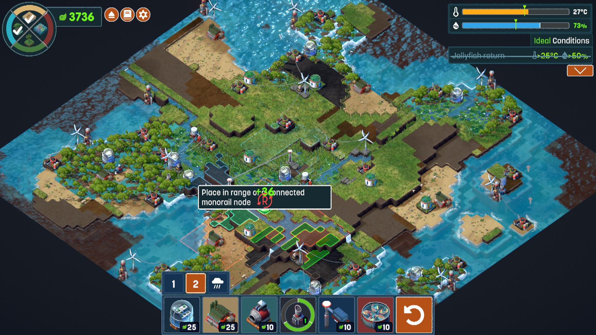
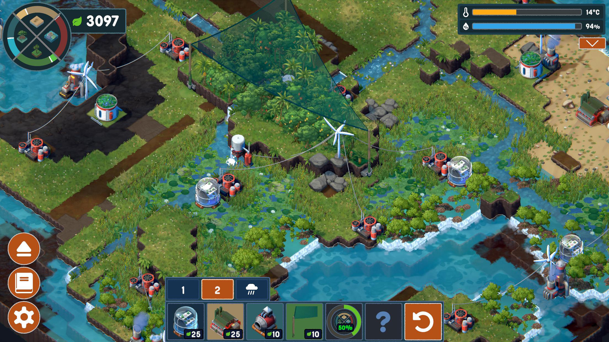

# Placement that reads like a game

**Terra Nil reference study and MyTerrain UI/UX plan · October 25, 2026**

**Scope after the user's clarification:** improve project selection, placement, feedback, visual hierarchy and the feel of the playable world. Preserve existing game rules and annual flow. No new time system, timed transformation sequence, progression system, simulation or mandatory “watch the world respond” segment. Immediate visual acknowledgement of a click is interaction feedback, not a new game mechanic.

[Open the illustrated research board](evidence/ux-reference-2026-10-25/index.html). It pairs direct reference frames with current game captures and a proposed placement layout. The layout is a design schematic, not implemented or accepted game output.

## 1. The diagnosis

The central issue is **legibility of action**. A player needs to know, at the same moment: what tool is active; which ground accepts it; what exactly it occupies or changes; what the click will do; what it costs; and whether the click worked. Attractive panels, correct transactions and more environmental detail do not independently answer that set of questions.

Terra Nil puts most placement information onto the thing being placed. Its toolbar, miniature, world ghost, affected terrain, local numbers and rejection reason describe the same action. Our current HUD has many of those ingredients, but scatters the explanation across a shifting dock, a right inspector, a top budget, broad parcel outlines and a toast. The player must mentally assemble the interaction.

The recommendation is to make **tool → land → footprint → confirmation** a single coherent visual language. This is a presentation and interaction redesign within the existing rules.

### What already exists — preserve and improve it

Audited source: refreshed `origin/main` **061fe5191a5f44acfb1ec232e0924b6a5c49721f**. The original checkout had an unrelated dirty Editor configuration; it was preserved. Work is isolated in `codex/terra-nil-interaction-study`.

The latest integrated play-first HUD evidence is `b4693ac`, not the much older Phase 2 prototype. It already has illustrated priced tools, three categories, available-field highlights, actual reservation/operating facts, queue edits, undo/redo, compact layouts and nonmodal annual highlights. Do not assign a new team to recreate these. [Implementation and evidence](PLAY_FIRST_HUD.md), [integrated captures](evidence/play-first/README.md).

Source inspection confirms:

- `TerraMain.Editing.cs` evaluates available fields with the same rejection path as queueing; budget and accepted-project restrictions already participate.
- `LandscapeRenderer.Highlight` gives available outlines almost the same visual weight as the hovered outline. `Ghost` uses the actual treatment and can replace baseline appearance during preview.
- `TerraHud.PlayFirst.ReflowPlanningDock` shifts the dock and can switch between four and three cards when the inspector appears. This is deliberate collision avoidance, but creates a moving interaction target.
- Pointer release calls the queue command for an active tool; the inspector also exposes Queue/Enter. These are parallel entry points to the same action, not a two-step “click to inspect, then click to place” model.
- `ConfirmEdit` clears the active tool after queueing. That is a reasonable default, but the resulting neutral state needs an obvious presentation.
- A built project occupies a **site slot** for the run, even if its mesh footprint occupies only a small part of the field. Showing a small park without explaining the site reservation is misleading.

These are verified source behaviors. The claim that a novice would be confused is a design diagnosis, not a measured usability result. Existing automated UI checks establish functioning controls and fit; they do not establish that a new player understands them.

### Specific gaps visible in current captures

| Visible problem | Why it hurts play | Change to specify |
|---|---|---|
| Large continuous tan field with cyan site boundaries | The map reads as land with an overlay, rather than understandable opportunities | Compose field edges, access, stream and woodland into readable masses; reveal subdued selectable-site cues only when useful |
| Several bright cyan outlines plus a yellow hover outline | Available, selected and prospective states compete | One dominant hovered footprint; quieter eligible destinations; persistent selection with a different shape/label |
| Preview park appears fully colored and planted | Hover can resemble an already committed change | Consistent proposal material/edge treatment and a local “Preview” label; queued and accepted states separate |
| A 48 × 40 m park sits inside a much larger outlined parcel | Occupied footprint and reserved gameplay slot are conflated | Draw and label both, with unequal emphasis: strong footprint, subdued site reservation |
| Four similar farmland miniatures | Tools differ in text more than visual identity | Keep real model imagery; add consistent crop/rotation/margin motifs and concise purpose text on focus |
| Right inspector lists capacity and abstract resource units | Facts exist, but “why would I place this here?” remains implicit | Lead with plain-language purpose and a supported site-specific trade-off; keep raw detail available |
| Dock moves/reflows when the inspector opens | Selecting and comparing tools changes the spatial layout | Fixed dock anchor and fixed card capacity per viewport; hover must not move controls |
| Identical current/year-end meter rows before action | Duplicated numbers look like unexplained progress/forecast | Display accepted values; show prospective facts only when real and explicitly labelled; avoid visually identical duplicate rows |
| Generic instruction below the tool cards | “Choose an outlined field” says what gesture to make but not what is selected | Name the active tool and action: “Public park · hover a field to preview” |
| Confirmation mainly reported in a top toast | The eye leaves the chosen place to find out if the click worked | Persistent queued mark at the site plus a small local acknowledgement and a visible plan count |

Compare actual captures in the research board; no claim of new gameplay acceptance follows from this audit.

## 2. Reference method and limits

The three user-supplied Terra Nil screenshots are **U1–U3**. Their capture version and exact video timestamps are unknown; do not pretend they came from the linked video. The linked video is Aliensrock's *Clever Strategy Game Where YOU Terraform A Barren Planet! – Terra Nil*, duration 13:20, showing the player's first game on Environmental Engineer difficulty. It is edited play, not a novice usability test or a current-version specification. Use only explicitly logged inspected timestamps below.

Reference imagery belongs to Free Lives / Devolver Digital and the relevant video creator. Reproductions here are small contextual research excerpts, outside `Assets/` and all game exports. They are not licensed production textures, icons or UI components. The official [press kit](https://freelives.net/terra-nil-press-kit/) corroborates authorship and supplies the broader visual context; the [official store description](https://store.steampowered.com/app/1593030/Terra_Nil/) describes the restoration premise. Neither proves an interaction we did not observe.

The refreshed repository also contains a newer three-location/MyTerrain direction, while this chat's supplied project instructions focus on one location. This study uses Wisconsin only and makes no location-scope change. It preserves the implemented atlas, naming and saves without authorizing expansion.

## 3. Direct screenshot reference analysis

### U1 — Placement explains itself at the point of action

**Observed:** recognizable bottom miniatures with prices; an orange selected tab; a local boxed instruction about a connected monorail node; a green number close to the placement; green/orange/cyan boundaries over the affected land; compact corner meters. We can see the existence of multiple spatial encodings, but cannot establish every color's semantics from this still alone. The local text overlaps the number: do not copy that flaw.

**Borrow (TN-03/04/05, CS-02):** the proposed object and its constraints form a single visual focus. Our local capsule should identify the project, validity and exact reservation effect; our footprint must identify occupied ground. Keep benefit/trade-off details in the fixed inspector. Use only existing eligibility/connection facts.

**Do not borrow:** monorails, recycling networks, a universal green reward number, tropical geography, arbitrary radial service areas, or Terra Nil's resource economy. The green number is not evidence that our USD budget should behave that way.

### U2 — The world remains readable with the UI present

**Observed:** water, banks, tree crowns, palms, undergrowth and flowers form distinct masses at the ordinary gameplay scale. The small illustrated bottom palette is subordinate to the landscape. Bright birds contrast against deeper green background shapes; scenery has broad value structure before tiny detail.

**Borrow (TN-01/02/09/10/11/12):** clear surface identities, grounded objects, readable edges and deliberately framed landmarks. Our field/creek/woodland/bridge should make the place orientable. The same zoom must permit placement and appreciation.

**Do not borrow:** wildlife AI, animated flocks, new weather, tropical species or a camera restricted to hiding weak assets. “More game-like” can be achieved through static composition and consistent visual affordances.

### U3 — Shape and connection communicate more than a panel

**Observed:** a translucent bounded region lies over the forest; thin lines connect machinery; normal terrain remains visible under the overlay; cost badges and the selected toolbar tier remain legible. This still does not establish that the blue polygon is a build footprint rather than another tool's range. Use it as evidence of readable spatial overlays, not as a literal placement implementation specification.

**Borrow (TN-05, CS-02):** show the geometry relevant to the selected action. Clearly distinguish *site slot*, *occupied footprint*, *whole-field treatment* and *existing modeled connection*. A local legend can name the active overlay.

**Do not borrow:** a generic blue polygon for every action, invented reach, or a grid that suggests free placement when the engine chooses fixed sites.

## 3A. Timestamped video study

Inspected **17 paused samples** spanning 00:10–12:00, with denser sampling of the opening placements. This is a visual study of edited footage, not a claim to have watched every second or heard the commentary. [Full observation log](evidence/ux-reference-2026-10-25/video-observations.json). Enlarged HUD inserts and held explanations may be video edits; they are not evidence of native size or tooltip persistence.

| Time | Direct observation | Transfer to MyTerrain |
|---|---|---|
| [00:10](https://www.youtube.com/watch?v=O4kOC6Ih0CA&t=10s) | Bright turbine ghost on highlighted rock; illustrated tool panel pairs output and required surface. | Match icon, ghost and eligible ground; requirements should be visible before a click. |
| [00:15](https://www.youtube.com/watch?v=O4kOC6Ih0CA&t=15s) | Toxin scrubber explanation is anchored to its toolbar card; illustration, outputs, requirements, handbook and close controls are visible. | Tool-focus explanation should explain purpose and constraints; do not copy its large size. |
| [00:25](https://www.youtube.com/watch?v=O4kOC6Ih0CA&t=25s) | Green scrubber candidate, affected ground, blue turbine region, connecting line and local 2/6 electricity badge appear together. | Separate occupied footprint from relevant context; show actual existing connections only. |
| [00:30](https://www.youtube.com/watch?v=O4kOC6Ih0CA&t=30s) | Irrigator candidate, outlined affected terrain, rotation affordance and +116 local number. Enlarged/held explanation is also visible in the edited video. | Keep candidate-specific information beside the candidate. Do not import rotation or resource rewards. |
| [00:35](https://www.youtube.com/watch?v=O4kOC6Ih0CA&t=35s) | Placed irrigator and a patch of new greenery; particles and spray are visible; resource display differs from preview. | Preview and committed appearance should differ. Timed spread/particles are explicitly outside this proposal. |
| [00:45](https://www.youtube.com/watch?v=O4kOC6Ih0CA&t=45s) | Green land is legible with machine silhouettes; an editorial enlargement emphasizes the resource/progress HUD. | Read settled terrain clearly; never derive native HUD dimensions from the edited insert. |
| [01:00](https://www.youtube.com/watch?v=O4kOC6Ih0CA&t=60s) | Scrubber ghost sits within a colored candidate area; turbine has a local 3/6 badge and a bright connection to the candidate. | Use a clear local relationship rather than requiring panel-to-map inference. |
| [01:05](https://www.youtube.com/watch?v=O4kOC6Ih0CA&t=65s) | Same selected scrubber card remains outlined while its world ghost is red outside the visible blue region. The exact rejection text is not visible in this sampled frame. | Retain tool identity on a blocked target, but improve on color alone with a text reason. |
| [01:10](https://www.youtube.com/watch?v=O4kOC6Ih0CA&t=70s) | Edited close view of an irrigator candidate: green area, holes/edges in contrasting color, rotation hint and local +116. | The affected shape is specific; do not treat this as uninterrupted recovery of the scrubber shown at 01:05. |
| [01:30](https://www.youtube.com/watch?v=O4kOC6Ih0CA&t=90s) | Edited close-up includes a large undo control and bottom tool costs. | Undo is easy to recognize; exact apparent size is editorial, not a layout measurement. |
| [02:00](https://www.youtube.com/watch?v=O4kOC6Ih0CA&t=120s) | Water-pump preview follows the channel shape; illustration includes the terrain context and prerequisite icons. | Use the real spatial domain of an existing action; a swale connection overlay should not be a generic circle. |
| [03:00](https://www.youtube.com/watch?v=O4kOC6Ih0CA&t=180s) | Wide play view has broad treated/untreated land masses, recognizable machines and a compact bottom rail. | Orient the player through terrain and object contrast; no permanent all-map grid. |
| [04:00](https://www.youtube.com/watch?v=O4kOC6Ih0CA&t=240s) | Different tool set and segmented corner goal graphic; beehive explanation pairs miniature, requirement and outcome. | Stable palette structure can hold different tools; no new tiers or goal wheel proposed. |
| [06:00](https://www.youtube.com/watch?v=O4kOC6Ih0CA&t=360s) | Large fire effect over terrain and machines. | Explicitly excluded: no fire propagation or timed-world response work. |
| [08:00](https://www.youtube.com/watch?v=O4kOC6Ih0CA&t=480s) | Illustrated handbook page explains a new stage using a paired symbol and short passage. | Keep help visual and reopenable; no new recycling/animal stage proposed. |
| [10:00](https://www.youtube.com/watch?v=O4kOC6Ih0CA&t=600s) | Blue circular scan region over water and banks; another tool uses another geometry. | Name an overlay's meaning; do not confuse range, occupied footprint and eligible site. |
| [12:00](https://www.youtube.com/watch?v=O4kOC6Ih0CA&t=720s) | Dense final landscape remains readable under corner status, numbered tool tabs and a short bottom palette. | World legibility with HUD present; no wildlife, recycling or time controls added. |

### The useful interaction sequence

The opening samples show a consistent vocabulary: pick a recognizable tool; inspect its requirements; see a candidate tied to suitable terrain; compare its affected area and local facts; see a clearly different placed state. At 01:05, a red invalid ghost retains the selected tool. These observations support persistent tool identity and world-local placement feedback. They do not require a new clock, animated consequences, network mechanic, scoring system or change to our annual model.

There are also weaknesses to avoid: icon-only cost/resource concepts need learning; the 01:05 sampled rejection uses color without visible explanatory text; the user-supplied U1's local text overlaps its number; edited tooltip enlargements are too large to copy literally. Our adaptation should be clearer for novices, not merely resemble the reference's chrome.

## 4. Placement interaction contract

This is the priority implementation contract. It changes the input/presentation layer, not ledger or simulation rules. Pointer, keyboard and inspector buttons use the same validated command.

| State | World | HUD and instruction | Click / Enter | Escape / right click |
|---|---|---|---|---|
| Browse | Normal scenery; hover identifies a site without pretending a project is active | Three category tabs and labelled tools; “Choose a project, then a field” | Select site for inspection; never queue without a tool | Close the highest open surface; otherwise remain in browse |
| Tool selected | Subdued cues at valid sites; hovered site receives strongest focus | Selected card + small active-tool label; “Public park · hover a field to preview” | On a valid site, queue; over no site, do nothing with a useful hint | Cancel the active tool; preserve the existing plan |
| Valid hover | Distinct proposal ghost, occupied footprint, faint reserved-site boundary where relevant | Local “Preview · West field”; exact reservation; fixed concise inspector | “Click to queue” / Enter / inspector Queue all mean the same action | Cancel preview/tool, not earlier proposals |
| Blocked hover | Keep the proposed identity visible; blocked footprint with cross/hatch; no fake valid ghost | One first-cause explanation and recovery; disabled Queue | No mutation; retain reason where attempted | Return to browse or cancel operation |
| Queued | Persistent dashed proposal boundary + small queued pin; accepted scene remains distinguishable | “Queued · Public park”; plan count; Move / Remove / Undo | Select/inspect the proposal; no duplicate submission | Deselect; do not undo implicitly |
| Replace preview | Existing queued action remains identifiable; replacement ghost labelled as prospective | “Replace Park with Homes”; exact net reservation from existing engine | Explicit Replace; selecting a tool alone never replaces | Keep the original proposal intact |
| Moving proposal | Source stays marked; destination previews full validity | “Move Public park · choose destination”; Cancel | Atomically move through existing command | Restore source state, no money change |
| Accepted object | Normal material, clear selection outline only when inspected | Read-only existing project; factual restriction | Inspect; no historical refund | Deselect |
| Camera/UI gesture | Hide or hold preview consistently; do not flash another target while crossing panels | No contradictory action hint | Drag, wheel, panel click and lost-focus release never queue | Predictable cancel/back |

**Keep the current single-click queue model.** Teach it explicitly; do not silently introduce click-to-select followed by click-to-confirm. A novice may use the inspector Queue button; an experienced player may click valid land. Both execute exactly once against the same frozen site/action/revision. Hover must never change the target after a button press begins.

**Start in Browse, with no silently armed farming tool.** A visible optional “Try a project” cue can focus the category rail without committing anything. Do not add a forced tutorial or mandatory first recipe. The player can dismiss the cue and inspect immediately.

**Default to deselecting after queue**, matching current semantics. Keep “Public park queued” visible at the chosen field and return the instruction to “Choose another project or review your plan.” Repeat-placement shortcuts are optional later polish, not required for this scope.

### Local feedback vocabulary

- **Available:** quiet site marker/edge, never as bright as the current footprint.
- **Preview:** distinct pale/teal ghost treatment, dashed edge and the word Preview. Retain enough form to identify the actual asset. Avoid making the entire world transparent.
- **Queued:** a persistent small pin with the matching miniature and a check/plan symbol; dashed ground border. “Queued” remains visible on focus. Do not visually certify it as built.
- **Accepted:** ordinary grounded object/surface; selection outline only on inspection.
- **Blocked:** cross/hatch + short reason, not hue alone. A blocked footprint does not turn every parcel red.
- **Selected:** a clear, stable focus ring and label; distinct from keyboard focus and from valid/invalid status.

No animation is required to communicate any state. Optional existing short cues can reinforce it, with full meaning preserved when muted/reduced motion is on. No new growth/construction playback is proposed.

### Rejection copy that helps the next attempt

| Rule category | Suggested copy template | Recovery |
|---|---|---|
| No site | “Choose one of the marked fields.” | Keep active tool and show eligible count |
| Protected | “This area is protected in this scenario.” | “Show available fields” |
| Footprint does not fit | “This project does not fit this field.” | Highlight the failed footprint boundary only if actual geometry is available; otherwise do not invent a collision map |
| Foundation/slope | “Ground is too uneven for this project.” | Show the actual existing rejection; suggest another marked field |
| Connection | “This field has no modeled swale connection.” | Show existing connected options; no new hydrology |
| Money | “Need $X more available funds, including reserved upkeep.” | Use authoritative preview difference; Budget / choose cheaper project |
| Accepted site | “This field already has an accepted project.” | Inspect it or choose another field; no destructive shortcut |
| Duplicate proposal | “Public park is already queued here.” | Move / Remove / Undo |

Do not return an opaque generic error or bury the first cause underneath recipe statistics. Preserve the detailed explanation on demand.

## 5. HUD composition and visual hierarchy

**At rest:** land is the primary subject. Compact year/funds at top left, compact three outcomes at top right, a fixed bottom project palette and a small number of secondary utilities. Avoid oversized location branding and a second full-width command toolbar competing with tools.

**During placement:** the important triangle is the selected card, the world footprint and the local preview capsule. The fixed inspector supports this triangle; it does not become a new dominant screen. Costs and constraints should be readable without moving the camera or opening a dialog.

### Tool palette

Keep the three existing categories and all current recipes. Use the same illustration as the preview/world asset, with the same lighting/perspective/background treatment. Keep a short readable name and a clearly labelled upfront price. Selection needs a shape/border and a word, not merely a hue change.

At a fixed viewport, the palette's position, card sizes and pagination remain fixed between browse, valid, blocked and inspector states. Use four cards at the standard desktop breakpoint and three at the compact breakpoint from the start, if needed. Do not decide the number of cards based on transient hover. Keep the chosen card visible when switching pages/categories.

On tool hover/focus, show one sentence about its purpose, the total reservation, and what land it accepts. “Park · recreation space; requires upkeep” is more teachable than an isolated abstract-unit count. All specifics come from existing recipe facts; omit unsupported promises.

Land-treatment thumbnails need distinct motifs: rows, planted cover, rotation pattern, margin, meadow, swale. These may be authored from existing models or code-native icons; no new generated raster assets. A tiny field seen from the same angle should not be the only distinction among four choices.

### Inspector: decision first, accounting second

Use a stable approximately 280–310 CSS-pixel-wide region above/right of the dock at desktop size, outside the active placement safe area. The exact final dimensions must be verified at 1280×720 and 125% zoom; this is a layout starting point.

1. **What / where:** “Public park · West field” and **Preview**.
2. **What the click does:** “Queue this site for a park.”
3. **Space:** “Park footprint 48 × 40 m. This project reserves the field's project slot.” Where the current recipe differs, render actual dimensions; whole-field actions say “Treats this field.”
4. **One benefit, one trade-off:** “Recreation capacity” and “Uses land and adds upkeep,” populated from actual action facts. Keep abstract units in details unless essential to compare.
5. **Money:** prominent total reservation, with upfront and ongoing components. Existing timing stays available as a concise fact; it does not become the focus of this redesign.
6. **Action:** Queue / Replace / Move, or a disabled button with the blocking reason above it. Details stays secondary. A close/cancel affordance is visible.

For the inspected park fixture, $50K upfront + $2K/year × 10 = $70K reserved. These are existing authored game assumptions, not real local cost estimates. The local capsule can say “Reserve $70K · Click to queue”; it must not say “Pay $70K now.”

### Budget and outcomes

Show **Available to plan**, not an unqualified cash number. Budget opens cash, existing commitments and queued reservations. A preview can show “Available after queue” only from the existing reservation calculation; show its exact dollar change alongside the current value without mutating it.

Keep three named outcomes, with accepted values. No new composite score, progress wheel or arbitrary target thresholds. A prospective meter overlay is out of this slice unless the current engine already provides that exact, labelled quantity. Do not invent immediate benefits to make placement more exciting.

### One instruction channel

Use one stable line tied to interaction state, with local rejection text taking precedence. Do not stack an onboarding banner, dock hint, tooltip hint and toast explaining the same click. Help is reopenable; detailed sources stay in the existing guide. A short three-part visual card is enough: **Choose a project → Preview a marked field → Click to queue; Undo before End Year.**

## 6. The world should read as playable land

This is not a request for more systems or ornamental clutter. The world needs readable composition at the same scale where decisions happen.

- **Frame opportunities with context.** Opening view contains at least two reachable fields, the creek/bridge and woodland context. Avoid an empty centre with most tools acting below the dock or beyond the screen edge. Do not force camera travel when a tool is selected.
- **Make the visual units coherent.** Crop rows and tonal bands follow the field; meadow is a distinct broad surface with restrained edge planting; woodland is a few strong canopy groups with clearings; creek banks have contact and overlap. Small detail supports those masses.
- **Ground objects.** Metric scale, footprint contact, consistent light direction and modest contact shadows matter more than increasing object count. A park, house and utility should belong to one palette/material family and match their thumbnails.
- **Separate contextual scenery from actionable land.** Quiet normal view; sparse site affordances on hover/selection; tool-specific eligibility only while placing. Do not permanently cover the scene with a planning grid.
- **Preserve geography and rules.** No invented river branches, surveyed parcel claims, shrinking prefabs, free placement, extra land slots, or support networks. The fixed-site model can feel deliberate if the interface makes its boundaries explicit.
- **Do not hide shortcomings with framing.** Normal play, close inspection and overview must all remain useful. The current broader Phase 2A scenery rebuild continues independently; this plan supplies interaction/composition requirements, not replacement assets or certification.

## 7. Delivery plan — bounded, reviewable slices

These are proposed work packages, not authorization to begin runtime work or spawn agents. Use the existing file/resource coordination board and integrate with the current owners. No parallel ledger, replacement simulation or additional scene is needed.

| Order | Deliverable | Reference / existing hook | Evidence needed to accept |
|---|---|---|---|
| **P0 · visual contract** | Annotated static layouts for browse, tool selected, valid hover, blocked hover, queued and replace; state/color/shape legend; exact copy | U1/U3, TN-03/04/05, CS-02/03/04; this board | At normal display size, a reviewer can locate active tool, footprint, reason and next action in each frame |
| **P1 · stable controls** | Fixed dock/inspector geometry per breakpoint; neutral start; clear selected-tool identity; one instruction channel; better tool distinction | `TerraHud.BuildActions`, `AnnualLayout`, `PlayFirst`; TN-04/06, AX-01 | Matched before/after states show no hover-driven movement or hidden active tool; pointer/keyboard routes agree |
| **P2 · map-first placement** | Hierarchical eligible cues; proposal material and exact footprint; reserved-site distinction; local valid/blocked capsule | `TerraMain.Editing.UpdatePreview`, `LandscapeRenderer.Highlight/Ghost`, existing art/eligibility; TN-05, CS-02 | Valid and blocked examples for a building, whole-field treatment and connected swale; no new geometry assumptions |
| **P3 · selection and recovery** | Persistent queued marker, clear browse after queue, local acknowledgement, explicit replacement, predictable cancel/move/undo | Existing QueueAction/MovePlan/History; CS-03, AX-01 | Queue → inspect → cancel → move → replace → undo/redo without accidental submissions; same money/history as baseline |
| **P4 · world presentation** | Opening/close/overview composition, field boundaries and ground/object contrast evaluated with the new HUD | Existing scenery owner; TN-01/02/09–12 | Actual Chrome matched reference/game stills; every actionable footprint visible at ordinary play zoom; scenery gate stays separate |
| **P5 · comprehension review** | Short uncoached placement exercise, issue-ranked observations and final walkthrough | All six states; existing Chrome evidence pattern | See acceptance below; internal checks and human evidence reported separately |

**First complete slice:** one ordinary park, one whole-field farming treatment and one connected swale, using their current definitions. They exercise small footprint versus site slot, surface coverage, and existing connection constraints. Validate the full interaction grammar before styling all remaining variants. Then apply it across all enabled recipes; do not leave the catalog half-consistent.

## 8. Acceptance: prove placement, not just panel fit

### Required engineering and visual checks

1. On arrival, a first-time player sees a clear way to start without an automatically armed tool. Opening guidance can be dismissed/reopened.
2. For each enabled recipe, selection identifies its name, icon, applicable sites and actual money semantics. No unavailable-looking button lacks a reason.
3. A valid hover shows where the object/treatment goes; buildings distinguish occupied footprint from reserved site; field actions show the whole treated area. Connected overlays use actual existing data only.
4. A blocked hover preserves tool identity, identifies the first cause and provides a useful recovery; rejected clicks cannot mutate state.
5. Hovering across land/UI and moving the pointer into Queue cannot retarget a pending press. Drag, wheel, focus loss, repeated click and keyboard activation do not double-queue.
6. Queue/cancel/move/replace/remove/undo/redo preserve the existing ledger and immutable accepted history. Compare state snapshots against the unchanged command behavior; do not reimplement financial math in the UI.
7. At 1280×720, 1440×900, 1920×1080, 125% zoom and larger text, tool/card/inspector bounds remain stable within each viewport. Local capsules clamp away from the cursor, occupied footprint and screen edge. Use a fixed fallback when local room is insufficient.
8. Color-off/sound-off/reduced-motion still communicates every state using labels, outlines and symbols. Maintain visible keyboard focus; essential instructions never rely on hover alone. Existing AX-01 minimums apply; do not shrink text to fit.
9. Preview uses existing ≤100 ms feedback and ≤200 ms placement-stall budgets, measured in Chrome. Avoid rebuilding expensive landscape geometry every pointer pixel or stacking more transparent full-scene overlays. No new performance claim from this plan.
10. Side-by-side normal/close/overview screenshots show coherent world/asset/thumbnail identity and a clear placement focus. No static composition can substitute for actual input checks.

### Uncoached exercise — when a participant is available

Ask the participant to place a park, explain the affected land and reservation, try a blocked field, recover, move the queued proposal and undo it. Give no spoken tutorial beyond the game's own prompts. Record wrong first clicks, accidental queues, help requests, time to first intentional placement, and whether they confuse preview/queued/accepted states.

Proposed small-pilot target: at least 4 of 5 participants complete the first queue within 60 seconds and recover/undo without coaching; none mistakes hovering for a completed purchase. These are **proposed product acceptance targets**, not Terra Nil measurements, statistical validation or achieved results. If human testing remains unavailable, use scripted walkthroughs to find defects and explicitly leave comprehension validation open. Do not turn an internal 4.5/5 score into evidence that the game is understandable.

## 9. What changes in the existing plan

The earlier library is useful for art and general principles, but “compact HUD,” “pictorial tools,” and “highlight eligible sites” are no longer sufficient work items: much of that already exists. Future tasks should name the interaction state and evidence pair they will improve.

- Extend TN-05 with the explicit placement-state contract and footprint/site-slot distinction above.
- Extend TN-03/04 with fixed control geometry and selected-tool continuity, not just a smaller navy HUD.
- Review P1–P3 as one placement experience, even if owners implement the files separately.
- Feed P4's world-readability requirements to the existing scenery work; retain Phase 2A's independent visual bar.
- Leave annual rules, weather, narration, consequences, timing, ending and replay outside this request. Their separate work does not establish that placement is clear.

**Requested outcome:** the existing game becomes easier and more satisfying to operate before adding more mechanics. A player should understand the next click by looking at the land and the selected tool.
