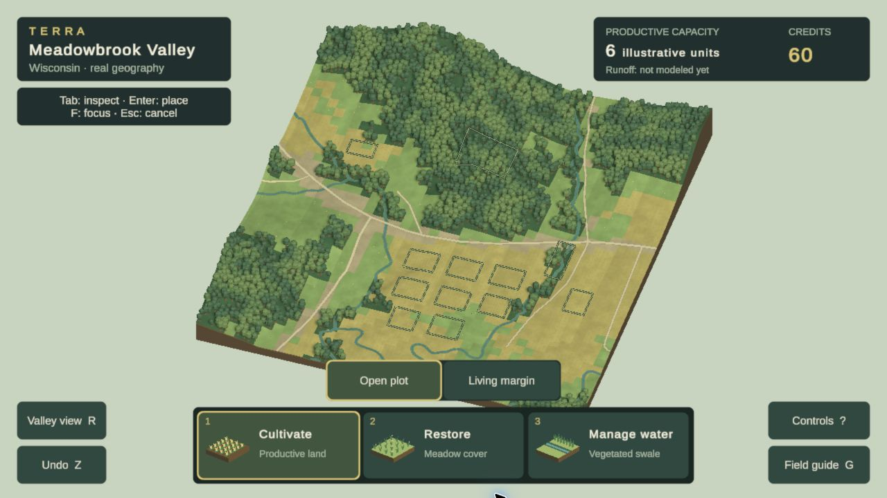
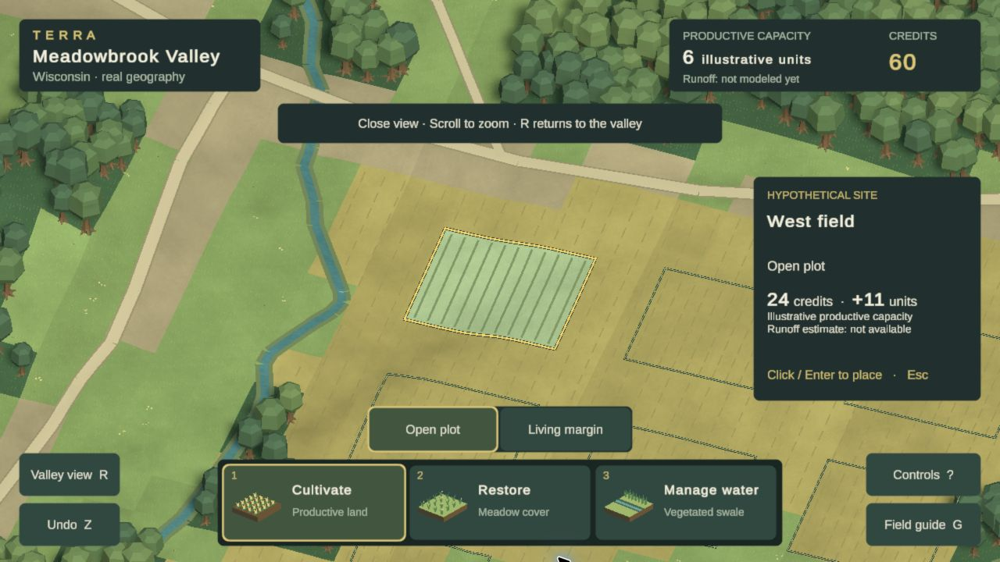

# Terra visual rebuild — target, experiments, and resources

**Active direction, October 24, 2026.** Read the [rewritten Phase 2A goal](PHASE_2A_GOAL.md). The user rejected the current appearance and authorized replacing existing work. This document guides the rebuild; it does not claim that the target has been implemented.

**User correction: established assets first.** Stop generating images for this pass. The generated canopy/understory route consumed effort without proving whole-scene quality and exposed flat-card limitations. Its fixed-camera workaround is provisional. Evaluate artist-authored environment families using their supplied materials/shaders and demo composition before writing substitute shaders or compensating for inadequate assets. Choose on actual normal/close/moving views in Terra, not catalogue polish, pack size, price, or familiarity. A successful import is not visual acceptance.

## The intended visual experience

**Current comparison focus — after study29c:** TN-01/02/05/09–12. [Actual Chrome review](CURRENT_VISUAL_REVIEW.md) pairs the candidate with Terra Nil. Swales now lower rendered terrain rather than adding raised ribbons; restoration uses elongated colonies and quieter ground. These changes resolve specific construction defects, but crop rows, disconnected grass groups, sparse context and overview composition still fail the visual gate. Next materially change field/groundcover construction, not another tint or density trial. Reconcile these renderer changes into the separate annual lifecycle before claiming full-game visual acceptance. [Integration boundary](VISUAL_WORK_HANDOFF.md).

An inviting, painterly rural landscape that is worth looking around before touching a tool. Woodland has soft, varied crowns and layered edges; fields read as cultivated land with convincing surface rhythms; water has a distinct bed, bank, surface, and relationship to surrounding vegetation. Warm sunlight and cool depth separate forms without washing everything into the same sage color. Interventions visibly belong to this world and improve or change its character.

The play camera should reveal a landscape, not automatically display a one-kilometer data rectangle. A closer, landscape-filling view with readable foreground, middle distance, and wooded slopes is a leading hypothesis. A full-location overview can remain useful without being the mandatory opening or permanent play scale. This is one AOI viewed differently, not a second location.

The precise assets and rendering technique are open. Replacing the current faceted asset family, terrain/cover renderer, water ribbons, floating earth slab, lighting rig, and camera is preferable to defending their sunk cost.

## Primary research and reference frames

### VR-01 — Terra Nil's painterly direction

The developer's [commercial-development announcement](https://vfqd.itch.io/terra-nil/devlog/188191/the-future-of-terra-nil) explicitly describes a new painterly direction inspired by Studio Ghibli. This is evidence about the intended art style, not a specification of its shaders.

**Implication for Terra:** evaluate painted surface/foliage treatment and shape design together. More copies of a flat-shaded tree mesh will not produce that result. The existing TN-01/02/05 patterns still apply, with direct visual quality now dominant.

### VR-02 — Actual vegetation production

Contributing artist Astrid Bruce's [Terra Nil willow-tree portfolio](https://astridbruce.artstation.com/projects/zPEND2) describes painted textures, game-ready assets, and placement in Unity.

**Implication:** investigate a coherent textured vegetation family and authored placement. Do not assert that every Terra Nil asset uses this exact technique; the portfolio documents this contribution.

### VR-03 — Official scene references

[Free Lives press kit](https://freelives.net/terra-nil-press-kit/) supplies official scene images. These complement the dated desktop HUD frame already in [DESIGN_REFERENCE.md](DESIGN_REFERENCE.md#visual-reference-board). Press images establish visual appearance; they do not prove current runtime performance or mechanics.

Inspected in Chrome on October 24: Screen 2 is a tropical scene with overlapping textured crowns, detailed shoreline growth, visible underwater forms and layered water. Screen 3 shows barren/restored ground with materially distinct surfaces and irregular, planted banks. These establish surface/edge richness; tropical species, coral, stepped terrain and machinery are not proposed features for Wisconsin. Screen 1 is a handbook view, so it is not used as the landscape target.

Use these as attributed comparison images only, never as Terra's shipped textures, models, or screenshots. Record which frame and displayed scale each study addresses.

## Rejected baseline

The earlier 2A iteration is useful evidence of what is insufficient:

These captures predate the user's reset and are not accepted art targets. The world still depends on repeated faceted canopy, coarse visible cover blocks, sparse fields, thin stream ribbons, and a distant floating map composition. A clean HUD and fast frame time do not remedy those shortcomings. Some boundary rendering experiments also remain unfinished; finishing that micro-detail is no longer the priority.

## Studies to build before committing to a replacement

| Study | Distinct hypothesis | Must demonstrate | Reject if |
|---|---|---|---|
| A — Painterly valley at play scale | A closer elevated camera, textured organic foliage, continuous ground treatment, strong forest–field–creek composition | Readable individual canopy groups and land interventions; layered depth; landscape fills the play frame | It is merely the old board enlarged, or looks like unrelated store assets |
| B — Authored miniature landscape | A carefully framed overview with deliberately designed perimeter, canopy masses, field patches and water detail | A strong whole-place silhouette and rich miniature quality at useful gameplay scale | The AOI shrinks back into an empty surround or relies on a showcase-only camera |
| C — More spatial rural view, if needed | A restrained perspective/oblique view that gives slopes, banks, and vegetation more presence | Strong spatial depth with clear targeting and controllable navigation | Foreground clutter hides decisions or the browser cost is disproportionate |

Build at least two materially different studies, then select using actual rendered comparisons. An art study may use a section of the same location and minimal temporary UI. Do not build additional authored levels. Record camera/lens, material family, light rig, assets and dominant weaknesses so the selection is reproducible.

## Replacement architecture: hypotheses to test

- Separate analytical geographic data from the visual surface. Preserve source identity and relative geography while replacing raw cell colors with art-directed transitions and detail. Explicitly label visual interpolation and decoration.
- Use a coherent textured foliage family with varied silhouettes, branch/crown structure, meaningful clearings, understory, and edge composition. Inspect leaf opacity, normals, texture filtering, and shadows in URP/Web rather than trusting a marketing render.
- Design ground layers for near, middle, and wide scales: broad value/color masses, field rhythms and transitions, then restrained fine detail. Avoid uniform high-frequency noise and repetitive tiny marks across every surface.
- Rebuild water as an integrated landscape feature: mapped route plus illustrative bed/bank geometry, surface shading, vegetation contact, and restrained motion. No fake hydrological claim follows from better-looking water.
- Author lighting and atmosphere as part of composition. Test shadows, ambient separation, color grading and distance depth together; keep the result clear during play. A post-process filter alone is not an art direction.
- Design interventions as complete land treatments, including edges and their visual transition, rather than a flat patch plus repeated object rows.
- Select LOD, batching/instancing, texture resolution and draw distance after measuring the representative visual scene. Do not begin by reducing the target to the old renderer's capabilities.

These are design/technical hypotheses, not findings about the reference game's implementation. Consult applicable Unity skills and installed URP documentation when implementing them.

## Resource register

Research date: October 24, 2026. **User budget: free resources only; Quaternius Source purchase declined.** Paid entries below are historical research, not planned acquisitions. Archive contents and real import results take precedence over catalogue claims.

| Resource | Why inspect it | Rights / acquisition | Status |
|---|---|---|---|
| [Quaternius Stylized Nature MegaKit](https://quaternius.com/packs/stylizednaturemegakit.html) / [creator's download page](https://quaternius.itch.io/stylized-nature-megakit) | Textured, varied foliage/plant/rock family; substantially different from the current faceted kit direction | Creator lists CC0. Free Standard tier; paid Source tier adds engine integration/shaders. Do not assume free models include those shaders | Downloaded and archive inspected: 68 models, 20 source textures, CC0 license included; eleven-model subset imported and rendered in Chrome studies; no final acceptance. [Acquisition record](evidence/phase2a/visual-rebuild/assets.json) |
| [Quaternius Ultimate Stylized Nature Pack](https://quaternius.com/packs/ultimatestylizednature.html) | Alternative textured nature family and seamless material sources | Creator lists CC0 and FBX/OBJ/glTF/Blend formats | Downloaded and nine-model subset imported in [study42](evidence/phase2a/visual-rebuild/study42-findings.md). Grass trial rejected after native/adapted lighting checks; imported trees not yet evaluated. No production adoption |
| [Free Stylized Nature Environment, Ink Phantom](https://marketplace.unity.com/packages/3d/environments/free-stylized-nature-environment-96371) | Alternative tree/grass/flower treatment to compare | Store lists free under Asset Store EULA; old original Unity version means conversion must be evaluated | Researched candidate; not acquired or accepted |
| [Kenney Nature Kit](https://kenney.nl/assets/nature-kit) | Existing asset baseline and potential secondary props | CC0; already present with license | Current dominant canopy treatment rejected; no obligation to keep it |
| [Elijah Cobden Stylized Nature Pack](https://elijahcobden.itch.io/stylized-nature-pack) | Coherent foliage, wheat, rocks, supplied Shader Graph materials and small forest demo; evaluate the complete artist setup | Name-your-price download; creator page lists CC BY 4.0, so preserve attribution and modification notices | Version 1.1 imported with supplied shaders and demo. Live Unity 6 evaluation rejected the birch canopy for this camera. Wheat failed Chrome study11 at elevated scale; superseded by a geometric trial. No production acceptance |
| [Elijah Cobden Stylized Trees Pack](https://elijahcobden.itch.io/stylized-trees-pack) | Oak/willow silhouettes with supplied leaf textures and shader | Free, CC BY 4.0; attribution and modification notices included | Imported, creator demo evaluated, oak wrappers in study12; not accepted |
| [Quaternius Ultimate Crops](https://quaternius.com/packs/ultimatecrops.html) | Solid wheat geometry that retains form at distance | Free CC0; three individual FBX files acquired | Mature wheat combined into a field cluster in study12; not accepted |
| [Quaternius MegaKit Source tier](https://quaternius.itch.io/stylized-nature-megakit/purchase) | Re-evaluate the existing model family using the creator's engine setup rather than our substitute materials | Listed at $14.99 on research date; not purchased | Purchase declined by user; not part of the active plan |
| [LMHPOLY Stylized Poly Nature Environment](https://www.lmhpoly.com/game-assets/stylized-poly-nature-environment) | Integrated trees, plants, ground, water, LODs, URP demo lighting and materials | Listed at $49.99 on research date; not purchased | Candidate coherent environment workflow; creator lists Unity 6 support. Catalogue quality is not proof of Terra Nil fit or browser performance |

For each acquired package record source URL, tier/version, download date, SHA-256, included license, file/texture/model inventory, and selected imports in `evidence/phase2a/visual-rebuild/assets.json`. Stage archives outside `Assets/` so evaluation does not bloat the shipped build. Import only the coherent selected subset. Retain required attribution/license files.

Current actual output and strongest criticisms: [visual study evidence](evidence/phase2a/visual-rebuild/README.md). The first study was rejected; later studies remain in progress. An [original generated meadow texture](../Assets/Terra/Art/ArchivedStudies/MeadowPaint.png) was tested in an earlier terrain material and is now archived outside the browser bundle; [exact prompt and provenance](evidence/phase2a/visual-rebuild/generated-meadow-prompt.md).

### Original foliage experiment

[PaintedTrees.png](../Assets/Terra/Art/ArchivedStudies/PaintedTrees.png) is an original four-tree transparent atlas made with the built-in image-generation tool; the [exact prompt and provenance](evidence/phase2a/visual-rebuild/generated-trees-prompt.md) are retained. It tests painted silhouettes on terrain with 3D shadow proxies, a materially different construction from the stock mesh forest. Study 07 revealed a missing player rendering variant, fixed and verified in Chrome in study 08. That study also exposed unacceptable flattening during steep camera tilt. Study 09 tests a deliberate fixed illustrated camera with pan/zoom, replacing free orbit, and adds [matching original understory](../Assets/Terra/Art/ArchivedStudies/PaintedUnderstory.png) with [recorded prompt/provenance](evidence/phase2a/visual-rebuild/generated-understory-prompt.md). The [study ledger](evidence/phase2a/visual-rebuild/README.md) records the export repair and actual comparison. No reference-game artwork is imported into the game.

## Iteration discipline

### Current study: supplied trees and geometric crops

The Elijah Cobden Nature demo has been evaluated with its intended materials, shaders and terrain. Its birch crowns do not suit the elevated view. Its textured wheat loses its shape at distance; coverage-preserving mipmaps expose a noisy stipple rather than a finished field. Do not repeat this failed path.

Study12 tests the separate free Elijah Cobden Trees Pack in the same AOI: oak meshes with their supplied textures/shader, corrected scale/root wrappers, broader proportions and copied palette materials. It also tests Quaternius's free mature wheat geometry, combined into a small field cluster. The supplied tree demo, intermediate tests and actual export evidence are kept in the [study ledger](evidence/phase2a/visual-rebuild/README.md). No new generated images or paid purchases were used. Credits are in the game field guide and source directories.

The whole scene still needs stronger canopy grouping, cultivated masses and integrated roads/banks. Judge the complete playable image against TN-01/02/09–12; neither successful importing nor genuine 3D geometry establishes acceptance. If this complete combination remains generic after the bounded comparison, reject it rather than keep adjusting its colors. Future candidates must be free and licensed.
Start each visual review with the strongest criticism of the current image. Compare matching reference and game states at comparable size. Choose the highest-impact change: composition, asset family, material language, lighting, or transformation. Keep an experimental branch/checkpoint so replacing work is inexpensive. Do not repeat tiny polish passes when the whole visual approach is wrong.

Actual in-engine/Chrome studies and a resource/import record now exist, but remain below the bar. The next milestone is a coherent, materially stronger landscape and treatment sequence across playable views. The final deliverable is the rebuilt playable location, not this document, a concept image, an asset download, or a favourable self-score.

### Study 13 follow-through — free material sources and landscape construction

[Actual Chrome evidence](evidence/phase2a/visual-rebuild/README.md#study-13--construct-the-forestfieldwater-junction) records deeper exposed banks, decorative mapped crossings, artist-authored ground textures and denser matte wheat. The close crop shapes, canopy repetition and overview field boundaries still fail the visual gate. A real interaction route also failed the frame-time fallback (42 ms p95). Free-only remains binding; no new generated images. Next work must improve close/distant field construction and measured render cost together, not repeat a palette/scale adjustment.

### Study 14 — continuous field shapes and artist vegetation

Current experiment: rounded visual crop masks, a creek-centered opening, willow forms along the water and varied hillside canopy heights; source geography and accounting stay unchanged. Dense clusters use the free artist-authored wheat cutout instead of enlarged geometric grain heads. Rejected generated canopy/ground/leaf textures and the F4 comparison are removed from active rendering; their assets are preserved in `Assets/Terra/Art/ArchivedStudies`, outside Resources. Instance bounds are cached and checked. Chrome evidence rejects the dense field cards: uniform carpet appearance and 83ms p95 in a 30-second foreground route. Cultivation/restoration/undo passed; no visual acceptance. Study15 tests narrower three-plant rows, illustrative access lanes and alpha-to-coverage; the first Editor view still has a substantial whole-scene gap.

Additional free-source evaluation: [Symphonie Studio’s free Oak sample](https://symphonie-studio.itch.io/stylizedforestkit) includes an oak and foliage shader. Browser downloads yielded no file; the creator file endpoint then successfully delivered the 50,648,638-byte archive. It contains one FBX and four URP variants, supplied shaders and LOD prefabs. Archive inspected and supplied URP setup evaluated in Unity. Its supplied material appeared nearly black; matte copies using original maps are the study16 browser candidate. Four variants share one sculpted mesh; repetition remains a risk. The page offers free production use, but the archive contains no separate license: do not call it CC0 or assume source redistribution rights. The $7 full kit was not purchased. [RAD River Forest](https://radcreations.itch.io/river-forest) is an Unreal content pack and was not selected for this Unity pipeline. [FabinhoSC’s CC0 branch texture](https://opengameart.org/content/stylized-branches-texture) was downloaded to a temporary research directory and visually inspected; it has explicit painted leaf/branch form, but is not yet integrated or accepted. Do not confuse these candidate resources with a completed art direction.

### Current comparison focus — after the solid-oak test

Re-inspected official Free Lives Screen 2 and Screen 3 in Chrome during study16. Screen 2 visibly layers overlapping crowns, ground plants and shore vegetation; its water separates shallows, deeper regions, submerged forms and foam. Screen 3 shows contrasting dry/treated ground, grass lips, exposed bank faces and water highlights even without a dense forest. These are observations of images, not claims about their rendering implementation. Tropical species, coral and stepped landforms are not proposed content for Wisconsin.

For Terra, TN-09/10/11/12 remain the dominant failed targets: ground is a soft colour wash, crop rows are overly mechanical, sparse meadow accents look scattered, roads lack integrated edges, water is a nearly uniform blue ribbon, and shadows obscure woodland interiors. Stronger individual oak leaves do not resolve those failures. Next representative scene work should establish a coherent ground–bank–water treatment and layered vegetation masses, with one normal and one close Chrome comparison. Stop density-only crop tuning after studies14–15. No material or asset is accepted because its catalogue screenshot looks good.

### Source-grass LOD tooling — study39

Free MIT [UnityMeshSimplifier](https://github.com/Whinarn/UnityMeshSimplifier), pinned53fdb312, bakes reviewed reductions of existing CC0 Quaternius grass. This is asset-processing tooling, not an art-quality substitute. [Inventory, rejected controls, replay and checks](evidence/phase2a/visual-rebuild/study39-findings.md). Browser benefit remains unverified. No new artwork, purchase or generated image.

### Free hand-painted ground research — studies50–53

[Atapataco’s grass/ground pack](https://atapataco.itch.io/handpainted-grass-ground-textures) contains24 original PNGs; creator comments permit commercial use with credit. No CC0 or standalone source redistribution claim. Meadow/crop experiments remain unadopted; the Wisconsin road candidate uses original dirt paint with adapted shader tint and tiling, credited beside the imported asset and in the game. [Source hashes/license context](evidence/phase2a/visual-rebuild/study50-atapataco-source.json) · [retained road/control comparisons](evidence/phase2a/visual-rebuild/study53-findings.md). The [raised crop-canopy experiment](evidence/phase2a/visual-rebuild/study52-findings.md) was rejected for artificial sheet edges. Whole-scene quality remains below the gate; no new image generation or paid resources.

## Study54 — connected grassland candidate

[Source-backed comparisons and verification](evidence/phase2a/visual-rebuild/study54-findings.md) retain overlapping swaths after rejecting isolated grass islands. Existing Quaternius geometry/materials are reused; no generated image or new resource. Wisconsin mapped context only: annual treatment consistency, Chrome performance and broader ground/field quality remain unresolved. This is not visual acceptance.

### Study 55 — restoration establishment

[Matched captures and lifecycle evidence](evidence/phase2a/visual-rebuild/study55-findings.md) retain larger planted swaths and flowering pockets over the prior fine scatter. The same planting matures through the accepted annual state. This is an Editor-verified candidate; Chrome, crop-mass quality and whole-scene acceptance remain open. TN-02/05/08.
