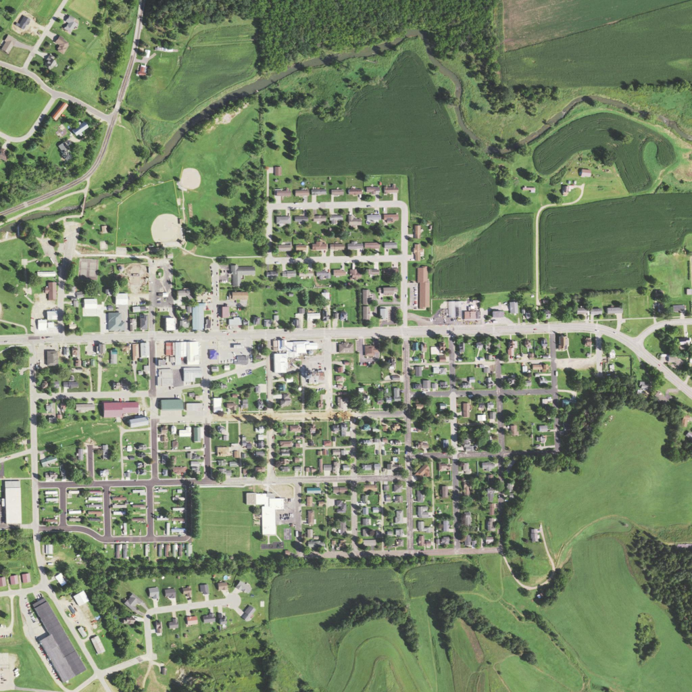
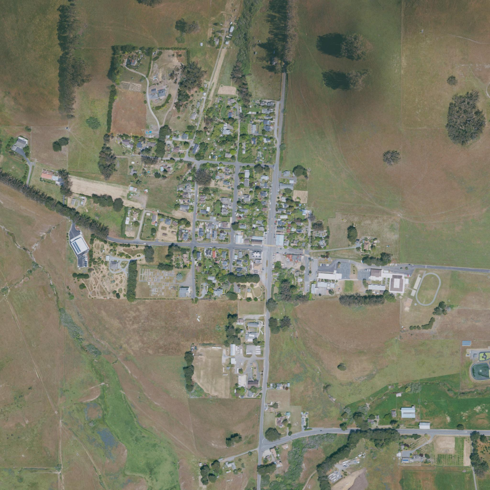

# Community import verification — October 25, 2026

Initial remote base: `ea37af047f4d8d167f88b802e76827c82a6c8183`. Isolated worktree: `community-locations/Terra`. The primary checkout's pre-existing Pipeline configuration edit was preserved. Prepared geography, skill, selector companion and tests are additive; existing atlas/scenery/annual owners' files were not overwritten.

## Observed checks

- Two real USGS/USDA downloads and exports: Coon Valley village center and Tomales. Source photos were opened and visually reviewed for community/field/road/water landmarks and missing coverage. Both are 2022 NAIP aerial orthophotos, native 0.6 m. The source catalogs preserve acquisition dates and raster IDs.
- Five offline Python tests pass: source/hash/projection consistency, corrupted image rejection, incomplete elevation rejection, reversed axis rejection, overwrite rejection and unsupported-region rejection. [Output](python-tests.txt).
- A separate 400 m / 512-pixel Coon Valley crop imported and validated in a temporary directory. It is not a third shipped location. [Receipt](forward-test.json).
- Installed and repository skill copies pass the skill-creator validator. [Output](skill-validation.txt).
- Unity 6000.6.6f1 recompilation completed without errors or warnings. `CommunityChecks.Run()` passed the source-node height, metric extent, UV-corner, triangle-winding, JSON guard, source JPEG decoding and rendering checks for both packs. [Receipt](unity-checks.json). Most of the 86,902 assertions traverse individual mesh vertices/triangles; this is not 86,902 independent gameplay cases.
- Actual Unity overhead renders retain the source plan view. A 5×5 sample grid per image compares source RGB to the rendered texture. Maximum normalized channel differences: Coon Valley **0.05098**, Tomales **0.06667**, below the specified 0.08 rasterization/color tolerance. These are image-registration checks, not a claim of survey-grade positional accuracy or exact RGB identity. [Coon Valley result](coon-valley-community-v1-registration.json), [Tomales result](tomales-community-v1-registration.json).

Chrome interaction/build evidence is pending in this checkpoint; do not interpret the Editor images as browser acceptance.

## Design and limits

Patterns **TN-01, TN-06, CS-04, AX-01**: land-dominant preview, source comparison and short explicit disclosures. The photos are public-domain source data rather than generated scenery. There is no accepted Phase 2A whole-scene benchmark; the existing gate remains open.

This is source imagery draped on 10 m terrain geometry. Buildings, trees, cover classes, permission/ownership and annual simulations are not reconstructed or inferred. The images preserve the observed plan layout; their shadows and rooftops remain baked into a surface, which is the principal oblique-view limitation. Automatic place search and scenario authoring are visibly unfinished. Existing annual run keys and financial rules are untouched.
