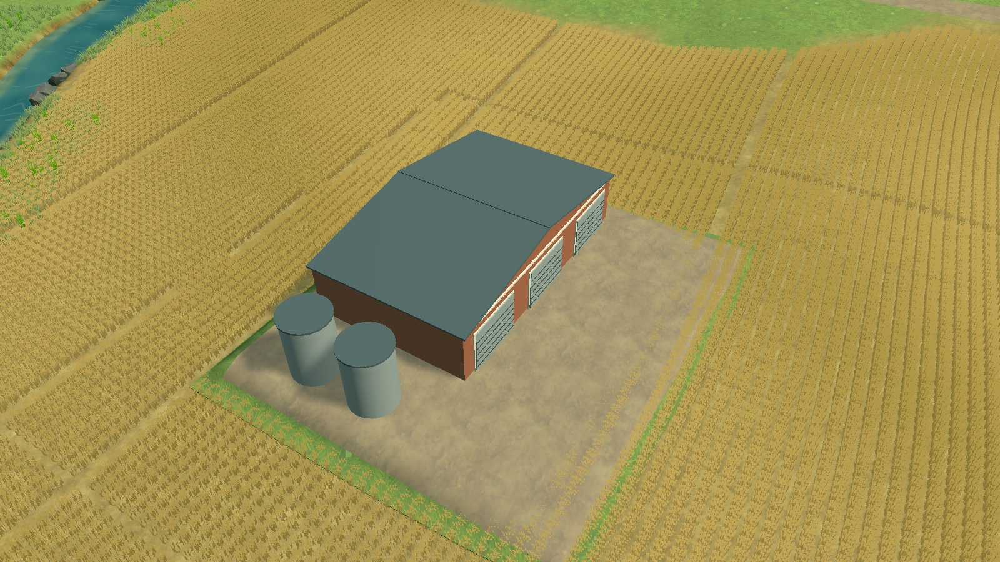
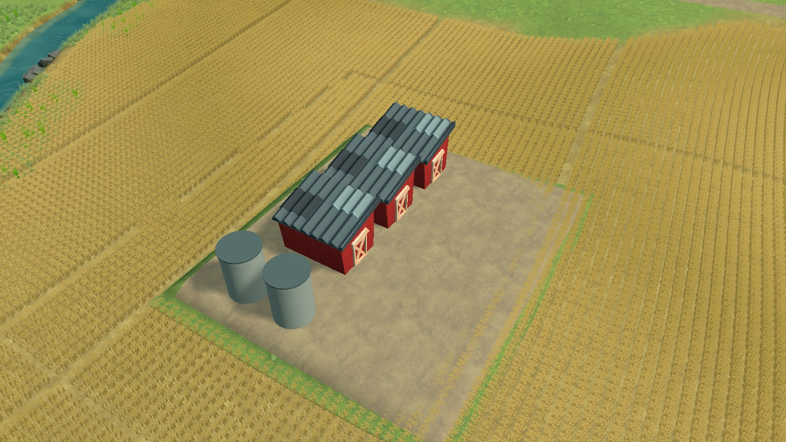

# Artist barn fit comparison — not integrated

October25,2026; source009f429/runtime144e3c5. Patterns TN-02/04/09/12. This tests an existing artist building against the same-map agricultural-storage project. [COZY FARM by styloo](https://styloo.itch.io/farm) is CC0, provides FBX/GLB and recommends unlit/NPR shading with its embedded gradient palette. Its author labels it as made without generative AI. Reused the previously acquired free9.8MB archive (SHA2567f398941a7859dd93b09efae4d103f7b1fdbc56b6e4885be836e7adf466df70b); no purchase or additional download.

The current single30×18m shed and two5m grain bins occupy the48×42m site. Native barnlvl1 has942vertices/383triangles and about3.61×4.60m horizontal dimensions/3.64m height. Removing its authoring offset and baking its rotation/scale, then uniformly scaling2.33499146 to8.5m height, gives8.42×10.74m horizontal dimensions. Three copies were tested at x−14/−4/6m inside the unchanged occupied footprint, retaining the original bins and graded ground. This is an isolated form comparison, not a proposed capacity or financial change.

Main-game frames10→543 advanced, then paused. The temporary instance replaces only rendering; no annual proposal or saved state was submitted. All images share frame543,1600×900,FOV42°,pitch42°,yaw−32°,center(−62,14.8107033,−152.5), distances75m(close)/175m(normal). Labels/HUD are hidden diagnostic views, not Chrome verification. Source palette first uses URP Unlit as recommended; the second trial uses matte URP Simple Lit to assess scene contact/shading.

The roof facets, siding and door framing are more legible than the plain existing shed. However, filling the intended hall with three separate small barns changes its form to accommodate the asset, leaves a larger empty yard, and adds conspicuous repeated roofs. Native unlit colors also look detached from scene lighting; Simple Lit helps contact but not the form mismatch. Do not integrate this arrangement or stretch the asset to fit30×18m. A future replacement must suit the intended facility and preserve the occupied-site contract. The broader scenery/transformation gate remains open.

Replay: import.cs outside Play, enter Play and confirm advancing frames, setup.cs, capture.cs (preserve outputs), trial.cs, capture.cs, lit.cs, capture.cs. Capture outputs are /tmp/terra-barn-study/capture-{75,175,550}.png; create that directory first. Stop Play and remove Assets/Editor/BarnStudy with AssetDatabase. These steps were completed; no production asset, renderer or scene change retained. Full-resolution evidence uses JPEGquality93.

A follow-up checked the apparent crop fringe against actual transformed crop-mesh AABBs. Across261,346 crop instances, **zero** intersect the storage footprint; the nearby crop appearance is outside the lot. No clearance-code change is justified by that observation. This was a separate advancing run(6→1842), then stopped.
