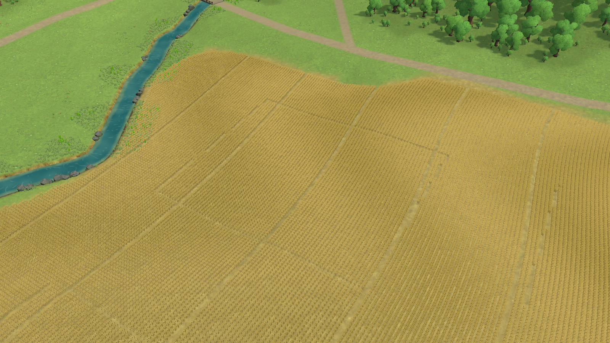
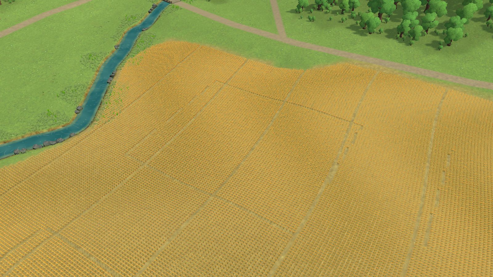
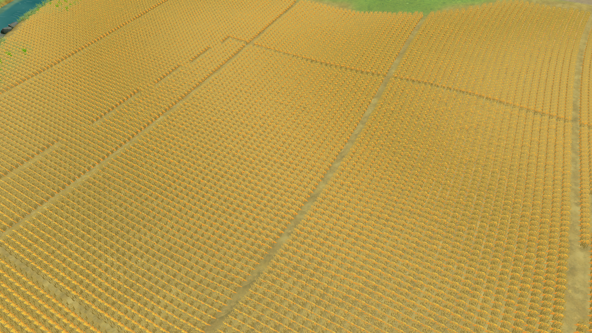
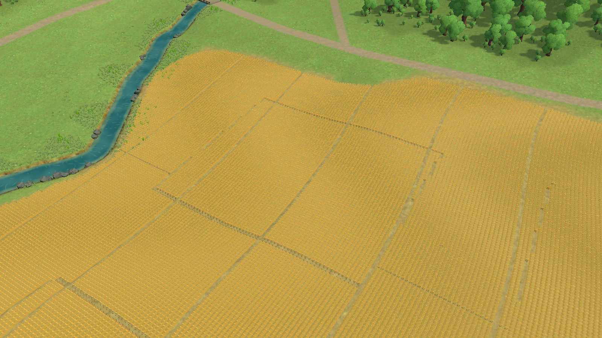
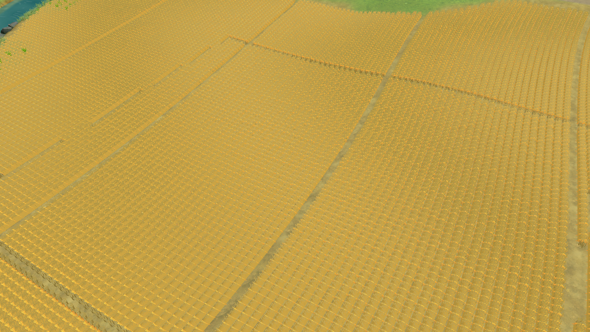

# Solid wheat and connected-row trials — rejected

October 25, 2026. Source `a686a5b`, own full-implementation Editor, Unity 6000.6.6f1. Patterns **TN-02/09/10/12**. These are diagnostic Editor comparisons, not Chrome acceptance or a production change. Existing wheat remains unchanged.

## Question and source

The current field reads as a dark/gold pixel grid at ordinary play distance. Earlier studies already rejected denser artist cards, enlarged low-detail geometric heads and broad crop-color bands. This trial tests a different solid-geometry artist crop with its intended palette, then a connected standing-crop surface beneath it.

[COZY FARM by styloo](https://styloo.itch.io/farm) offers the free `cozyfarmbystyloo.zip` (9.8 MB, updated August 6, 2026) under **CC0**, as stated on its primary page. The paid Blender-source archive was not acquired. No purchase or generated image. Download succeeded after refreshing the expired download session; neither earlier timed-out click produced a file.

Archive SHA-256: `7f398941a7859dd93b09efae4d103f7b1fdbc56b6e4885be836e7adf466df70b`.

Only wheat FBX, its unchanged embedded gradient palette extracted from wheat GLB, and the artist README (line endings/trailing whitespace normalized) are preserved under `source/`. These are evidence/replay inputs outside Assets and the player. The artist recommends unlit/emission or NPR materials, no metallic finish, and double-sided rendering where needed. The test used URP Unlit, supplied palette, white base color and no culling. FBX imports as 335 vertices (GLB has 325), 332 triangles; source wheat height is 1.77473044 m after imported transforms. Root authoring offset was removed, rotation/scale baked, and the mesh normalized to the current cluster's 2.3 m local height. Existing plant transforms, planting positions, row/access-lane coordinates and terrain were preserved.

## Method

The actual game advanced from frame 6 to 743, then to **2614** before intentional pause. All compared captures use that same paused frame, 1600×900, perspective FOV 42°, pitch 42°, yaw −32°, centered on West field (-50, 12.9072495, -152.5). Distances are 75 m (close), 175 m (normal diagnostic), and 550 m (wide). Evidence copies are full-resolution JPEG quality 93; source capture is PNG. Lines/world labels were hidden for this landscape-only diagnostic. Instanced batches were submitted explicitly before each offscreen render. No annual action, saved state, geography, source prefab or material was changed. Runtime-only replacements were discarded when Play stopped.

Run `terra-import-cozycrop.cs` through Unity CLI eval_file before Play. Enter Play and verify frames advance, run `terra-crop-capture.cs` for baseline, then `terra-crop-trial.cs` and capture again. Finally `terra-crop-rows.cs` adds the connected-surface experiment; capture again. Capture output uses `/tmp/terra-crop-{75,175,550}.png`; copy each stage before the next. Stop Play and delete the temporary `Assets/Editor/CozyCropTrial` import using AssetDatabase. The fixture scripts use reflection solely for temporary diagnostics; they are not production code.

## Comparison and decision

The artist wheat has more legible solid forms nearby, but its brighter unlit palette makes individual placement more conspicuous at normal scale. It still reads as a repeated grid, with sparse heads over visible ground. It does not establish the connected, controlled cover masses of the [official Terra Nil bank reference](https://freelives.net/uploads/2024/04/Terra-Nil-Screen-3.webp). That reference has different geography and scale; it is a composition/material guide, not a prescription to invent Wisconsin landforms. Baseline/native close and wide captures are also retained for checking the result beyond one view.

The second trial connects existing consecutive plants along the shared curved planting coordinate with 1.20 m wide, crowned strips. It follows existing Height() values, stays within existing row runs and retains the 1.35 m row interval/access lanes. It uses the existing matte-grain shader and leaves native stalk detail above it. This makes the surface more continuous but introduces visibly ribbed manufactured strips and discontinuities at existing planting groups. It is also costly: **49 generated meshes, 2,580,480 vertices**, in addition to the native trial's **552 batches / 262,955 plants**. These counts are diagnostics, not a browser performance measurement.

**Reject both trials.** Neither solves field mass/readability well enough to justify production integration or a Web build. Do not repeat this as a denser native-wheat scatter or increase strip coverage to hide the grid. A future crop direction must demonstrate a composed field surface at normal scale and credible nearby forms before full-AOI generation. No Phase 2A dimension is newly accepted. All trial assets were removed from Assets, Play stopped, and production source remains `a686a5b`.
