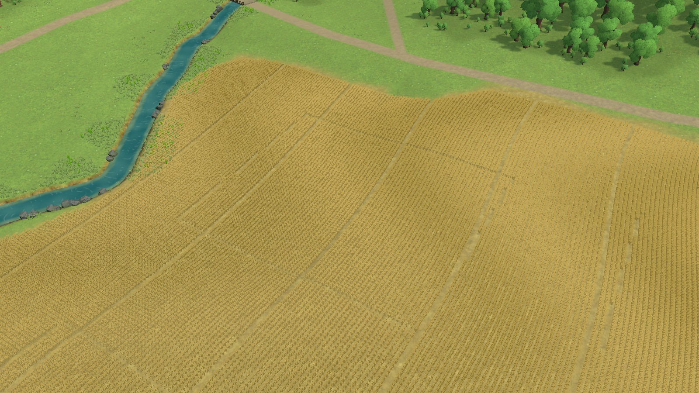
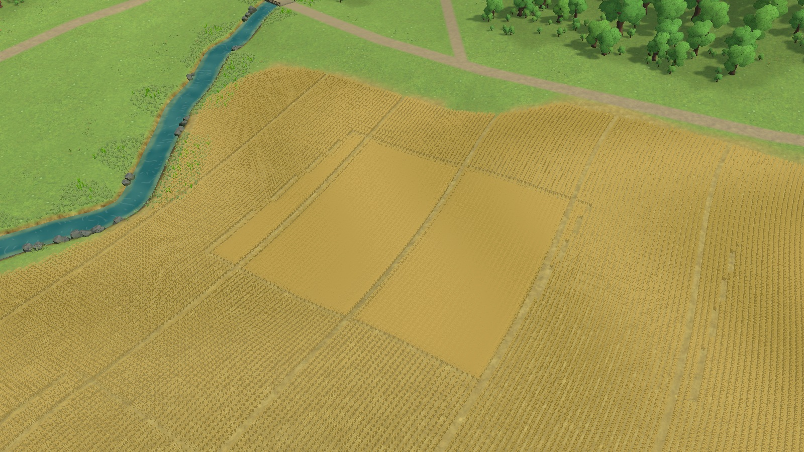
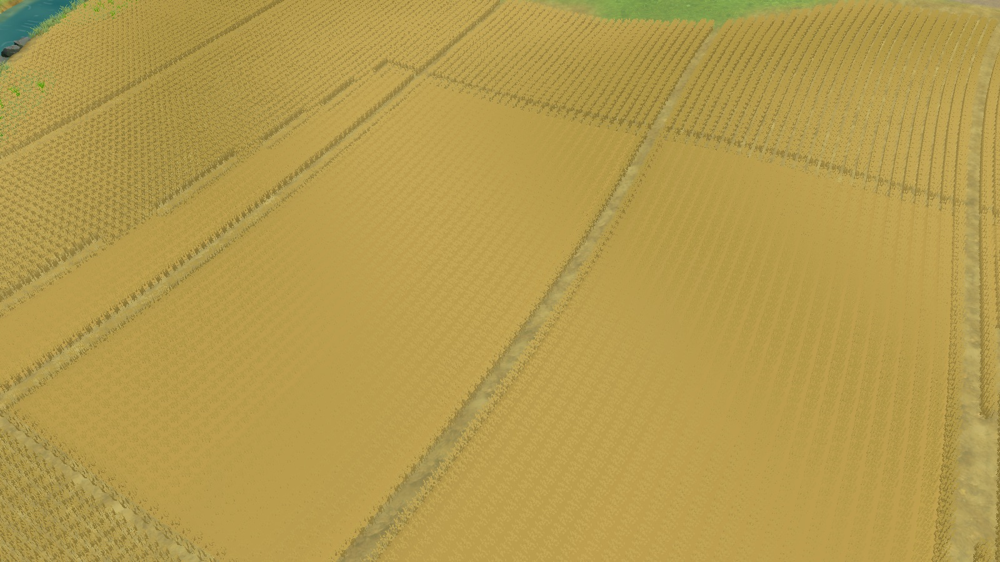

# Continuous crop-canopy study — rejected

October 25, 2026. Source `8cfb3ad` (runtime `144e3c5`). Patterns TN-02/09/10/12. This tests a continuous canopy mass with sparse stalk detail on West field, following the rejected solid-wheat and connected-row studies. No imported assets, generated images, source terrain, annual state or production renderer changes.

The live Editor advanced from frame9 to1864, then was intentionally paused. Baseline and trial use the same frame, camera, 1600×900 output, FOV42°, pitch42°, yaw−32°, center(-50,12.9072495,-152.5) and distances75/175/550m as the earlier crop comparison. These are offscreen diagnostic renders with UI/labels hidden, not browser acceptance or performance evidence.

The temporary mesh connects existing crop locations inside West field, retains the access lanes, follows terrain and tapers its edges. Broad height variation replaces per-row ribs. It has **4,123 vertices / 7,672 triangles**, with **830 of4,123 original stalk clusters** retained at edges and sparse deterministic interior positions. It reuses the current matte-grain shader. Temporary reflection setup initially failed on a public method lookup before creating geometry; the replay now calls the public Contains method directly.

The continuous surface removes much of the internal dotted repetition, but reads as a smooth padded patch with a stalk fringe. It loses believable crop structure and creates conspicuous rectangular transitions to adjacent fields. The close view is especially weak. **Reject**; do not integrate or expand across the AOI. A new noise texture or denser fringe would not resolve the construction problem. This alternative is materially different from individual stalk grids and connected ribs, but still does not meet the reference’s coherent forms and ground transitions.

Run `capture.cs` in the playing main scene and preserve its /tmp outputs, then run `trial.cs` followed by `capture.cs` again. Stop Play to discard all runtime geometry and filtered batch arrays. No source asset/scene import is needed. All six captures retain their full resolution as JPEG quality93. Phase2A remains open.
