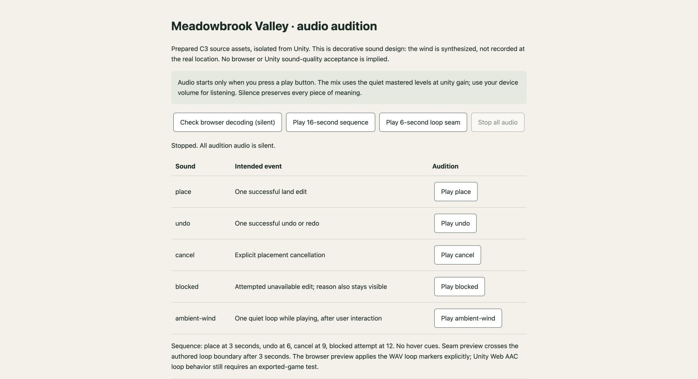

# C3 audio delivery evidence — October 24, 2026

Status: **isolated source kit prepared; integration/listening acceptance pending**. Based on `08092a1f19ceb064ab21c11c6f97dd221693d410` in its own managed worktree. C1/C2 visual kit work is intentionally not started while Phase 2A selects the art family. Nothing in this delivery passes or bypasses that visual gate.

## Delivered and measured

- Five real 22.05 kHz mono PCM16 WAVs: 57.999-second synthesized wind cycle, placement, undo/redo, explicit cancel, blocked attempt.
- Exact source URLs, source and derivative SHA-256 hashes, processing recipes, CC0 declarations and license text in the [manifest](../../../Assets/Terra/Audio/ExternalKit/manifest.json). The existing Kenney family was reused; wind was acquired free from Luke.RUSTLTD's creator submission. No local field-recording or species claim.
- **2,581,526 bytes** of WAV sources; short cues total 21,614 bytes. Approximately 4.92 MiB for one float32 decoded copy at source sample rate, excluding overhead. Actual Unity memory/download size unmeasured; the Chrome AudioContext resampled to 44.1 kHz, so its decoded buffers are approximately twice that simple source-rate estimate.
- [94 offline checks passed](audio-audit.json). They check provenance, derivative/source identity, format, frame counts, level headroom, faded cue endpoints, ambient RMS, 1,024-frame zero guard, `smpl` loop markers, sample-boundary statistics, source budget and unique project-wide GUIDs.
- Ambient seam step: −48.871 dBFS, 0.966 times ordinary adjacent-step RMS; first/last-second RMS differ by 1.357 dB. These numerical checks catch gross boundary defects; they are **not a listening result**.
- Rerunning the builder with pinned sources produced identical WAV and manifest hashes. Builder used Python 3.12, NumPy 2.5.4, soundfile 0.14.0. Verification uses Python standard library only.

Commands from the checkout root:

```sh
python3 tests/audio-kit/verify_kit.py --output docs/evidence/package-c3/audio-audit.json
python3 tests/audio-kit/build_kit.py --wind-source /path/to/pinned/wind1.wav
python3 -m http.server 8766 --bind 127.0.0.1
```

The builder needs NumPy/soundfile and the hash-verified original wind outside the project; it never downloads code or media itself. Its only outputs are the owned audio path and required parent metadata. Kenney originals are not modified.

## Chrome-only audition check

Opened `http://127.0.0.1:8766/docs/evidence/package-c3/audition.html` in actual Chrome 155. The page was initially silent with playback buttons disabled. Clicking the silent decode check successfully decoded **all five WAVs**, mono, with correct durations; the AudioContext sample rate was 44,100 Hz. The six-second seam button entered playback state and returned to stopped state automatically. The sequence button entered playback state; Stop cancelled it and disabled the stop control. No autoplay, game scene or Unity Editor was used. [Observed state record](chrome-check.json).



This is a native Web Audio preview, not a Unity WebGL/AAC test. I cannot hear tool playback and **did not perform a subjective listening review**. Browser control/status success does not establish audible quality, click-free loops, speaker output, or final game mix. The full 16-second sequence was not listened to or completed in this check. Console capture was not performed.

## Selection and design interpretation

TN-07 is the primary pattern: minimal, quiet feedback with visible meaning preserved; TN-08 favors space to appreciate the landscape. Four action cues share Kenney's established interface family. All three intervention families share the same placement cue, avoiding a sound hierarchy that implies one land-use choice is universally correct. No site-hover noise or recurring reward stinger. Wind is generic synthesized ambience and does not introduce unverifiable birds or other wildlife.

Source inspection covered decode/channel/duration/peak/RMS for all ten already-installed Kenney clips and the downloaded wind. The source Kenney peaks ranged approximately −1.35 to +0.43 dBFS decoded; they were too close to full scale to drop into a layered kit unchanged. Drop/back/close/error were selected as a small event family by source identity and brief durations; no auditory-superiority claim is made. Pluck, confirmation, click, select, open and toggle are excluded to avoid an oversized interface palette. The wind source offers a long cycle without requiring a musical theme or geographically specific recording.

A two-second source crossfade plus the official Unity-recommended prefix/loop metadata are prepared. [Unity's Web documentation](https://docs.unity3d.com/6000.6/Documentation/Manual/webgl-audio.html) warns that Web AAC encoding may alter loop starts; final exported Chrome playback must be checked. The isolated audition sets loopStart/loopEnd explicitly and does not prove Unity honors them.

The Unity audio optimization skill was consulted for import considerations. Its workflow requires a live Editor audit and `SaveAndReimport`; the active Editor belongs to the visual owner and is outside this package. No existing import settings were changed, no fabricated import verification is reported, and new `.meta` files only establish stable identities. The handoff records the proposed Web load/preload/normalization setup for integration.

## Pending primary-owner integration

See the [C3 handoff](../../asset-kit.md) for event mapping and proposed importer settings. Check listener balance (especially the brief undo cue), import/readback in Unity, first-user-gesture unlock, no old/new double cues, mute while pending/loading/playing, tab/background pause, bounded repeated blocked attempts, and at least two full ambient cycles in the actual Chrome build. Runtime must have one ambient source only and retain text/visual feedback when silent. These are not yet implemented.

No runtime/HUD/main scene, Packages, ProjectSettings, global mixer, shader, renderer, or visual contract changes are included. No public deployment or accepted reference-quality comparison was made. The Phase 2A scenery owner and Phase 3 editing owner retain their integration boundaries.
