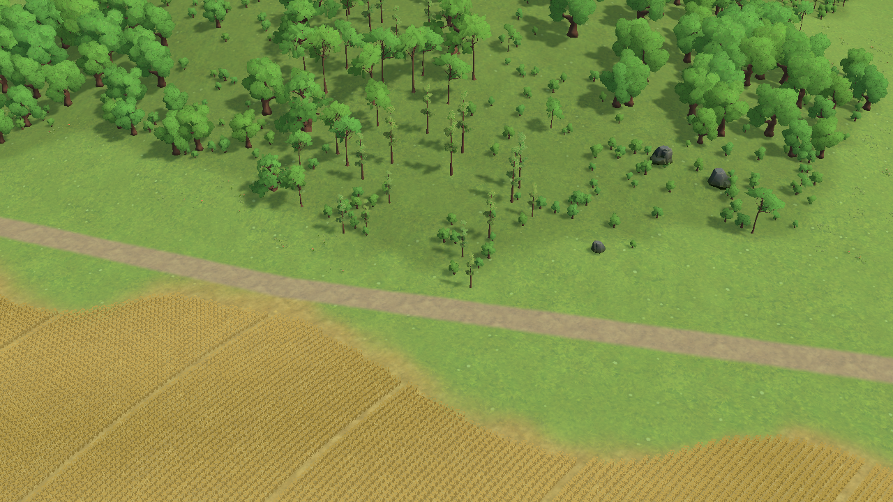
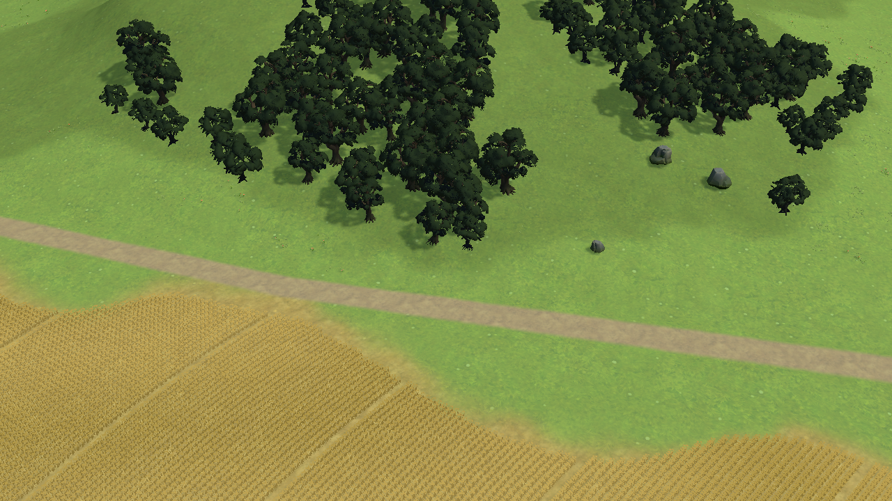
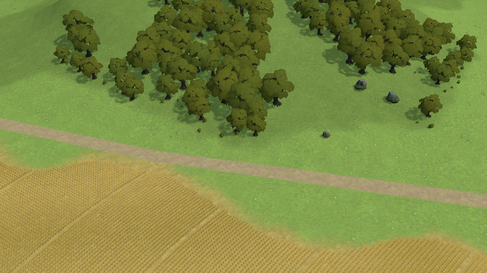
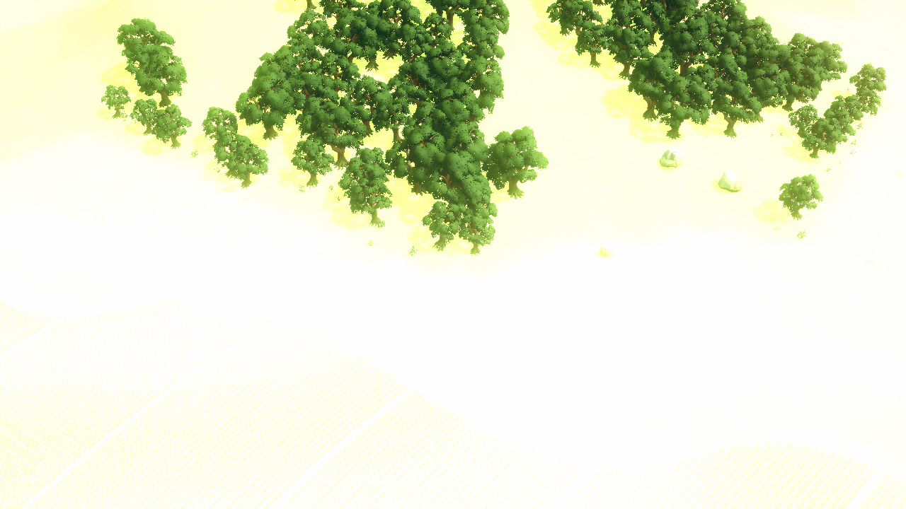

# Study33 — free TriForge foliage evaluation; not selected

October 24, 2026. Patterns **TN-02/09/10/12** from the [persistent reference](../../../DESIGN_REFERENCE.md). Terra Nil remains the whole-scene bar. No dimension is certified at 4.5/5.

The user authorized accepting Unity's Terms and Asset Store EULA for this free asset. The 67-asset URP dependency subset imported successfully after the trust-dialog wait. [Inventory and provenance](study33-asset-inventory.json); [official listing](https://assetstore.unity.com/packages/3d/environments/fantasy/fantasy-worlds-forest-free-stylized-forest-environment-open-worl-282610). Standard Unity Asset Store EULA, not CC0. The original archive and imported library remain local research material, outside this checkpoint; no purchased resource or generated image.

## Actual comparison

All captures are 1280×720 Editor camera renders, without HUD. They are not Chrome output or performance evidence. The baseline and first native comparison use target x/z (170,0), zoom60, pitch34, yaw-32, perspective. The temporary bounded woodland cohort contains 149 mature trees and 105 saplings, preserving source cover, mapped routes and height. Stop Play discards it.

Native crowns provide fuller branching forms, but read too dark and noisy against our ground. This is a failed integration candidate, not proof the pack itself is unsuitable.

Adapting our existing volume-lit foliage shader to the creator's leaf meshes makes fuller masses but flattens them into repetitive olive crowns. Mixing authored normals at 0.5 and 1 did not resolve the dominant failure. The temporary shader edit was reverted exactly; no shader change is adopted.

The creator's HDR ambient, intensity-4 sun and post-processing profile overexpose our custom terrain. A controlled ACES profile and fixed leaf cutoff still leave material-response disagreement. This needs a coherent ground/forest lighting approach, not another small tint adjustment.

The [creator-gallery capture](study33-creator-gallery.png) has an unsuitable camera framing (mostly sky/ground and a clipped tree), so it cannot establish intended asset quality. A properly framed creator-scene comparison remains outstanding. [All capture hashes](study33-captures.json) retain the experiments, including rejected controls.

## Technical findings and limits

- The native distance cutoff uses `lerp(_MaskClip, _MaskClip * .4, distance / 150)` without clamping. It reaches zero at 250m and becomes negative beyond that, filling cards at strategy distances. Disabling the distance keyword and using a fixed cutoff addresses that artifact, but does not solve the scene's lighting or visual quality.
- [Prefab inspection](study33-prefab-inspection.json): mature tree height about 16.1m; LOD0 18,324 triangles, LOD2 4,207. The creator uses five LODs with different material ordering. Existing generic instancing must not submit every LOD simultaneously. Native shaders reported supported on this Editor's Metal renderer with no shader errors; Web compatibility is untested.
- Native foliage, stock URP Lit, fixed-alpha, volume-lit and creator-lighting controls were runtime trials. No native material, scene, renderer or game-source edit is retained from them.
- Fresh annual runtime reached Year1 / Planning / revision0 / cash1000000000 / queued0 / assets0 after staging the missing WorldPack data and reopening TerraMain to load its catalog. Frame count advanced 495→505. No year was committed. This initialization check is not a repeat of the separate full annual or focus-framing suite.
- TerraMain is restored, Play is stopped, and the temporary background override is off. Incidental PC renderer prefilter, Pipeline config and missing DOTween debug metas remain outside this checkpoint.

## Reproduction and next work

[Inspection](study33-scripts/inspect.cs.txt), [bounded native cohort](study33-scripts/woodland-trial.cs.txt), [foliage adaptation](study33-scripts/foliage-adaptation.cs.txt), and [creator-lighting trial](study33-scripts/creator-lighting-trial.cs.txt) are Editor script-eval bodies, not runtime game code. They require the separately acquired imported pack and the initialized TerraMain Play session. Run only in an isolated visual worktree. Intermediate per-material controls were exploratory and are not all encoded in these replay scripts.

Next compare the properly framed creator scene, then choose a substantial coherent material/lighting and forest-floor construction. Curate dependencies and explicit LOD selection only if a candidate merits integration. Require actual Chrome opening, close and overview comparisons before adopting it. Do not treat acquiring a production pack, or improving on a rejected baseline, as meeting the reference bar.
