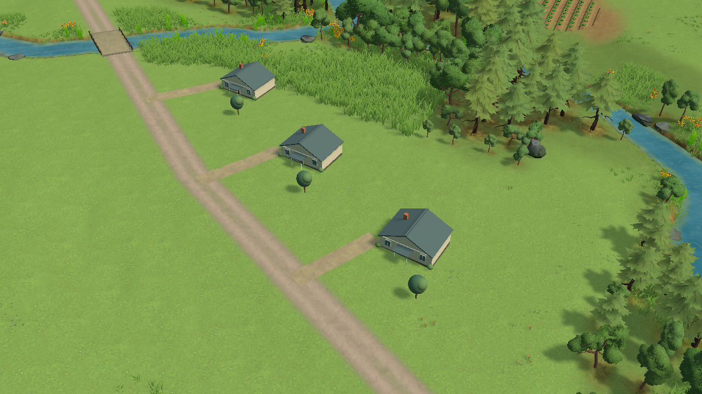

# Study65 — the existing fictional community

October25,2026. Candidate source builds on93327ce, including origin/main913c79f. **Editor-verified implementation checkpoint; no Chrome or visual-gate acceptance.**

## Visual decision

The valley's roads crossed broad empty ground even though the annual scenario already counted four homes. This study depicts those existing homes at metric scale, using the reviewed low-density prefab from Peter's catalog. TN-01/02/09/12 guide composition, grouped detail, surface coherence and scale. The [Free Lives bank/ground reference](https://freelives.net/uploads/2024/04/Terra-Nil-Screen-3.webp) was reopened and inspected in Chrome. Its deliberate surface masses and crisp transitions remain substantially stronger. Four buildings do not close that gap.

The first trial kept each prefab's level26×32m lawn. [Close capture](study65-homes-close.png) shows raised rectangular stamps and different grass texture. **Rejected.** The integrated version keeps the continuous landscape as the yard, levels only each12×9m house foundation, grounds the catalog garden tree separately, and builds4m-wide access strips to the nearest mapped road. Original prefab assets remain unchanged.

[Matched opening control](study65-control-normal.png). Both integrated captures are actual1280×720 Editor camera renders, **without HUD**, not browser screenshots. Normal: perspective yaw−32°,pitch34°,zoom105,target(−90,30,−70); close: yaw−32°,pitch40°,zoom45,target(−302,17,12). Production camera controls/framing are unchanged. The small houses add human scale and context. Repeated roof/tree forms, sparse yard detail, porch/ground finishing and the surrounding empty meadow remain weak; this is not production-quality art acceptance or a new≥4.5 score.

## Geography and annual boundary

Fixed authored Wisconsin centres:(−285,4),(−321,18),(−355,35),(−140,−20), all facing180°. Source terrain rejected two south-road candidates with7.8/9.1m lot relief. A fourth westward lot intersected mapped water and was replaced with the east-bank site. Final1m whole-lot samples contain only source grass/sealed cover; nearest mapped-water edge distances are42.18,47.63,13.02,38.44m. No lot bounding box intersects any current management/protected-site bounding box. Sampling is bounded evidence, not a legal or hydrological suitability survey. [Placement report](study65-layout-result.json).

FullAnnualGameplay already seeds four fictional homes outside project footprints. These visuals add **no annual assets, queued projects, income, capacity, services or public costs**. Source data, eligibility and runoff inputs are untouched. The source-information panel explicitly states these are fictional starting homes, not surveyed buildings. Other locations receive no invented placement layout in this change.

## Verification and limits

- [Compilation](study65-compile.json):0errors/0warnings.
- [35Editor checks](study65-check.json):four homes at unit scale; current-site exclusion; source-cover/water sampling; owned garden meshes; unchanged community instances/transforms through margin preview, restoration apply/remove and displayed no-new-action Year10; unchanged serialized geography and live Year1/Planning/revision0/$10M/queue0/assets0.
- No-new-action simulation is a separate temporary model; the saved run was not advanced. This is **not** an actual browser ten-year/reload/replay test.
- Browser/full-HUD output, disclosure fit, close porch finishing, transformed/replay states, and final source/export provenance remain pending. Latest completed Web64 timing, reported by the integration chat, fails at37/41/34ms p95; its archived receipt remains the authority. No study65 performance pass is claimed.
- Runtime implementation uses the current catalog house's isolated garden region. If that prefab geometry changes, recheck this adapter instead of assuming the region still contains only a tree.

Replay sources:[setup](study65-setup.cs.txt),[camera](study65-view.cs.txt),[capture](study65-capture.cs.txt),[checks](study65-check.cs.txt),[layout](study65-layout.cs.txt),[initial platform trial](study65-instantiate-lot-platform.cs.txt),[terrain-yard trial](study65-instantiate.cs.txt). Experimental meshes were transient Play objects. Runtime source now owns created meshes through LandscapeRenderer.Dispose.

## Free asset follow-up

The user authorized accepting the terms for BigRookGames' [Stylized Hand Painted Nature Pack—Free](https://assetstore.unity.com/packages/3d/vegetation/trees/stylized-hand-painted-nature-pack-free-177775). Browser acceptance completed; a refreshed page confirms ownership onOctober25. No payment. [Asset register](assets.json) records version1.1 and the listing's advertised contents separately from a downloaded inventory. Download/import/native-material evaluation remain pending; no quality claim follows from acquisition.
