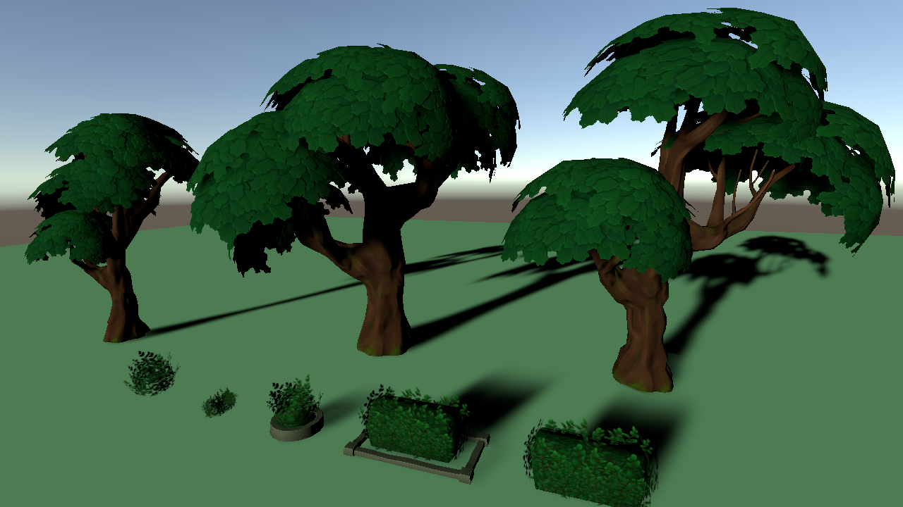
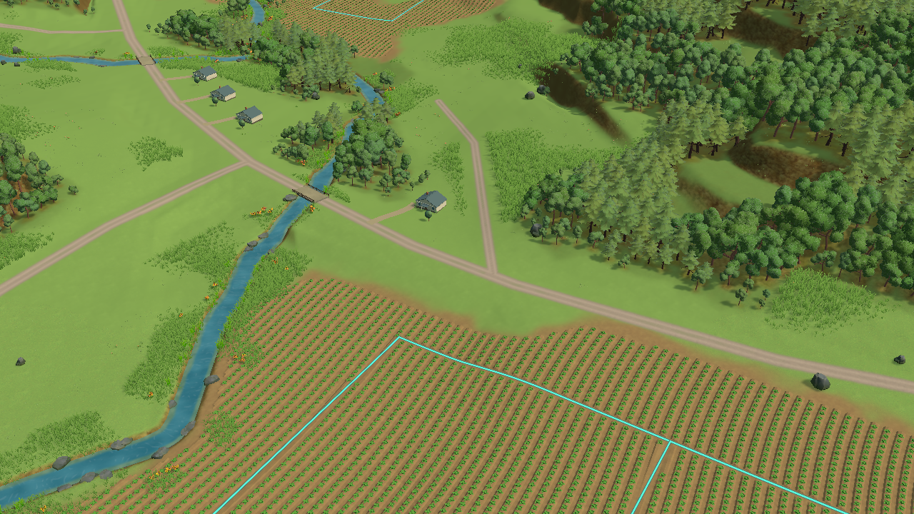
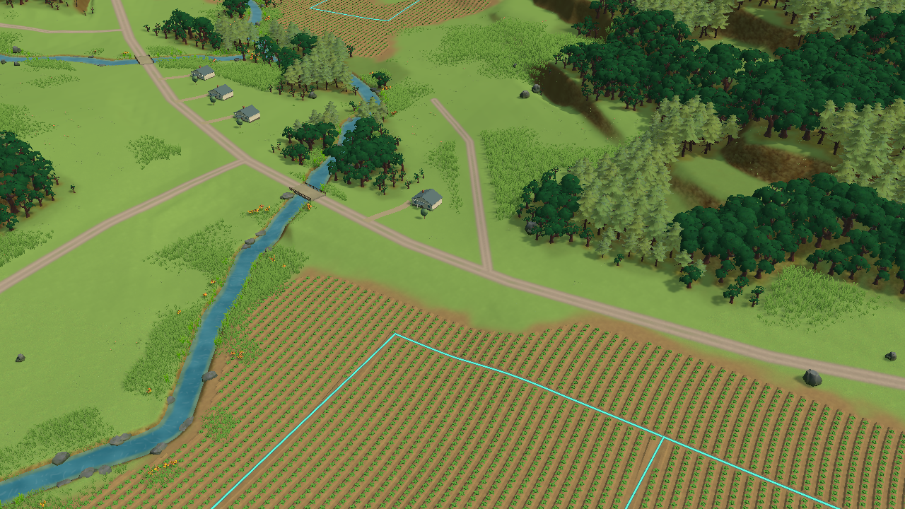
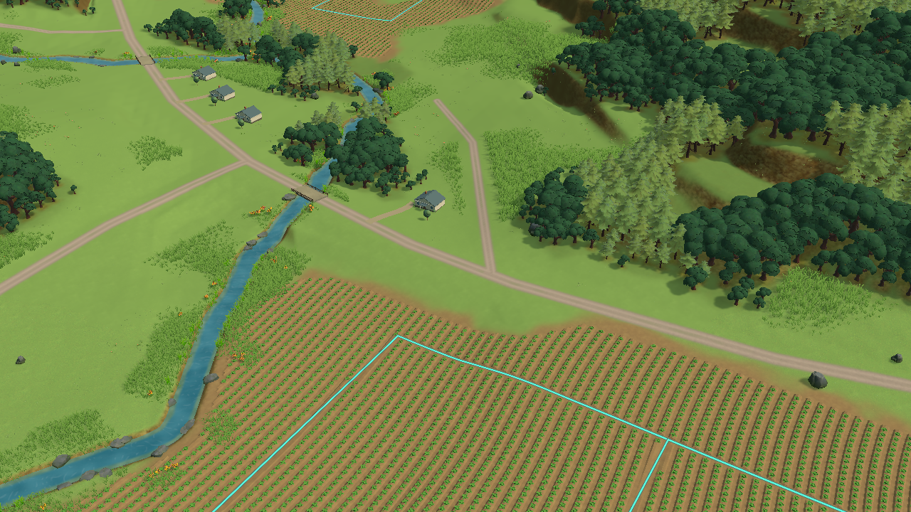
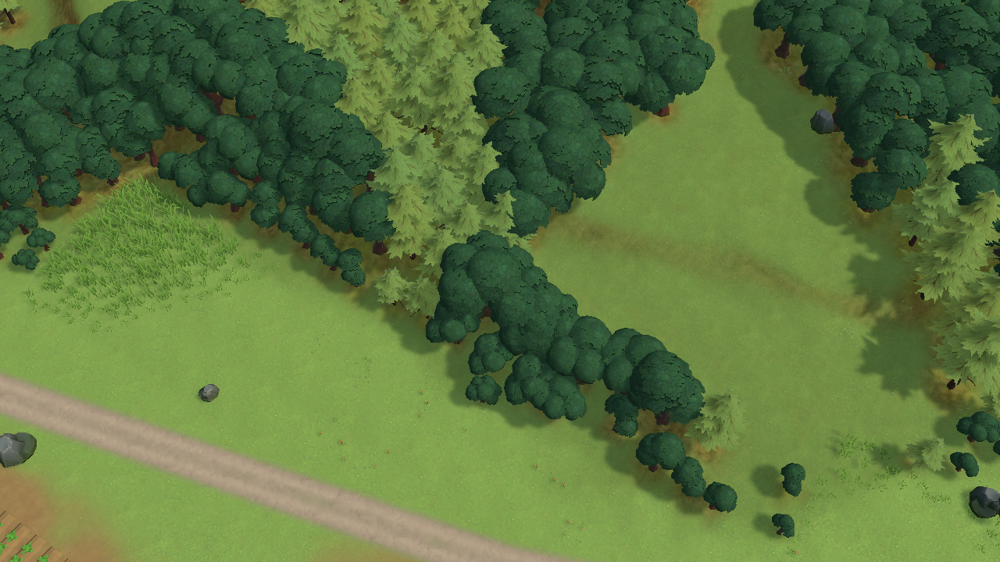

# Study66 — painted nature family rendered comparison

October 25, 2026. Editor-only asset comparison, **not adopted**. Phase 2A remains open. The import interruption recorded below is resolved; the original acquired package imported through Unity's Package Manager service.

## Rendered result and decision

The supplied URP demo and a Wisconsin scene comparison are now inspected. The new trees make broader crown masses, but swapping them into the same dense placement pattern produces repeated rounded layers and a dark, uniform canopy. A bounded leaf-material adaptation closes some cutout holes; it does not establish the reference's shape hierarchy, surface variety or woodland-edge richness. **Do not promote this swap or spend another pass adjusting its tint.**

The next structural study should distinguish mature canopy, young growth and low woodland-edge growth. Keep the actual normal/close cameras; do not hide these limitations by locking the camera. Existing ground, field rhythm and shoreline weaknesses remain separate requirements.

This uses the creator's demo camera/light, supplied URP materials, and Terra's existing URP pipeline. It is not a claim to reproduce the publisher's original Unity version or all project settings. The initial missing floor material was corrected by restoring the supplied `URP_default` GUID; the final capture above has no missing floor. Ten inspected materials resolve to supported URP/Lit.

All scene comparisons are actual 1280×720 Editor camera renders without HUD. Normal: perspective, yaw−32°, pitch34°, zoom105, target(−90,30,−70). Close: same yaw, pitch55°, zoom55, target x110/z20 at the rendered terrain height. Camera and source terrain were not redesigned for the new assets. No browser, motion, timing, full-HUD or lifecycle acceptance is claimed.

### What changed in the trial

- Replaced **5,149** broadleaf instances only in Play memory. The three native prefabs are normalized through a wrapper preserving their FBX orientation. Existing positions/yaw and rendered tree heights remain; native crown breadth changes intentionally. Conifers remain the control family.
- Kept the creator's URP materials for the first scene render. The adapted render changes only borrowed runtime leaf-material copies: neutral white multiplier, alpha cutoff0.5 instead of1, two-sided rendering and a matte surface. No texture repaint or generated image was used.
- Source asset metrics: three native tree prefabs contain4,589 /3,245 /3,095 triangles before instancing. The original models have no supplied LOD chain in the inspected prefabs. Whole-scene browser cost is unmeasured; a plausible appearance would still need reductions and measurement.
- Annual diagnostic before/after replacement stays Year1 /Planning /revision0 /cash1,000,000,000 cents /queue0 /assets0. This is a narrow diagnostic observation, not a full state fingerprint or annual test.
- Trial changes vanished when Play stopped. The Editor then closed gracefully, confirmed PID36458 terminated. No production renderer, scene or resource prefab was changed. Imported source files remain untracked evaluation resources.

[Replacement result](study66-rendered/replace-result.json) · [asset geometry metrics](study66-rendered/asset-metrics.json). Replay scripts are preserved beside these files as `.cs.txt`; local acquisition materials are recoverable from the hashed archive below. Import the original product through Package Manager, apply its nested URP materials with their original GUIDs, then run setup/view, control capture, replacement, native capture, material adaptation and adapted normal/close captures in that order. Run only in an owned Editor with the required shared reservations.

## Purpose and evidence boundary

Evaluate a coherent existing painted tree/bush family against the repeated crowns and weak woodland transitions in study65. Terra Nil patterns TN-01/02/09–12 remain the comparison criteria. First inspect the supplied URP demo/materials; then compare the same Wisconsin play and close views. An asset download is not evidence of visual improvement.

The user approved accepting the Terms/EULA for BigRookGames' [Stylized Hand Painted Nature Pack – Free](https://assetstore.unity.com/packages/3d/vegetation/trees/stylized-hand-painted-nature-pack-free-177775). Account ownership was confirmed in Chrome during study65. Unity's signed-in Asset Store download service retrieved product177775 without payment. No purchase or generated image was used.

## Downloaded contents

- Version1.1 archive:53,124,420 bytes; SHA-256 `233fc839ec098e654ec1672887acb3b426f760afbb186ab9ea5e61acf8250cab`.
- [Actual archive inventory](study66-archive-inventory.json): tree and bush models/prefabs, painted textures, materials, built-in/URP/HDRP demo scenes and two nested conversion packages. This replaces the earlier advertised-only inventory.
- [Nested URP inventory](study66-urp-inventory.json): materials only. It does not contain project settings or replacement scripts. The inspected leaf material references a cutout shader, leaf albedo and normal textures; its supplied color/cutoff should be evaluated before adaptation.
- License recorded in the [asset register](assets.json): Unity Asset Store EULA. Source assets remain external licensed resources; no redistribution claim beyond the applicable terms.

## Earlier import interruption — resolved

A filtered evaluation archive excluded the HDRP scene and embedded conversion archives. `AssetDatabase.ImportPackage` through the study Editor timed out. Read-only process sampling identified `ActiveTrustWindowProxy.ShouldProceedAfterTrustCheck` waiting in a modal window. No `Assets/BigRookGames` folder appeared. The subsequent command also timed out; no successful import or render is claimed.

The study Editor was closed with the CLI after the modal prevented graceful shutdown. All work was saved; no Play scene was active. The downloaded original and inspection files remain recoverable under local `Builds/ArtResearch/Study66`. Other Editors were not operated. The research browser tab was also closed for the coordinated performance window.

Resolution: the original acquired product imported successfully through `IAssetStorePackageInstaller.Install(177775,false)`, queued on the Editor update. Supplied nested URP material contents were then applied through an Editor script. The filtered archive was abandoned. No project settings, trust settings or global security settings were altered.

## Coordination adoption

The shared coordinator was adopted at the next safe boundary. A desktop request was cancelled when another owner held that resource; editor-only reservation7 was acquired to stop the existing Play session and close this Editor, then released after verified completion. Subsequent work was offline evidence only. Performance timing remains owned by the separate rendering/performance chat; these captures are not timing evidence.

## Shared-state refresh

Fetched `origin/main` at `64384a04e956f623a38c07b7bfa611c941fe231b` and merged its test/evidence additions as `c0ebb13`, retaining both sides of the phase-status conflict. These include the annual-completion checks and failed Web64 timing. No candidate crop runtime was promoted. Study65 remains the latest Editor art candidate; study64 remains the latest browser-tested art on this branch.
