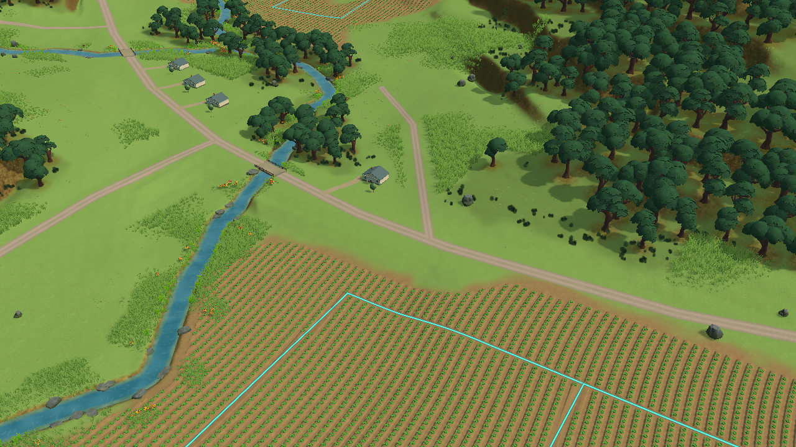
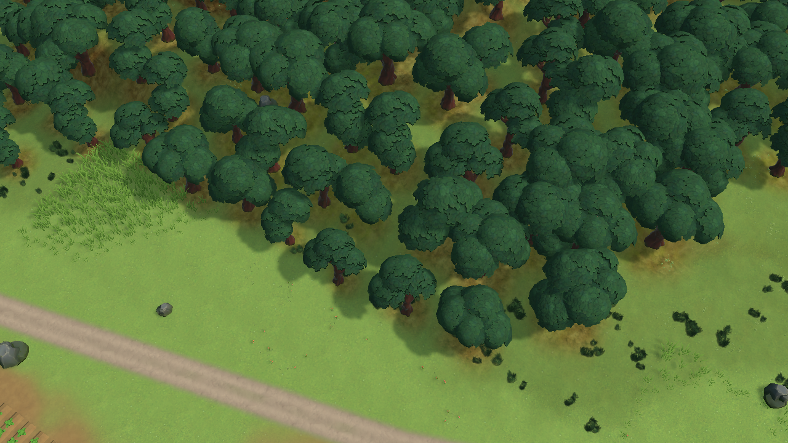
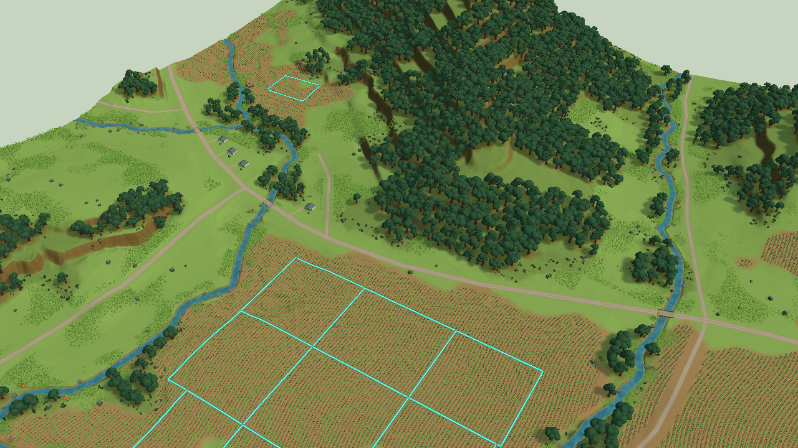

# Study67 — woodland age/edge structure, rejected

October25, source`d05f641`; latest remote inspected before the study`970e8af`. This follows [study66](../study66-findings.md). **Actual Editor renders remain below the visual gate; no production adoption.**

## Hypothesis and actual construction

The model-for-model swap preserved a repetitive dense planting pattern. This Play-only study changes that structure: larger mature crown groups separated by broad glades, actual low bush geometry along irregular source woodland edges, and a canopy footprint rebuilt from the new tree positions. It uses the downloaded BigRook family coherently, replacing the conifers for this comparison. No new location, source cover, annual state or production renderer is edited.

The executed [composition script](compose.cs.txt) produces **1,750 canopy instances and2,824 shrubs in135 spatial groups**. Source woodland and mapped route/water clearance queries constrain roots; crown extents are illustrative and not comprehensively proved contained. Original prefab orientation is normalized, tree sizes vary with woodland enclosure, and low growth uses bush01/02 rather than miniature copies of mature trees. The bounded study66 material adaptation is retained. The source JSON equality and annual diagnostic guards pass; this is not a full annual/lifecycle test. [Observed receipt](receipt.json).

## Actual comparison and decision

The normal view has a clearer difference between mature trees and low growth, but the crowns still look like repeated layered domes. The bushes become disconnected dark dots rather than a convincing continuous woodland edge. Close range exposes the same leaf-sheet pattern and gaps around the thick trunks. The wide view remains dominated by uninterrupted bright grass, regular crop rows and weak transitions. These are substantial visual failures, not polish details.

**Reject the direction.** Do not continue adjusting density, tint or the three BigRook mature-tree variants. Keep this as evidence against a model substitution approach. The next major study needs a different whole-scene construction, particularly ground/vegetation contact and the field–meadow–woodland transition; source selection must demonstrate that complete relationship in its intended workflow. Another isolated foliage catalogue is insufficient.

Reference patterns: TN-01/02/09–12 in [the design library](../../../../DESIGN_REFERENCE.md); [Terra Nil's official restored-bank scene](https://freelives.net/uploads/2024/04/Terra-Nil-Screen-3.webp) remains the visual target. Comparison concerns grouping and surface/contact quality, not an assertion that Wisconsin should use tropical species or stepped fantasy terrain.

All images are1280×720 Editor camera renders without HUD. Normal uses the same study66 camera: perspective/yaw−32/pitch34/zoom105/target(−90,30,−70). Close uses yaw−32/pitch55/zoom55 at x110/z20 and sampled ground height. Wide uses yaw−32/pitch42/zoom300/target(0,35,0). [Unchanged normal control](../study66-rendered/control-normal.png). No Chrome, motion, performance, transformed annual states or final acceptance claim.

## Reproduction and cleanup

Import the original approved BigRook product and supplied URP materials as described in study66. Enter Play in the owned TerraMain scene, verify frames advance, then run setup/view, compose and capture. Run close/capture for the close view; use the wide parameters above in local`view.txt` for view/capture. Scripts are preserved here as `.cs.txt` and locally under`Builds/ArtResearch/Study67`. The initial source must have study65's scene candidate; later source changes require new controls.

Normal/close/wide captures were made at frames4739/8267/8575. The annual diagnostic remains Year1/Planning/revision0/cash1,000,000,000 cents/queue0/assets0. Play then stopped and EditorPID40731 closed gracefully; both the Editor and its persistent CLI launcher were verified absent. Shared reservation11 was released. No candidate remained in the production renderer or scene.

A first `unity open --until-ready` reported ready but its process exited before Play; this was verified, not inferred from timeout. The persistent `--wait` CLI launcher succeeded. The coordinator's `unity` wrapper currently appends `--project-path` after any nested `--`, causing `job wait` argument rejection. Editor script calls therefore used the same held reservation's `run` wrapper with the explicit own-project target **before** the nested separator. No resource lock or project boundary was bypassed. Tooling-owner files were not edited.
