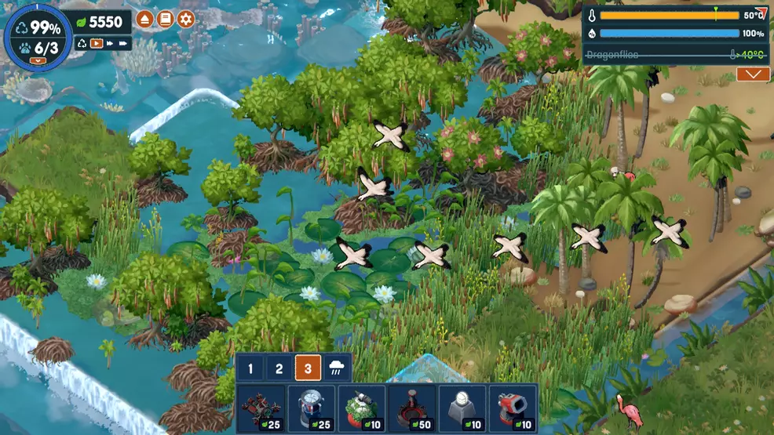
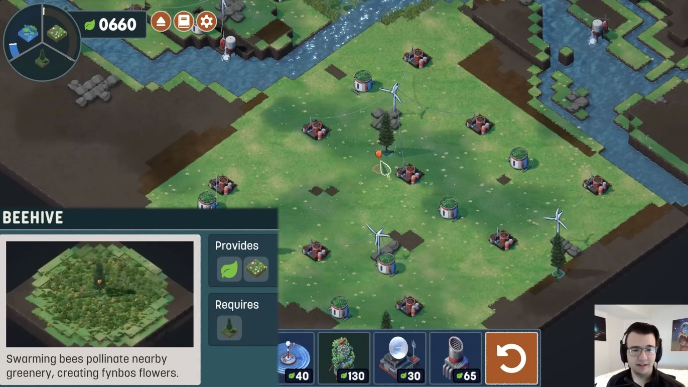

# Field study: visible result to judge

These are inspected reference and historical game frames, not a montage or a newly rendered candidate. Study76 still needs its own actual captures. The comparison follows TN-01/02/09–12 and does not alter the Phase2A acceptance gate.

## Reference: connected vegetation and layered edges

Terra Nil, user-supplied screenshot; exact version and timestamp unknown. Original provenance and limitations: [reference study](../../../ux-reference-2026-10-25/README.md). Documentation reference only, never a production asset.

Visible in this frame: dense low vegetation reads as a connected body. Taller stems, flowers and broad leaves interrupt it selectively. Tree crowns, exposed roots, water and sand remain distinct at the same time. Edges have a profile rather than ending as a clipped flat green plane. Tropical species and roots are not prescriptions for Wisconsin. This is a hierarchy and continuity reference.

## Reference: low ground can be deliberately quiet

[Aliensrock video at 04:00](https://www.youtube.com/watch?v=O4kOC6Ih0CA&t=240s), preserved by the linked project reference study. Edited video with facecam/enlarged explanation; not a native UI scale measurement or continuous playtest.

The open green ground uses broad value changes and sparse pale accents while individual objects remain readable. A rich scene does not require every patch of ground to carry tall blades. Therefore the new field technique must remain confined to a useful cover class; spreading dense grass over every surface would miss the reference.

## Historical game comparison: repeating rows dominate

Historical Chrome capture, 1280×720, before the current merged HUD/parcel changes. It is not recertified as the latest build. The visible field is dominated by repeated exposed-soil stripes and evenly spaced small green forms. Elsewhere, grass appears in separate patches against broad empty green ground. Study75's subsequent detailed-wheat/distant-surface approach also failed, as recorded in its [pinned evidence](https://github.com/namanpro47/Terra/tree/22e3741/docs/evidence/phase2a/visual-rebuild/study75-distance).

## Decision after rendering study76

- At normal and wide scale, does the field read as a living cultivated mass without noisy individual strokes or the previous flat surface transition?
- At close scale, do roots contact the actual terrain, blades have a coherent profile, and lanes/field boundaries look intentional?
- During camera and wind movement, does that appearance hold without sparkling, popping, floating ends or conspicuous repeated patterns?
- Does the field belong beside the existing meadow, woodland, water and buildings? A vivid green patch with a weaker surrounding scene is not an accepted direction.

Compare original source gradient and the documented adapted palette with identical geometry, camera and fixed wind time. If both retain the same dominant visual failure, stop tuning color or density. Record the failure and change the construction. Do not promote the study based on its much smaller triangle count, successful compilation, or being better than the old rows alone.
